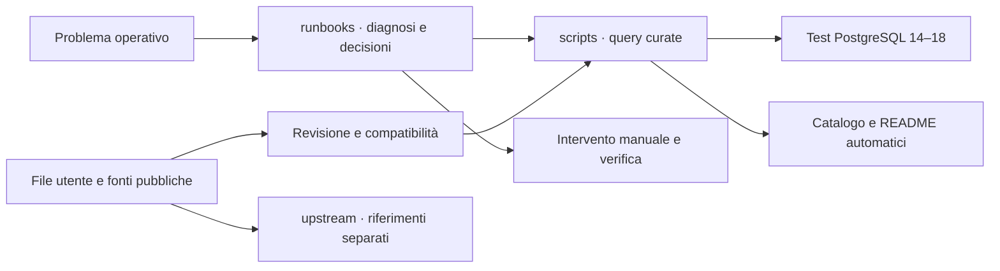

# PG-DN_scripts

<p align="center"></p>

[](https://github.com/Mohamed-DN/PG-DN_scripts/actions/workflows/validate.yml)
[](docs/QUICKSTART.md)
[](LICENSE)

Una biblioteca operativa PostgreSQL per trovare rapidamente la diagnosi giusta, capire i risultati e scegliere un intervento controllato. Nasce dalla revisione dei tuoi dieci file e dalla ricerca di raccolte DBA pubbliche, con provenienza e licenze visibili.

<!-- BEGIN GENERATED COUNTS -->
**68 script curati** · PostgreSQL 14–18 · [Catalogo ricercabile](docs/CATALOG.md) · [Fonti esterne](upstream/README.md)
<!-- END GENERATED COUNTS -->

## Parti dal problema

| Situazione | Procedura | Script |
| :-- | :-- | :-- |
| Database lento o indisponibile | [Triage](runbooks/triage.md) | [Attività](scripts/monitoring/README.md) |
| Sessioni bloccate | [Lock](runbooks/locks.md) | [Connessioni](scripts/administration/README.md) |
| Disco occupato dai WAL | [Crescita WAL](runbooks/wal-growth.md) | [WAL](scripts/wal/README.md) |
| Replica in ritardo | [Replica](runbooks/replication-lag.md) | [Replica fisica, logica e slot](scripts/replication/README.md) |
| Dead tuples, bloat, freeze | [Vacuum e bloat](runbooks/vacuum-bloat.md) | [Manutenzione](scripts/maintenance/README.md) |
| Query o indici da analizzare | [Query lente](runbooks/slow-queries.md) | [Prestazioni](scripts/performance/README.md) |
| Backup e ripristino | [Backup e recovery](runbooks/backup-restore.md) | [Ispezione](scripts/backup/README.md) |
| Privilegi e accessi | [Sicurezza](runbooks/security.md) | [Ruoli e privilegi](scripts/security/README.md) |
| Monitoraggio continuativo | [Metriche e azioni](runbooks/monitoring.md) | [Monitoraggio](scripts/monitoring/README.md) |

## Primo utilizzo

Servono Python 3.10+ per gli strumenti e il client `psql` per le query. Configura una connessione libpq (`PGSERVICE`, oppure `PGHOST`, `PGDATABASE`, `PGUSER`) e un file password protetto. [Guida con esempi Linux e PowerShell](docs/QUICKSTART.md).

```console
python tools/pgdn.py list --search wal
python tools/pgdn.py run scripts/administration/inventory/server-info.sql
```

Puoi anche eseguire direttamente un file con `psql -X -v ON_ERROR_STOP=1 -f percorso.sql`. Le query curate iniziano una transazione read-only e hanno timeout locali. Leggi sempre versione e privilegi nell’header; `read-only` non significa costo zero. [Regole operative](docs/SAFETY.md).

Per i comandi quotidiani: [cheat sheet psql e CLI](docs/reference/psql-cheatsheet.md) · [ruoli, schemi e manutenzione](docs/reference/administration-actions.md).

## Come è organizzato



| Cartella | Contenuto |
| :-- | :-- |
| [`scripts/`](scripts/README.md) | Query per categoria e funzione; un compito per file, header uniforme |
| [`runbooks/`](runbooks/README.md) | Procedure: controlli, interpretazione, interventi, verifica e recupero |
| [`upstream/`](upstream/README.md) | Codice esterno con licenze originali e manifest; richiede revisione prima dell’uso |
| [`docs/`](docs/README.md) | Architettura, avvio, fonti e rapporto delle correzioni |
| [`tools/`](tools/README.md) | Ricerca, esecuzione e generazione degli indici |
| [`tests/`](tests/README.md) | Controlli statici e prove su database isolati |

## Il README si aggiorna da solo

Aggiungi uno script nella categoria desiderata, oppure crea una sottocartella. Il workflow **Refresh navigation** rigenera albero, catalogo e README delle cartelle `scripts/` dopo un push al ramo principale; è disponibile anche l’avvio manuale. Su branch e pull request il workflow di validazione controlla che gli indici siano aggiornati.

Per vedere subito la modifica prima del push:

```console
python tools/catalog.py
python tools/catalog.py --check
```

GitHub visualizza un file statico: l’automatismo è il commit generato da Actions. Non occorrono servizi esterni. [Come contribuire e aggiungere un header](docs/CONTRIBUTING.md).

<details>
<summary><strong>Esplora l’albero completo del repository</strong></summary>

<!-- BEGIN GENERATED TREE -->
```text
PG-DN_scripts/
├── .github/
│   ├── workflows/
│   │   ├── navigation.yml
│   │   ├── README.md
│   │   └── validate.yml
│   └── README.md
├── docs/
│   ├── adr/
│   │   ├── 0001-repository-layout.md
│   │   └── README.md
│   ├── assets/
│   │   ├── banner.svg
│   │   └── README.md
│   ├── evidence/
│   │   ├── curated-sha256.json
│   │   ├── physical-replication.json
│   │   ├── postgres-matrix.json
│   │   └── README.md
│   ├── reference/
│   │   ├── administration-actions.md
│   │   ├── psql-cheatsheet.md
│   │   └── README.md
│   ├── architecture.md
│   ├── CATALOG.md
│   ├── CONTRIBUTING.md
│   ├── QUICKSTART.md
│   ├── README.md
│   ├── REPLICATION_LAB.md
│   ├── SAFETY.md
│   ├── SOURCE_REVIEW.md
│   ├── SOURCES.md
│   ├── UPSTREAM_AUDIT.md
│   ├── USER_NOTES.md
│   └── VALIDATION.md
├── runbooks/
│   ├── backup-restore.md
│   ├── barman.md
│   ├── incident-template.md
│   ├── locks.md
│   ├── monitoring.md
│   ├── pgbackrest.md
│   ├── pitr.md
│   ├── README.md
│   ├── replication-lag.md
│   ├── security.md
│   ├── slow-queries.md
│   ├── triage.md
│   ├── vacuum-bloat.md
│   └── wal-growth.md
├── scripts/
│   ├── administration/
│   │   ├── configuration/
│   │   │   ├── connection-capacity.sql
│   │   │   ├── non-default-settings.sql
│   │   │   ├── README.md
│   │   │   ├── vacuum-settings.sql
│   │   │   └── wal-settings.sql
│   │   ├── connections/
│   │   │   ├── active.sql
│   │   │   ├── by-state.sql
│   │   │   ├── idle-in-transaction.sql
│   │   │   └── README.md
│   │   ├── inventory/
│   │   │   ├── databases.sql
│   │   │   ├── extensions.sql
│   │   │   ├── largest-relations.sql
│   │   │   ├── materialized-views.sql
│   │   │   ├── partition-tree.sql
│   │   │   ├── README.md
│   │   │   ├── routines.sql
│   │   │   ├── schemas.sql
│   │   │   ├── sequences.sql
│   │   │   └── server-info.sql
│   │   └── README.md
│   ├── backup/
│   │   ├── inspection/
│   │   │   ├── active-backup-senders.sql
│   │   │   ├── README.md
│   │   │   └── recovery-state.sql
│   │   └── README.md
│   ├── maintenance/
│   │   ├── bloat/
│   │   │   ├── README.md
│   │   │   ├── relation-size-breakdown.sql
│   │   │   └── toast-breakdown.sql
│   │   ├── progress/
│   │   │   ├── analyze.sql
│   │   │   ├── create-index.sql
│   │   │   ├── README.md
│   │   │   └── vacuum.sql
│   │   ├── vacuum/
│   │   │   ├── dead-tuples.sql
│   │   │   ├── oldest-transactions.sql
│   │   │   ├── README.md
│   │   │   └── wraparound-risk.sql
│   │   └── README.md
│   ├── monitoring/
│   │   ├── activity/
│   │   │   ├── advisory-locks.sql
│   │   │   ├── blocking-sessions.sql
│   │   │   ├── long-running.sql
│   │   │   ├── prepared-transactions.sql
│   │   │   ├── README.md
│   │   │   ├── ssl-connections.sql
│   │   │   └── wait-summary.sql
│   │   ├── capacity/
│   │   │   ├── database-sizes.sql
│   │   │   ├── README.md
│   │   │   └── tablespace-inventory.sql
│   │   ├── statistics/
│   │   │   ├── checkpointer.sql
│   │   │   ├── database-counters.sql
│   │   │   ├── README.md
│   │   │   ├── reset-times.sql
│   │   │   └── table-activity.sql
│   │   └── README.md
│   ├── performance/
│   │   ├── indexes/
│   │   │   ├── definitions.sql
│   │   │   ├── duplicate-candidates.sql
│   │   │   ├── invalid-indexes.sql
│   │   │   ├── README.md
│   │   │   ├── unused-candidates.sql
│   │   │   └── usage-by-table.sql
│   │   ├── io/
│   │   │   ├── buffercache-summary.sql
│   │   │   ├── database-io-timing.sql
│   │   │   ├── pg-stat-io.sql
│   │   │   └── README.md
│   │   ├── queries/
│   │   │   ├── README.md
│   │   │   ├── top-mean-time.sql
│   │   │   ├── top-temp-blocks.sql
│   │   │   └── top-total-time.sql
│   │   └── README.md
│   ├── replication/
│   │   ├── logical/
│   │   │   ├── README.md
│   │   │   ├── subscriptions.sql
│   │   │   └── workers.sql
│   │   ├── physical/
│   │   │   ├── primary-senders.sql
│   │   │   ├── README.md
│   │   │   ├── standby-receiver.sql
│   │   │   └── standby-replay.sql
│   │   ├── slots/
│   │   │   ├── logical-stats.sql
│   │   │   ├── README.md
│   │   │   └── retention.sql
│   │   └── README.md
│   ├── security/
│   │   ├── privileges/
│   │   │   ├── database-acl.sql
│   │   │   ├── hba-rule-health.sql
│   │   │   ├── README.md
│   │   │   ├── relation-acl.sql
│   │   │   ├── rls-policies.sql
│   │   │   └── schema-acl.sql
│   │   ├── roles/
│   │   │   ├── expiring-logins.sql
│   │   │   ├── membership.sql
│   │   │   ├── README.md
│   │   │   └── role-inventory.sql
│   │   └── README.md
│   ├── wal/
│   │   ├── archive/
│   │   │   ├── archive-status.sql
│   │   │   ├── README.md
│   │   │   └── ready-files.sql
│   │   ├── retention/
│   │   │   ├── README.md
│   │   │   ├── retention-context.sql
│   │   │   └── wal-counters.sql
│   │   └── README.md
│   └── README.md
├── tests/
│   ├── integration.py
│   ├── README.md
│   ├── replication.py
│   ├── test_lab_safety.py
│   ├── test_navigation.py
│   └── test_upstream.py
├── tools/
│   ├── catalog.py
│   ├── pgdn.py
│   ├── README.md
│   └── validate.py
├── upstream/
│   ├── andyatkinson_pg_scripts/
│   │   ├── README.md
│   │   └── source_index.json
│   ├── Azmodey_pg_dba_scripts/
│   │   ├── README.md
│   │   └── source_index.json
│   ├── dataegret_pg_utils/
│   │   ├── bin/
│   │   │   ├── check_replication_lag.pl
│   │   │   ├── generate_pgbouncer_userlist.sh
│   │   │   ├── log_check.sh
│   │   │   ├── makecron.sh
│   │   │   ├── offlag.sh
│   │   │   ├── pg_log_search.pl
│   │   │   ├── postgresql-audit.sh
│   │   │   ├── README.md
│   │   │   ├── server-audit.sh
│   │   │   ├── server-checklist.sh
│   │   │   ├── slony_extract_schema_to_file.sh
│   │   │   └── stuff-update.sh
│   │   ├── loganalyze/
│   │   │   └── log_analyze.pl
│   │   ├── slonik_template/
│   │   │   ├── cluster_config.slonik.template
│   │   │   ├── create_set.slonik
│   │   │   ├── create_slave_node.slonik
│   │   │   ├── drop_set.slonik
│   │   │   ├── drop_slave_node.slonik
│   │   │   ├── execute_script.slonik
│   │   │   ├── init_cluster.slonik
│   │   │   ├── populate_set.slonik.template
│   │   │   ├── populate_set.slonik_footer
│   │   │   ├── populate_set.slonik_header
│   │   │   ├── set_drop_items.slonik
│   │   │   ├── setup_cluster.slonik
│   │   │   ├── slon.conf.template
│   │   │   ├── store_path.slonik
│   │   │   ├── subscribe_set.slonik
│   │   │   └── switchover.slonik
│   │   ├── sql/
│   │   │   ├── global_reports/
│   │   │   │   ├── query_stat_cpu_time.sql
│   │   │   │   ├── query_stat_io_time.sql
│   │   │   │   ├── query_stat_total.sql
│   │   │   │   ├── query_stat_total_10.sql
│   │   │   │   ├── query_stat_total_11.sql
│   │   │   │   ├── query_stat_total_13.sql
│   │   │   │   ├── query_stat_total_14.sql
│   │   │   │   ├── query_stat_total_15.sql
│   │   │   │   ├── query_stat_total_16.sql
│   │   │   │   ├── query_stat_total_17.sql
│   │   │   │   └── query_stat_total_18.sql
│   │   │   ├── old/
│   │   │   │   ├── create_db_activity_view_old.sql
│   │   │   │   └── table_disk_activity.sql
│   │   │   ├── slony/
│   │   │   │   └── temp.txt
│   │   │   ├── 83compat.sql
│   │   │   ├── amcheck_indexes.sql
│   │   │   ├── cache_stat.sql
│   │   │   ├── check_all_tables_have_pk.sql
│   │   │   ├── check_are_all_subscribed.sql
│   │   │   ├── check_config.sql
│   │   │   ├── check_missing_grants.sql
│   │   │   ├── check_strange_fk.sql
│   │   │   ├── check_uniq_indexes.sql
│   │   │   ├── create_db_activity_view.sql
│   │   │   ├── create_db_activity_view9.2.sql
│   │   │   ├── create_query_stat_cpu_time_view.sql
│   │   │   ├── create_query_stat_io_time_view.sql
│   │   │   ├── create_query_stat_log.sql
│   │   │   ├── create_query_stat_time_view.sql
│   │   │   ├── create_repl_activity_view9.5.sql
│   │   │   ├── create_slonik_set_full.sql
│   │   │   ├── create_slonik_set_incremental.sql
│   │   │   ├── create_xlog_math_procedures.sql
│   │   │   ├── db_activity.sql
│   │   │   ├── db_activity9.2.sql
│   │   │   ├── db_activity9.6.sql
│   │   │   ├── dirty_to_read_stat.sql
│   │   │   ├── generate_drop_items.sql
│   │   │   ├── index_bloat.sql
│   │   │   ├── index_candidates_from_ssd.sql
│   │   │   ├── index_candidates_to_deduplicate.sql
│   │   │   ├── index_candidates_to_partial.sql
│   │   │   ├── index_candidates_to_ssd.sql
│   │   │   ├── index_disk_activity.sql
│   │   │   ├── indexes_with_nulls.sql
│   │   │   ├── indexing_progress.sql
│   │   │   ├── locktree.sql
│   │   │   ├── low_used_indexes.sql
│   │   │   ├── low_used_indexes_with_replica.sql
│   │   │   ├── master_wal_position.sql
│   │   │   ├── query_stat_counts.sql
│   │   │   ├── query_stat_cpu_time.sql
│   │   │   ├── query_stat_io_time.sql
│   │   │   ├── query_stat_rows.sql
│   │   │   ├── query_stat_time.sql
│   │   │   ├── query_stat_total_single_db.sql
│   │   │   ├── redundant_indexes.sql
│   │   │   ├── reindex_non_btree_indexes.sql
│   │   │   ├── replication_pretty.sql
│   │   │   ├── seq_scan_tables.sql
│   │   │   ├── seq_scan_tables_with_replica.sql
│   │   │   ├── set_default_grants.sql
│   │   │   ├── set_missing_grants.sql
│   │   │   ├── slave_wal_position.sql
│   │   │   ├── slony_tables.sql
│   │   │   ├── sync_tablespaces.sql
│   │   │   ├── table_bloat.sql
│   │   │   ├── table_bloat_approx.sql
│   │   │   ├── table_bloat_approx12.sql
│   │   │   ├── table_candidates_from_ssd.sql
│   │   │   ├── table_candidates_to_ssd.sql
│   │   │   ├── table_index_write_activity.sql
│   │   │   ├── table_write_activity.sql
│   │   │   ├── top_databases.sql
│   │   │   ├── top_tables.sql
│   │   │   ├── vacuum_progress.sql
│   │   │   ├── vacuum_truncate_speedup.sql
│   │   │   └── versions_check.sql
│   │   ├── .gitmodules
│   │   ├── LICENSE.md
│   │   ├── manifest.json
│   │   ├── README.md
│   │   └── README.upstream.md
│   ├── limdauto_pg_monitoring/
│   │   ├── activities/
│   │   │   └── connections.sql
│   │   ├── examples/
│   │   │   └── collectd.conf
│   │   ├── imgs/
│   │   │   └── demo.png
│   │   ├── locks/
│   │   │   ├── connections.sql
│   │   │   ├── relations.sql
│   │   │   └── statements.sql
│   │   ├── tables/
│   │   │   ├── disk.sql
│   │   │   └── io.sql
│   │   ├── LICENSE
│   │   ├── manifest.json
│   │   ├── README.md
│   │   └── README.upstream.md
│   ├── nikolays_postgres_dba/
│   │   ├── .cursor/
│   │   │   └── rules/
│   │   │       └── sql-style.mdc
│   │   ├── .github/
│   │   │   └── workflows/
│   │   │       ├── claude-code-review.yml
│   │   │       ├── claude.yml
│   │   │       └── test.yml
│   │   ├── init/
│   │   │   └── generate.sh
│   │   ├── matviews/
│   │   │   └── refresh_all.sql
│   │   ├── misc/
│   │   │   └── generate_password.sql
│   │   ├── roles/
│   │   │   ├── alter_user_with_random_password.psql
│   │   │   └── create_user_with_random_password.psql
│   │   ├── sql/
│   │   │   ├── 0_node.sql
│   │   │   ├── 1_databases.sql
│   │   │   ├── 2_table_sizes.sql
│   │   │   ├── 3_load_profiles.sql
│   │   │   ├── a1_activity.sql
│   │   │   ├── b1_table_estimation.sql
│   │   │   ├── b2_btree_estimation.sql
│   │   │   ├── b3_table_pgstattuple.sql
│   │   │   ├── b4_btree_pgstattuple.sql
│   │   │   ├── b5_tables_no_stats.sql
│   │   │   ├── c1_amcheck_indexes.sql
│   │   │   ├── c2_amcheck_heap.sql
│   │   │   ├── c3_amcheck_parent.sql
│   │   │   ├── c4_amcheck_full.sql
│   │   │   ├── e1_extensions.sql
│   │   │   ├── i1_rare_indexes.sql
│   │   │   ├── i2_redundant_indexes.sql
│   │   │   ├── i3_non_indexed_fks.sql
│   │   │   ├── i4_invalid_indexes.sql
│   │   │   ├── i5_indexes_migration.sql
│   │   │   ├── l1_lock_trees.sql
│   │   │   ├── l2_lock_trees.sql
│   │   │   ├── m1_buffercache.sql
│   │   │   ├── p1_index_create_progress.sql
│   │   │   ├── r1_create_user_with_random_password.sql
│   │   │   ├── r2_alter_user_with_random_password.sql
│   │   │   ├── s1_pg_stat_statements_top_total.sql
│   │   │   ├── s2_pg_stat_statements_report.sql
│   │   │   ├── s3_pg_stat_statements_workload.sql
│   │   │   ├── t1_tuning.sql
│   │   │   ├── t2_storage_parameters.sql
│   │   │   ├── v1_vacuum_activity.sql
│   │   │   ├── v2_autovacuum_progress_and_queue.sql
│   │   │   └── x1_alignment_padding.sql
│   │   ├── test/
│   │   │   └── regression/
│   │   │       ├── 0_node.out
│   │   │       ├── a1_activity.out
│   │   │       └── p1_alignment_padding.out
│   │   ├── .gitignore
│   │   ├── CLAUDE.md
│   │   ├── LICENSE
│   │   ├── manifest.json
│   │   ├── README.md
│   │   ├── README.upstream.md
│   │   ├── RELEASE_NOTES.md
│   │   ├── start.psql
│   │   └── warmup.psql
│   ├── pgexperts_pgx_scripts/
│   │   ├── bloat/
│   │   │   ├── index_bloat_check.sql
│   │   │   └── table_bloat_check.sql
│   │   ├── columns/
│   │   │   ├── integer_usage.py
│   │   │   └── missing_PKs.sql
│   │   ├── duplicate_indexes/
│   │   │   ├── duplicate_indexes.sql
│   │   │   └── readme.md
│   │   ├── indexes/
│   │   │   ├── duplicate_indexes_fuzzy.sql
│   │   │   ├── fk_no_index.sql
│   │   │   ├── needed_indexes.sql
│   │   │   └── unused_indexes.sql
│   │   ├── kill_idle/
│   │   │   ├── kill_idle_93_table.sql
│   │   │   ├── kill_idle_xact_91.sh
│   │   │   └── kill_idle_xact_93.sh
│   │   ├── locks/
│   │   │   ├── lock_tables.sql
│   │   │   ├── log_locks.sh
│   │   │   └── README.rst
│   │   ├── pgbouncer/
│   │   │   └── log_pgbouncer_stats.sh
│   │   ├── slony/
│   │   │   ├── log_slony_status.sh
│   │   │   └── see_replication_config.sql
│   │   ├── vacuum/
│   │   │   ├── database_xid_age.sql
│   │   │   ├── last_autovacuum.sql
│   │   │   ├── last_autovacuum_and_autoanalyze.sql
│   │   │   ├── no_stats_table_check.sql
│   │   │   └── table_xid_age.sql
│   │   ├── LICENSE
│   │   ├── manifest.json
│   │   ├── README.md
│   │   └── README.upstream.md
│   ├── README.md
│   └── SOURCES.json
├── .gitattributes
├── .gitignore
├── catalog.json
├── LICENSE
└── README.md
```
<!-- END GENERATED TREE -->

</details>

## Provenienza e verifica

- [Cosa è stato corretto nei dieci file ricevuti](docs/SOURCE_REVIEW.md) e [appunti riorganizzati](docs/USER_NOTES.md).
- [Ricerca e fonti](docs/SOURCES.md), [audit delle raccolte importate](docs/UPSTREAM_AUDIT.md), [manifest delle sorgenti](upstream/SOURCES.json).
- [Risultati e limiti dei test](docs/VALIDATION.md); le raccolte esterne non ereditano la verifica degli script curati.
- [Architettura](docs/architecture.md) e [decisione sulla struttura](docs/adr/0001-repository-layout.md).

La raccolta cresce per casi d’uso e verifiche. Le fonti esterne restano attribuite ai rispettivi autori; le relative licenze prevalgono per quei file.
