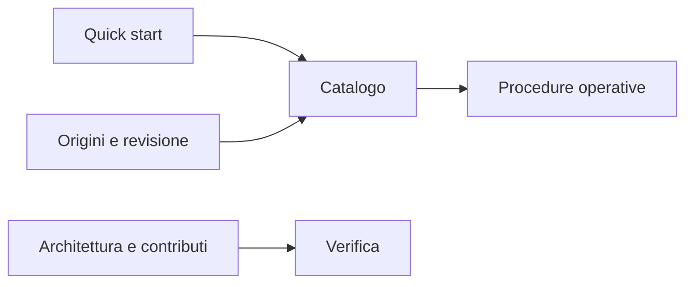

# Documentazione

[← Home](../../README.md)

| Percorso | Cosa trovi |
| :-- | :-- |
| [Avvio rapido](QUICKSTART.md) | Connessione e primi comandi |
| [Catalogo](CATALOG.md) | Tutte le query curate, con descrizioni e privilegi |
| [Sicurezza](SAFETY.md) | Privilegi, costi, dati sensibili e azioni |
| [Revisione delle sorgenti](SOURCE_REVIEW.md) | Problemi individuati e correzioni |
| [Note operative](USER_NOTES.md) | Concetti diagnostici e limiti d'interpretazione |
| [Riferimento rapido](reference/README.md) | Metacomandi psql, ruoli, schemi e azioni di manutenzione |
| [Fonti](SOURCES.md) | Ricerca e materiali pubblici |
| [Audit upstream](UPSTREAM_AUDIT.md) | Licenze, commit e limiti |
| [Architettura](architecture.md) | Struttura e ciclo di vita |
| [Scelte architetturali](ORACLE_DESIGN_REVIEW.md) | Organizzazione della libreria e mappa commentata |
| [Ricerca delle sorgenti](RESEARCH_EXPANSION.md) | Ulteriori strumenti di monitoraggio e cataloghi SQL |
| [Cataloghi e accessi](expansion-admin.md) | Casi d’uso, fonti e adattamenti delle query |
| [Prestazioni e manutenzione](expansion-performance.md) | Diagnostica di indici, replica e operazioni |
| [Contribuire](CONTRIBUTING.md) | Aggiungere e verificare script |
| [Manutenzione della raccolta](MAINTENANCE.md) | Estendere il catalogo e aggiornare le fonti esterne |
| [Validazione](VALIDATION.md) | Prove effettuate e limiti |
