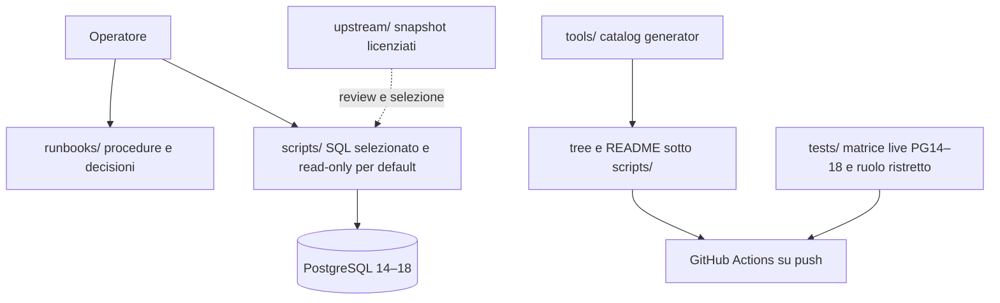

# Architettura del repository

## Scopo

Questo repository raccoglie strumenti e procedure per amministrare PostgreSQL 14–18. Il contenuto distingue codice verificabile, snapshot upstream e istruzioni operative: la presenza di uno script non equivale a un'autorizzazione a eseguirlo in produzione.

## Confini e flusso

| Percorso | Responsabilità | Regola |
|---|---|---|
| `scripts/` | SQL scelto e curato per attività amministrative | Solo diagnostica read-only; le azioni che cambiano stato appartengono ai runbook e ai riferimenti operativi, con prerequisiti e verifica. |
| `upstream/` | Snapshot di codice o SQL di terzi con provenienza/licenza | Separato dagli script curati; non eseguire direttamente. Ogni promozione richiede revisione di licenza, sicurezza, compatibilità e comportamento. |
| `runbooks/` | Diagnosi, decisioni e azioni manuali | Ogni azione operativa deve avere criteri di ingresso, verifica, rollback o escalation. |
| `tools/` | Generatore deterministico del catalogo | Python standard library; genera `tree` e README sotto `scripts/`, senza alterare SQL. |
| `tests/` | Controlli live per PostgreSQL 14–18 | Includere una matrice versioni e almeno un ruolo con privilegi limitati; una sola versione non dimostra compatibilità dell'intera matrice. |
| `docs/` | Convenzioni, sicurezza e contributi | Contratto condiviso da operatori, autori e CI. |

Il flusso atteso è: ricercare un runbook, scegliere lo script della categoria pertinente, controllare versione e privilegi, acquisire evidenze prima di qualunque modifica, eseguire una sola azione selettiva, confrontare le evidenze dopo l'intervento e registrare esito ed eventuale rollback. La generazione del catalogo deve produrre lo stesso output per gli stessi file e non deve riscrivere contenuti manuali estranei alle aree generate.

## Compatibilità PostgreSQL

Target dichiarati: PostgreSQL 14, 15, 16, 17 e 18. La compatibilità si valuta su versione server e privilegi effettivi; non dedurla dalla versione del client. Le viste e le colonne di statistiche cambiano nel tempo: controllare `server_version_num` e la documentazione della major installata prima di eseguire SQL non portabile. Per esempio, `pg_stat_io` è disponibile da PostgreSQL 16; PostgreSQL 18 aggiunge viste e impostazioni che non vanno presupposte sui server precedenti. Le query dei runbook favoriscono funzioni e viste consolidate e annotano le eccezioni.

Riferimenti: [documentazione PostgreSQL 14](https://www.postgresql.org/docs/14/), [15](https://www.postgresql.org/docs/15/), [16](https://www.postgresql.org/docs/16/), [17](https://www.postgresql.org/docs/17/), [18](https://www.postgresql.org/docs/18/).

## Affidabilità operativa

Il catalogo è un indice, non una fonte di autorizzazione. Gli script di sola lettura devono restare tali; le azioni che interrompono sessioni, cambiano configurazione o modificano dati devono essere opt-in. Nessuna procedura raccomanda tuning numerico universale. Failover, recupero da corruzione, modifica dei parametri persistenti e ripristini distruttivi richiedono un operatore responsabile, una decisione esplicita e un piano di recupero verificato.
