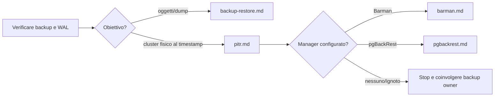

# Runbook PostgreSQL

Procedure operative per triage, diagnosi e recupero di PostgreSQL 14–18. Sono guide decisionali; eseguire prima le verifiche in sola lettura e seguire le regole in [SAFETY](../_support/docs/SAFETY.md). Ogni runbook distingue ciò che è osservabile da ciò che richiede un intervento. Le procedure qui documentate non sono dichiarate testate hands-on.

## Scegli il percorso

<!-- BEGIN GENERATED INDEX -->
| Procedura | Quando usarla |
| :-- | :-- |
| [Backup, restore e PITR](backup-restore.md) | Usare per verificare protezione dati, recuperare una base logica o predisporre ripristino fisico. |
| [Backup e PITR con Barman](barman.md) | Procedura riferita alla sintassi documentata per **Barman 3.17.0** e PostgreSQL 14–18. |
| [Scheda incidente PostgreSQL](incident-template.md) | Copiare questa scheda in uno spazio autorizzato dal processo di incident response. |
| [Diagnosi dei lock](locks.md) | Usare quando sessioni applicative sono in attesa, DDL resta bloccato o l'allarme mostra lock non concessi. |
| [Baseline e monitoraggio PostgreSQL](monitoring.md) | Questa procedura aiuta a stabilire una baseline e leggere gli allarmi senza trasformare valori istantanei in diagnosi. |
| [Backup e PITR con pgBackRest](pgbackrest.md) | Procedura basata sulla documentazione pgBackRest **2.59.3**. |
| [PITR fisico su istanza isolata](pitr.md) | Procedura PostgreSQL 14–18 per ripristinare un backup fisico e riprodurre WAL fino a un istante UTC, fermandosi in pausa per ispezionare i dati. |
| [Ritardo di replica fisica e logica](replication-lag.md) | Usare quando una replica è in ritardo, non riceve WAL, il replay è fermo o il consumer logico non avanza. |
| [Diagnosi ruoli, privilegi e autenticazione](security.md) | Usare per accesso negato o sospetto e per verificare privilegi prima di un cambiamento. |
| [Diagnosi query lente](slow-queries.md) | Usare quando una query ha latenza elevata o peggiora rispetto alla baseline. |
| [Triage iniziale PostgreSQL](triage.md) | Usare questa procedura quando un allarme o una segnalazione non ha ancora una causa verificata. |
| [Autovacuum, VACUUM e bloat](vacuum-bloat.md) | Usare quando crescono tabelle/indici o spazio, l'autovacuum sembra non recuperare arretrato, o aumentano transazioni lunghe e rischio wraparound. |
| [Crescita di WAL e ritardo archivio](wal-growth.md) | Usare quando `pg_wal` o il repository WAL cresce, `pg_stat_archiver` segnala fallimenti oppure lo spazio libero diminuisce. |
<!-- END GENERATED INDEX -->

L'indice include automaticamente le procedure presenti, anche nelle sottocartelle. La descrizione deriva dal primo paragrafo di ciascuna guida.

## Flusso operativo

Ogni procedura collega gli script SQL puntuali da eseguire in sequenza e spiega cosa osservare prima di scegliere il passo successivo. Seguire il flusso: **diagnosi -> script -> valutazione dei risultati -> passo successivo condizionato -> verifica**. Se il risultato è incompleto per versione o privilegi, oppure non identifica una causa, fermarsi e raccogliere l'evidenza mancante prima di intervenire. Le query di sola lettura non autorizzano da sole modifiche, terminazioni o failover.

## Procedure operative

Aprire il runbook associato al sintomo nella tabella iniziale. Il percorso numerato indica il primo script, i campi da leggere, le diramazioni per i risultati osservati e i criteri di chiusura. I percorsi sono descritti nei singoli runbook per evitare di scegliere script dalla sola categoria.

Riferimenti ufficiali sono collegati in ogni procedura; selezionare il manuale della major installata quando una funzione può variare.

## Recupero dati

Backup e PITR non sono intercambiabili: un dump logico protegge database/oggetti selezionati; PITR fisico richiede una base backup e tutti i WAL necessari fino alla timeline e al target. Nessun runbook afferma di avere superato un test PITR live.
