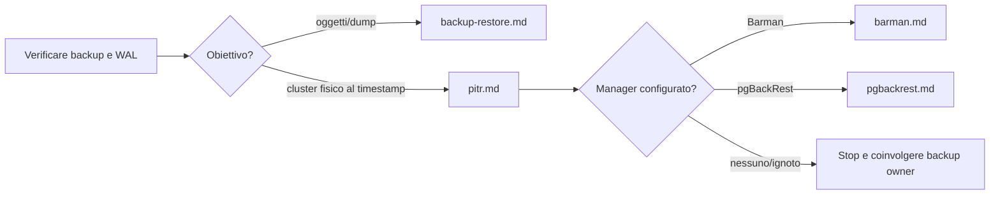

# Runbook PostgreSQL

Procedure operative per triage, diagnosi e recupero di PostgreSQL 14–18. Sono guide decisionali; eseguire prima le verifiche in sola lettura e seguire le regole in [SAFETY](../_support/docs/SAFETY.md). Ogni runbook distingue ciò che è osservabile da ciò che richiede un intervento. Le procedure qui documentate non sono dichiarate testate hands-on.

## Scegli il percorso

| Sintomo | Procedura |
|---|---|
| Allarme nuovo o impatto non chiaro | [triage](triage.md) |
| Sessioni in attesa / blocchi | [locks](locks.md) |
| Crescita improvvisa di `pg_wal` o archivio fermo | [wal-growth](wal-growth.md) |
| Standby indietro o non aggiornato | [replication-lag](replication-lag.md) |
| Bloat sospetto o autovacuum in ritardo | [vacuum-bloat](vacuum-bloat.md) |
| Query lenta o regressione | [slow-queries](slow-queries.md) |
| Backup o ripristino logico | [backup-restore](backup-restore.md) |
| PITR fisico con backup e WAL | [pitr](pitr.md) |
| Backup manager Barman | [barman](barman.md) |
| Backup manager pgBackRest | [pgBackRest](pgbackrest.md) |
| Ruoli, autenticazione o privilegi | [security](security.md) |
| Baseline di metriche e capacità | [monitoring](monitoring.md) |
| Registrazione uniforme dell'incidente | [incident-template](incident-template.md) |

## Flusso operativo

Ogni procedura collega gli script SQL puntuali da eseguire in sequenza e spiega cosa osservare prima di scegliere il passo successivo. Seguire il flusso: **diagnosi -> script -> valutazione dei risultati -> passo successivo condizionato -> verifica**. Se il risultato è incompleto per versione o privilegi, oppure non identifica una causa, fermarsi e raccogliere l'evidenza mancante prima di intervenire. Le query di sola lettura non autorizzano da sole modifiche, terminazioni o failover.

## Procedure operative

Aprire il runbook associato al sintomo nella tabella iniziale. Il percorso numerato indica il primo script, i campi da leggere, le diramazioni per i risultati osservati e i criteri di chiusura. I percorsi sono descritti nei singoli runbook per evitare di scegliere script dalla sola categoria.

Riferimenti ufficiali sono collegati in ogni procedura; selezionare il manuale della major installata quando una funzione può variare.

## Recupero dati

Backup e PITR non sono intercambiabili: un dump logico protegge database/oggetti selezionati; PITR fisico richiede una base backup e tutti i WAL necessari fino alla timeline e al target. Nessun runbook afferma di avere superato un test PITR live.
