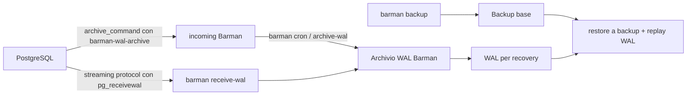

# Backup e PITR con Barman

Procedura riferita alla sintassi documentata per **Barman 3.17.0** e PostgreSQL 14–18. Prima di eseguire, leggere la versione installata e la pagina della stessa release; non assumere che un comando o una flag della release 3.17 esista nella versione locale. I nomi tra `<...>` sono placeholder e vanno sostituiti solo dopo verifica del target.

## Flusso dei WAL: distinguere le due modalità



`archive_command`/`barman-wal-archive` trasferisce segmenti completati da PostgreSQL; Barman li archivia come parte del normale cron/`archive-wal`. `barman receive-wal` avvia `pg_receivewal` e trasferisce lo stream via protocollo di replica; `barman cron` gestisce poi i segmenti acquisiti. Sono modalità di ingestione distinte, configurate per server: verificare la configurazione effettiva (`archiver`, `streaming_archiver`, slot e processi) e non avviare un secondo consumer o cambiare modalità durante un incidente senza change approvato.

## 1. Precheck e diagnostica (Barman 3.17.0)

Eseguire dal nodo Barman con ruolo autorizzato. Output `show-server`/diagnosi può includere `conninfo`: oscurarlo prima di condividerlo.

```sh
export SERVER_NAME='sostituire-con-server-Barman-configurato'
barman --version
barman check "$SERVER_NAME"
barman status "$SERVER_NAME"
barman list-backups "$SERVER_NAME"
```

Dopo aver selezionato un ID dalla lista e verificato che appartenga al server atteso:

```sh
export BACKUP_ID='incollare-l-ID-verificato-dalla-lista'
barman show-backup "$SERVER_NAME" "$BACKUP_ID"
barman check-backup "$SERVER_NAME" "$BACKUP_ID"
barman verify-backup "$SERVER_NAME" "$BACKUP_ID"
```

Significato dei controlli:

1. `--version` deve indicare la release per cui sono stati verificati i flag. Se è diversa da 3.17.0, consultare la documentazione corrispondente e `barman <comando> --help`.
2. `check` mostra salute di connessione, configurazione, directory, archiviazione e processi. `status`, `list-backups` e `show-backup` forniscono lo stato e identificano esplicitamente l'ID, tipo, orari, timeline e WAL associati.
3. `check-backup` controlla che i WAL necessari alla consistenza del backup siano archiviati. Non equivale a provare un PITR fino a un timestamp successivo.
4. `verify-backup` richiama `pg_verifybackup` sul manifest quando disponibile (PostgreSQL 13+). Per backup rsync potrebbe essere necessario un manifest generato: farlo solo come passo esplicito approvato, verificando compatibilità e impatto.
5. `barman list-processes <SERVER_NAME>` aiuta a osservare processi gestiti; registrare stato e log prima di qualunque azione.

Prima del restore verificare che il target UTC sia successivo alla fine del backup scelto. Per recuperare un punto che ricade dentro un backup, Barman richiede il backup precedente. Se la timezone non è specificata, Barman usa quella del proprio host: usare sempre `+00` nel target.

## 2. Backup mirato

Verificare che `<SERVER_NAME>` identifichi il cluster giusto e che il metodo, repository, spazio e retention siano già configurati. Avviare un backup soltanto nella finestra approvata:

```sh
barman backup <SERVER_NAME>
barman list-backups <SERVER_NAME>
barman check-backup <SERVER_NAME> <BACKUP_ID_APPENA_CREATO>
```

Non usare `all` in un'attività mirata. Il backup può provocare checkpoint e carico I/O; valutare l'impatto e controllare il risultato prima di considerarlo recuperabile. Seguire la policy Barman configurata per `backup_method`, WAL e retention; evitare cambi a retention nel corso dell'incidente.

## 3. Restore PITR su host/directory isolati

Definire host, major PostgreSQL compatibile, directory nuova/vuota, spazio, tablespace, porta e rete isolata. Verificare con il team infrastruttura che la destinazione non possa servire traffico applicativo. Salvare output dei precheck e usare un ID esplicito, non `auto`, così la selezione è riesaminabile.

Con variabili già valorizzate e approvate, il comando Barman 3.17.0 è:

```sh
export BARMAN_SERVER='sostituire-con-server-Barman-configurato'
export BACKUP_ID='sostituire-con-ID-verificato'
export TARGET_UTC='2026-10-18 12:30:00+00'
export TARGET_TLI='sostituire-con-timeline-numerica-verificata'
export RESTORE_HOST='sostituire-con-host-di-restore-isolato'
export DESTINATION_DIR='/srv/restore/INCIDENTE/CLUSTER-pitr'

barman restore \
  --remote-ssh-command "ssh postgres@$RESTORE_HOST" \
  --get-wal \
  --target-time "$TARGET_UTC" \
  --target-tli "$TARGET_TLI" \
  --target-action pause \
  "$BARMAN_SERVER" "$BACKUP_ID" "$DESTINATION_DIR"
```

`--get-wal` fa recuperare WAL al server durante la recovery; in remoto Barman configura `barman-wal-restore` per il `restore_command`. La modalità remota esegue il restore sul nodo target tramite SSH e PostgreSQL; assicurare autenticazione a chiave e permessi. Non aggiungere `--delta-restore` a una destinazione condivisa/esistente: il delta sovrascrive contenuti. Se una directory già esiste o non è sicuramente vuota, fermarsi e scegliere un nuovo percorso isolato. `--target-action pause` crea `recovery.signal` quando è presente un target e consente ispezione prima di promuovere.

Prima di avviare PostgreSQL, ispezionare il recovery configuration creato, verificare `restore_command`, `recovery_target_time`, `recovery_target_timeline`, `recovery_target_action=pause`, ownership delle directory e file di configurazione inclusi. Applicare porta dedicata, bind localhost e regole HBA/firewall isolati secondo [pitr.md](pitr.md). Non esporre la destinazione alla rete applicativa.

## 4. Ricezione WAL: diagnosi e gestione

Per `receive-wal`, verificare versione, server e stato del processo gestito:

```sh
barman --version
barman check <SERVER_NAME>
barman status <SERVER_NAME>
barman list-processes "$SERVER_NAME"
```

Il comando `barman receive-wal <SERVER_NAME>` avvia/gestisce il ricevitore secondo la versione/configurazione locale; non lanciarlo alla cieca se `list-processes` mostra già un processo. Per un ingresso via archive command, controllare la configurazione `archive_command`, i WAL in arrivo e il processo Barman che li trasferisce all'archivio. Correggere prima causa misurata (rete, accesso, slot, spazio o configurazione) e seguire il supervisore configurato.

Non inviare `kill -9`, non cancellare file di proprietà dell'account Barman, file `.partial`, spool o WAL per liberare spazio e non eliminare/ricreare slot per tentativi. Registrare log e process list; coinvolgere il responsabile Barman/DBA per una procedura supportata e validare i WAL necessari prima di intervenire.

## 5. Verifica e arresto

Dopo il restore, seguire [pitr.md](pitr.md) per startup isolato, controllo dei log, verifica `pg_is_in_recovery()`, target raggiunto e validazione business read-only prima di qualunque promozione. Se il server termina prima del target, il target timeline non coincide o i WAL non sono disponibili, non promuovere: conservare log e output e concordare un nuovo restore da backup/timeline corretti in un'altra directory. Per il cleanup arrestare il clone e seguire la retention e il processo di incidente; nessuna cancellazione automatica.

Fonti: [Barman 3.17.0 command reference](https://docs.pgbarman.org/release/3.17.0/user_guide/commands.html), [Barman 3.17.0 recovery](https://docs.pgbarman.org/release/3.17.0/user_guide/recovery.html), [Barman 3.17.0 backup](https://docs.pgbarman.org/release/3.17.0/user_guide/backup.html), [PostgreSQL PITR](https://www.postgresql.org/docs/14/continuous-archiving.html).
