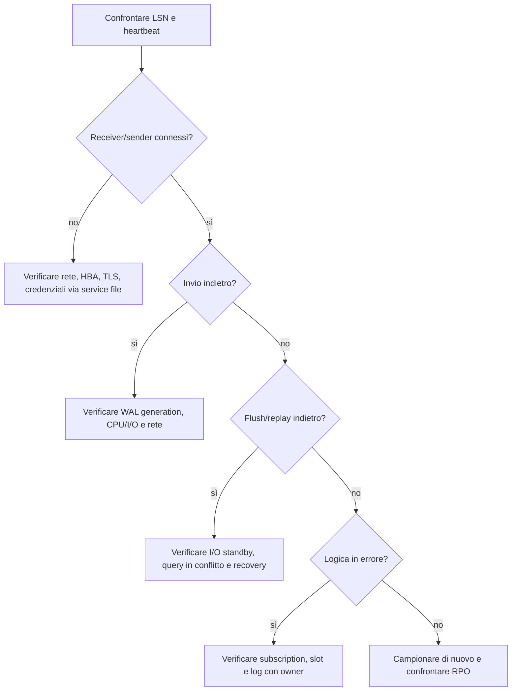

# Ritardo di replica fisica e logica

Usare quando una replica è in ritardo, non riceve WAL, il replay è fermo o il consumer logico non avanza. Il ritardo temporale da solo non descrive la perdita potenziale: distinguere invio, scrittura, flush, replay e applicazione.

## Percorso operativo

1. Sul primary eseguire [primary-senders.sql](../scripts/replication/physical/primary-senders.sql). `state`, `sync_state` e LSN descrivono invio e avanzamento; `replay_lag_bytes` è un divario LSN, non una durata. Se il sender manca o non è attivo, verificare rete e log senza promuovere lo standby.
2. Sullo standby eseguire [standby-receiver-health.sql](../scripts/replication/physical/standby-receiver-health.sql). Una vista vuota o messaggi vecchi portano a verificare connessione/receiver; `latest_end_lsn` e `receipt_age` descrivono ricezione, non replay.
3. Se la ricezione avanza ma l'applicazione no, eseguire [standby-replay.sql](../scripts/replication/physical/standby-replay.sql). Confrontare `received_lsn` e `replayed_lsn`; `time_since_last_commit` può crescere a cluster idle e non misura il lag. Un divario persistente sotto carico richiede verifiche I/O e conflitti sullo standby.
4. Se il ramo è logico, eseguire [workers.sql](../scripts/replication/logical/workers.sql) sul subscriber e, se slot/consumer sono coinvolti, [logical-stats.sql](../scripts/replication/slots/logical-stats.sql). Stato/errori dipendono da major e privilegi; non ricreare subscription prima di valutare perdita e risincronizzazione.
5. Ripetere i campioni durante traffico rappresentativo e verificare LSN in convergenza, messaggi recenti e RPO rispettato. Se dati divergono, WAL richiesto manca o un failover è considerato, coinvolgere DBA e owner servizio.

## Precheck

Stabilire topologia, ruolo atteso, sincronia richiesta, RPO/RTO, versione, rete, archivio WAL, stato consumer e ultime variazioni. Non promuovere uno standby o modificare la modalità sync durante la diagnosi. Su un primary servono permessi per osservare i sender e le subscription.

## Primary: streaming fisico

```sql
SELECT application_name, client_addr, state, sync_state,
       sent_lsn, write_lsn, flush_lsn, replay_lsn,
       write_lag, flush_lag, replay_lag,
       pg_wal_lsn_diff(pg_current_wal_lsn(), sent_lsn) AS unsent_bytes,
       pg_wal_lsn_diff(sent_lsn, write_lsn) AS sent_not_written_bytes,
       pg_wal_lsn_diff(write_lsn, flush_lsn) AS written_not_flushed_bytes,
       pg_wal_lsn_diff(flush_lsn, replay_lsn) AS flushed_not_replayed_bytes
FROM pg_stat_replication;
SELECT slot_name, slot_type, active, restart_lsn, confirmed_flush_lsn
FROM pg_replication_slots;
```

## Standby: ricezione e replay

```sql
SELECT pg_is_in_recovery(), pg_last_wal_receive_lsn(),
       pg_last_wal_replay_lsn(), pg_last_xact_replay_timestamp(),
       clock_timestamp() - pg_last_xact_replay_timestamp() AS replay_age;
SELECT status, receive_start_lsn, written_lsn, flushed_lsn,
       latest_end_lsn, last_msg_send_time, last_msg_receipt_time
FROM pg_stat_wal_receiver;
```

Le stringhe di connessione sono escluse dall’output. `replay_age` non misura il ritardo quando non ci sono transazioni nuove; comparare LSN e timestamp messaggi e generazione WAL. Le colonne lag temporali su `pg_stat_replication` possono diventare NULL in assenza di attività.

## Replica logica

Sul subscriber:

```sql
SELECT subname, pid, relid::regclass AS relation, received_lsn,
       latest_end_lsn, last_msg_send_time, last_msg_receipt_time,
       latest_end_time
FROM pg_stat_subscription;
```

Per la subscription selezionata verificare anche stato/errore nel log del subscriber e la connessione sul publisher; non esporre stringhe di connessione. `pg_stat_subscription` e colonne disponibili dipendono dalla major.

## Albero e intervento



Correggere per prima la causa misurata (connettività, risorse, archiver, conflitto o processo consumer). Prima di cambiare `synchronous_commit`, `synchronous_standby_names`, slot o retention, ottenere approvazione in base a RPO e rischio. Non fare failover dal runbook generico.

## Successo, rollback ed escalation

Successo: LSN si avvicinano durante il carico, messaggi sono recenti, consumer applica e il ritardo rientra nella soglia concordata. Annullare una modifica configurativa se aumenta la perdita ammessa o il carico; documentare la ricaduta e ripristinare la configurazione precedente con controllo `pg_settings`. Escalare a DBA/owner applicazione se si perdono segmenti richiesti, il dato divergente è possibile, uno slot è invalido o il failover diventa candidato.

Fonti: [monitoraggio cumulativo](https://www.postgresql.org/docs/current/monitoring-stats.html), [streaming replication e slot](https://www.postgresql.org/docs/current/warm-standby.html), [monitoraggio logico](https://www.postgresql.org/docs/current/logical-replication-monitoring.html).
