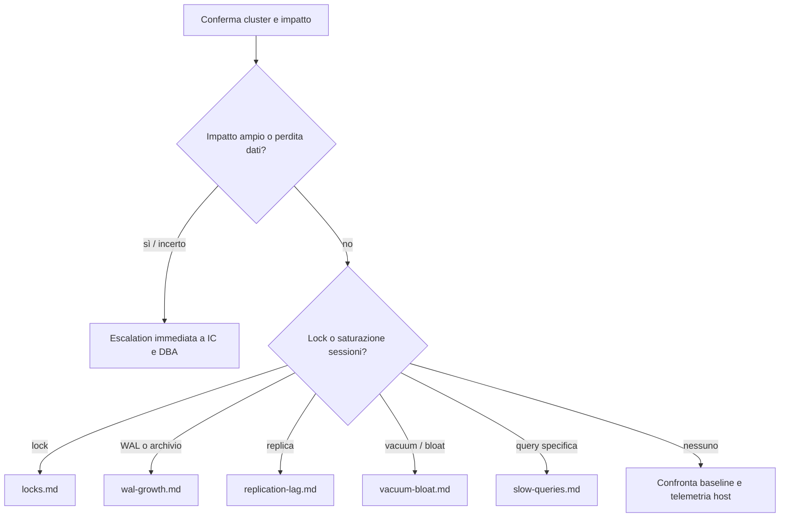

# Triage iniziale PostgreSQL

Usare questa procedura quando un allarme o una segnalazione non ha ancora una causa verificata. L'obiettivo è circoscrivere impatto e cambiamenti recenti prima di terminare sessioni o modificare parametri.

## Percorso operativo

1. Confermare endpoint, database e ruolo; eseguire [server-info.sql](../scripts/administration/inventory/server-info.sql). Verificare versione, indirizzo e `pg_is_in_recovery()` rispetto alla topologia attesa. Se il nodo non è quello previsto o lo stato è ambiguo, fermarsi e confermare l'endpoint fuori banda.
2. Eseguire [wait-summary.sql](../scripts/monitoring/activity/wait-summary.sql). `sessions` conta le sessioni visibili per backend/stato/attesa; se prevalgono attese `Lock`, passare a [locks.md](locks.md), mentre una fotografia isolata non dimostra persistenza.
3. Eseguire [database-counters.sql](../scripts/monitoring/statistics/database-counters.sql) e confrontare due campioni timestampati con lo stesso `stats_reset`. `deadlocks`, `temp_bytes` e blocchi sono cumulativi; se crescono insieme al sintomo, aprire il runbook specifico, altrimenti confrontare host e baseline.
4. Se il segnale riguarda replica o WAL, usare [primary-senders.sql](../scripts/replication/physical/primary-senders.sql) o [archive-status.sql](../scripts/wal/archive/archive-status.sql); LSN in byte e contatori archiver sono evidenza di stato, non causa automatica. Continuare con [replication-lag.md](replication-lag.md) o [wal-growth.md](wal-growth.md) solo se i campioni confermano il ramo.
5. Chiudere il triage quando impatto, intervallo, risultato ripetuto e responsabile sono registrati; verificare la soglia concordata o escalare se il trend cresce o una perdita dati è possibile.

Da `procedures/`: `psql "service=$PGSERVICE" -X -v ON_ERROR_STOP=1 -f ../scripts/monitoring/activity/wait-summary.sql`.

## Precheck

Registrare ora UTC, fuso, ambiente, endpoint/cluster, database, segnalante, sintomo, prima osservazione e impatto sugli utenti. Confermare l'identità del cluster tramite canale indipendente dall'alias del client. Usare un ruolo osservativo; evitare output con query o dati sensibili. Per la raccolta, il ruolo deve poter vedere le sessioni che si stanno valutando.

```sh
psql "service=$PGSERVICE" -X -v ON_ERROR_STOP=1
```

```sql
SELECT clock_timestamp() AS observed_at, current_database(), current_user,
       inet_server_addr(), inet_server_port(), version();
SELECT pg_postmaster_start_time(), pg_is_in_recovery();
SELECT datname, numbackends, deadlocks, conflicts, stats_reset
FROM pg_stat_database
WHERE datname = current_database();
SELECT state, wait_event_type, wait_event, count(*)
FROM pg_stat_activity
WHERE datname = current_database()
GROUP BY 1,2,3 ORDER BY 4 DESC;
```

Da host/monitoring, controllare disponibilità filesystem, CPU, memoria, I/O, errori recenti del servizio, rete e stato backup/archivio. Non incollare log grezzi contenenti segreti o query sensibili.

## Decisione



## Interpretazione e azione

Un singolo campione non stabilisce la causa: confrontare almeno due osservazioni con timestamp e baseline, verificando se il sintomo cresce o rientra. `pg_stat_database` contiene contatori dall'ultimo reset e non è un tasso finché non si confrontano intervalli. `pg_is_in_recovery()` identifica un server in recovery/standby, non prova che sia il primario previsto.

Non riavviare, terminare backend o cambiare configurazione come primo tentativo. Se una risorsa è vicina all'esaurimento, seguire il runbook dedicato e concordare l'impatto prima dell'azione.

## Successo, rollback ed escalation

Triage concluso quando target, impatto, finestra temporale, evidenze, ipotesi e responsabile sono registrati e instradati a un runbook specifico. Se l'impatto aumenta, ci sono errori di storage/corruzione, il primario è incerto o il margine di spazio è critico, passare subito all'incident commander/DBA senior e al responsabile infrastruttura. Non c'è rollback per la sola raccolta read-only; ripristinare eventuali modifiche di raccolta concordate.

Fonti: [attività e statistiche](https://www.postgresql.org/docs/current/monitoring-stats.html), [progress reporting](https://www.postgresql.org/docs/current/progress-reporting.html).
