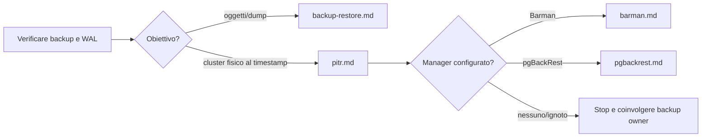

# Runbook PostgreSQL

Procedure operative per triage, diagnosi e recupero di PostgreSQL 14–18. Sono guide decisionali; eseguire prima le verifiche in sola lettura e seguire le regole in [SAFETY](../docs/SAFETY.md). Ogni runbook distingue ciò che è osservabile da ciò che richiede un intervento. Le procedure qui documentate non sono dichiarate testate hands-on.

## Scegli il percorso

| Sintomo | Procedura |
|---|---|
| Allarme nuovo o impatto non chiaro | [triage](triage.md) |
| Sessioni in attesa / blocchi | [locks](locks.md) |
| Crescita improvvisa di `pg_wal` o archivio fermo | [wal-growth](wal-growth.md) |
| Standby indietro o non aggiornato | [replication-lag](replication-lag.md) |
| Bloat sospetto o autovacuum in ritardo | [vacuum-bloat](vacuum-bloat.md) |
| Query lenta o regressione | [slow-queries](slow-queries.md) |
| Backup o ripristino logico | [backup-restore](backup-restore.md) |
| PITR fisico con backup e WAL | [pitr](pitr.md) |
| Backup manager Barman | [barman](barman.md) |
| Backup manager pgBackRest | [pgBackRest](pgbackrest.md) |
| Ruoli, autenticazione o privilegi | [security](security.md) |
| Baseline di metriche e capacità | [monitoring](monitoring.md) |
| Registrazione uniforme dell'incidente | [incident-template](incident-template.md) |

## Script SQL correlati

Gli script sono organizzati per categoria. Finché il catalogo non elenca file specifici, aprire la directory indicata e leggere il relativo README:

| Attività | Categoria |
|---|---|
| Blocchi e connessioni | [`scripts/administration/connections/`](../scripts/administration/connections/) |
| WAL e archiviazione | [`scripts/wal/archive/`](../scripts/wal/archive/), [`scripts/wal/retention/`](../scripts/wal/retention/) |
| Replica fisica/logica e slot | [`scripts/replication/physical/`](../scripts/replication/physical/), [`scripts/replication/logical/`](../scripts/replication/logical/), [`scripts/replication/slots/`](../scripts/replication/slots/) |
| Vacuum, bloat e progresso | [`scripts/maintenance/vacuum/`](../scripts/maintenance/vacuum/), [`scripts/maintenance/bloat/`](../scripts/maintenance/bloat/), [`scripts/maintenance/progress/`](../scripts/maintenance/progress/) |
| Query, indici e I/O | [`scripts/performance/queries/`](../scripts/performance/queries/), [`scripts/performance/indexes/`](../scripts/performance/indexes/), [`scripts/performance/io/`](../scripts/performance/io/) |
| Backup | [`scripts/backup/inspection/`](../scripts/backup/inspection/) |
| Ruoli e privilegi | [`scripts/security/roles/`](../scripts/security/roles/), [`scripts/security/privileges/`](../scripts/security/privileges/) |
| Attività, statistiche, capacità | [`scripts/monitoring/activity/`](../scripts/monitoring/activity/), [`scripts/monitoring/statistics/`](../scripts/monitoring/statistics/), [`scripts/monitoring/capacity/`](../scripts/monitoring/capacity/) |
| Inventario e configurazione | [`scripts/administration/inventory/`](../scripts/administration/inventory/), [`scripts/administration/configuration/`](../scripts/administration/configuration/) |

## Convenzione di lettura

Usare il runbook come percorso: precheck → evidenza → interpretazione → azione selettiva (se giustificata) → verifica → rollback o escalation. Se dati, versione o privilegi non consentono di seguire una diramazione in sicurezza, fermarsi e passare al DBA/on-call responsabile. Riferimenti ufficiali sono collegati in ogni procedura; selezionare il manuale della major installata quando una funzione può variare.

## Recupero dati

Backup e PITR non sono intercambiabili: un dump logico protegge database/oggetti selezionati; PITR fisico richiede una base backup e tutti i WAL necessari fino alla timeline e al target. Nessun runbook afferma di avere superato un test PITR live.
