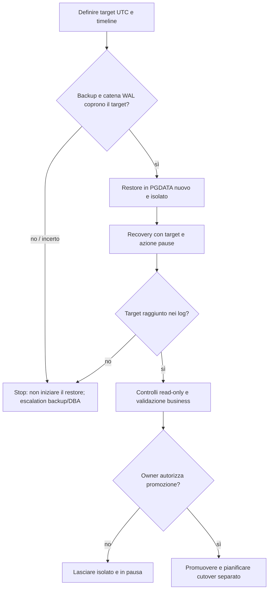

# PITR fisico su istanza isolata

Procedura PostgreSQL 14–18 per ripristinare un backup fisico e riprodurre WAL fino a un istante UTC, fermandosi in pausa per ispezionare i dati. È una procedura operativa documentata, non una dichiarazione di test PITR live. Per sintassi specifica di Barman o pgBackRest seguire anche [barman.md](barman.md) o [pgbackrest.md](pgbackrest.md).



## 1. Definire il punto di recupero

Registrare ID incidente, cluster sorgente, major, timestamp target con offset `+00`, fuso e fonte dell'orologio. Scegliere un istante prima dell'evento dannoso usando log applicativi/DB correlati; non convertire un orario locale senza documentare offset e DST. Per un evento transazionale preciso, concordare se includere o escludere la transazione al target. Individuare la timeline di origine e ogni cambio/promozione successiva. Non assumere `latest` se l'archivio contiene più timeline: selezionare il target timeline coerente con la storia del cluster.

## 2. Precheck di backup, WAL e timeline

Prima di copiare dati, il DBA e il proprietario backup devono dimostrare tutti i punti seguenti:

1. Esiste un backup fisico consistente, completato e leggibile, il cui intervallo copre l'inizio del recovery necessario. Per backup incrementali verificare tutta la catena e i backup base richiesti.
2. Il repository conserva ogni WAL necessario dal punto di consistenza del backup fino al target, inclusi i segmenti finali e i file di history delle timeline.
3. Il manager riconosce un backup compatibile con la versione maggiore e il target timeline/tempo richiesti. Verificare output `check`, lista/dettaglio backup e `verify` disponibili nella versione installata; un esito positivo non sostituisce una prova di restore.
4. La directory di destinazione, filesystem, spazio, tablespace e configurazione PostgreSQL sono distinti dal cluster attivo. Il target non può ricevere traffico applicativo o repliche.
5. Sono definiti responsabile del recovery, autorizzazione a promuovere, controlli applicativi, criterio di stop e destinazione del servizio dopo la validazione.

Se la copertura WAL o timeline è incerta, fermarsi e chiedere al responsabile backup/DBA di ricostruire la catena. Non tentare di colmare segmenti mancanti con file presi da un altro cluster.

## 3. Preparare una directory nuova e vuota

Gli esempi sono per Linux, PostgreSQL eseguito come utente `postgres`, e richiedono valori approvati per ogni placeholder. Non sostituire un `PGDATA` esistente. Creare una directory nuova, fuori dal percorso del cluster di produzione, con nome e mount approvati:

```sh
export PGDATA='/srv/restore/INCIDENTE/CLUSTER-pitr' # sostituire con un percorso nuovo
export PORT=55432
export LOGFILE='/srv/restore/INCIDENTE/postgres-pitr.log' # sostituire con il log del clone

: "${PGDATA:?impostare PGDATA}"
test ! -e "$PGDATA" || { echo "PGDATA esiste: stop" >&2; exit 1; }
install -d -o postgres -g postgres -m 0700 "$PGDATA"
find "$PGDATA" -mindepth 1 -maxdepth 1 -print -quit
```

L'ultimo comando non deve stampare contenuti prima del restore. Se stampa un elemento, fermarsi e usare un altro percorso nuovo. Verificare ownership, spazio per cluster e tabelle fuori da `PGDATA`, e assenza di symlink verso il cluster live. Non ripulire un percorso esistente con cancellazioni ricorsive.

## 4. Ripristinare il backup e configurare il fetch WAL

Eseguire il restore tramite il backup manager installato, usando il suo runbook e un `BACKUP_ID` scelto dopo il precheck. Impostare esplicitamente il target timestamp UTC e timeline. I due manager creano o installano in modo diverso il recovery config: controllare tutti i file effettivamente letti dal server, inclusi `postgresql.conf`, file inclusi e `postgresql.auto.conf`, per eliminare target duplicati o incompatibili.

Il recupero deve usare un `restore_command` fornito dal manager. Esempi di forma documentata per i manager sono:

```conf
# pgBackRest; la stanza deve essere quella già configurata per il cluster
restore_command = 'pgbackrest --stanza=<STANZA> archive-get %f "%p"'

# Barman remoto: richiede SSH a chiave e barman-cli sul nodo PostgreSQL.
restore_command = 'barman-wal-restore -U barman <BARMAN_HOST> <SERVER_BARMAN> %f %p'
```

Per Barman locale, eseguire `barman get-wal` con l'identità Barman e predisporre i permessi necessari per l'utente PostgreSQL, come descritto in [barman.md](barman.md). Per Barman remoto usare `barman-wal-restore` con SSH configurato; non inserire password nella stringa. Se il tool genera `restore_command` o `postgresql.auto.conf`, esaminare il risultato prima dello start. I placeholder non sono valori da copiare letteralmente.

PostgreSQL 14–18 usa le impostazioni normali e `recovery.signal`; `recovery.conf` appartiene a versioni precedenti e impedisce l'avvio. Se il manager non ha già creato correttamente il segnale, controllare poi crearlo vuoto e di proprietà di `postgres`:

```sh
install -o postgres -g postgres -m 0600 /dev/null "$PGDATA/recovery.signal"
```

Impostare nel file di configurazione effettivo del cluster isolato il target scelto. Il timestamp deve esplicitare UTC; usare la timeline numerica verificata nel precheck.

```conf
recovery_target_time = '2026-10-18 12:30:00+00'  # sostituire con il target approvato
recovery_target_timeline = '4'                    # timeline verificata dal DBA
recovery_target_action = 'pause'
hot_standby = on
archive_mode = off
listen_addresses = '127.0.0.1'
port = 55432
```

`pause` permette di ispezionare il database prima di promuovere; non usare `promote` o `shutdown` automatico per questo flusso. Impostare **`archive_mode=off` nella configurazione effettiva prima dello start**: un clone non deve inviare WAL al repository del primary. Il valore ereditato `always` può archiviare anche durante recovery; `on` può farlo dopo la promozione. Il fetch tramite `restore_command` continua a funzionare con archiving disabilitato. Assicurarsi che `pg_hba.conf`/firewall non permettano l'accesso delle applicazioni o di altri cluster. Se la destinazione non deve accettare connessioni esterne, non affidarsi al solo nome host.

## 5. Avviare il recovery isolato e attendere

Registrare configurazione e ownership prima dell'avvio, poi eseguire come `postgres` usando binari della stessa major. Il binding localhost e la porta dedicata sono protezioni aggiuntive; mantenere anche isolamento di rete.

```sh
sudo -u postgres pg_ctl -D "$PGDATA" \
  -o "-p $PORT -c listen_addresses=127.0.0.1" \
  -l "$LOGFILE" start
```

Seguire il log fino a un messaggio di recovery che confermi il raggiungimento del target e la pausa. Verificare sulla porta isolata:

```sh
psql "host=127.0.0.1 port=$PORT dbname=postgres" -X -v ON_ERROR_STOP=1 \
  -c "SELECT clock_timestamp(), pg_is_in_recovery(), pg_last_wal_replay_lsn(), pg_last_xact_replay_timestamp();"
```

Atteso: il server risponde solo sull'endpoint isolato, `pg_is_in_recovery()` è `true`, e log e replay indicano il target approvato. Il testo esatto del messaggio varia per versione/localizzazione: verificare il senso e gli errori nel log, non una stringa rigida. `pg_last_xact_replay_timestamp()` può essere NULL o più vecchio se non vi sono transazioni recenti; da solo non prova il target.

## 6. Condizioni di stop e validazione business

Fermare il flusso senza promuovere se il server segnala che il recovery è terminato prima del target, mancano segmenti, la timeline non coincide, il comando restore fallisce, il server esce dalla recovery senza target confermato, oppure la directory/porta/istanza non è quella isolata. Acquisire log e output, fermare il clone con `pg_ctl stop` e concordare un nuovo restore in un altro percorso vuoto, scegliendo backup/timeline corretti. Non usare `pg_resetwal` e non rimuovere WAL manualmente.

Quando il target è raggiunto, mantenere il cluster in pausa e in sola lettura. Validare con owner applicativo: record sentinella, transazioni attese prima/dopo l'incidente, vincoli, conteggi o controlli funzionali pertinenti, estensioni e permessi. Eseguire query di ispezione read-only; nessun test che scrive sul clone prima della decisione. La validazione tecnica non dimostra da sola la correttezza di business.

## 7. Promozione, cutover e cleanup

Solo dopo approvazione esplicita del responsabile dati e piano di cutover, promuovere il clone quando deve diventare scrivibile:

```sh
sudo -u postgres pg_ctl -D "$PGDATA" promote
psql "host=127.0.0.1 port=$PORT dbname=postgres" -X -v ON_ERROR_STOP=1 \
  -c 'SELECT pg_is_in_recovery();'
```

Il risultato atteso dopo promozione è `false`. La promozione crea una nuova timeline e non instrada automaticamente le applicazioni. Prima di aprire l'accesso, verificare ruolo primary, endpoint, autenticazione, backup/archiviazione per il nuovo primary, replica, monitoring e decisione di fencing del vecchio primary. Il cutover applicativo è un change separato con owner, finestra e rollback documentati.

Riattivare l’archiviazione soltanto quando il clone è diventato il primary autorizzato e dopo aver verificato destinazione, stanza/server del backup manager e separazione dal vecchio primary. Il cambio di `archive_mode` richiede un riavvio: pianificarlo nel cutover, senza trasformare una prova isolata in un writer dell’archivio produttivo.

Se il clone è solo una prova, fermarlo in modo controllato dopo aver preservato le evidenze autorizzate. Non cancellare l'area di restore durante un incidente o senza approvazione del responsabile e della policy di conservazione; il cleanup deve verificare percorsi e tablespace e non colpire il cluster sorgente.

Fonti: [PostgreSQL 14 PITR](https://www.postgresql.org/docs/14/continuous-archiving.html), [PostgreSQL 18 PITR](https://www.postgresql.org/docs/18/continuous-archiving.html), [parametri recovery PostgreSQL 14](https://www.postgresql.org/docs/14/runtime-config-wal.html#RUNTIME-CONFIG-WAL-RECOVERY-TARGET), [Barman 3.17 recovery](https://docs.pgbarman.org/release/3.17.0/user_guide/recovery.html), [pgBackRest command reference](https://pgbackrest.org/command.html).
