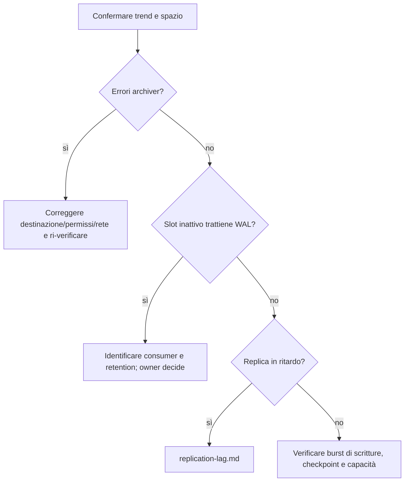

# Crescita di WAL e ritardo archivio

Usare quando `pg_wal` o il repository WAL cresce, `pg_stat_archiver` segnala fallimenti oppure lo spazio libero diminuisce. I file WAL attivi sono parte della consistenza: non cancellarli, spostarli o rinominarli manualmente.

## Precheck

Confermare cluster primario/standby, dimensione e filesystem di `PGDATA`, trend con timestamp, spazio libero, archiviazione configurata, backup più recente, replica e slot. Verificare che il monitor conti il mount corretto. Concordare subito l'escalation se lo spazio residuo non copre il consumo durante la diagnosi.

## Diagnostica read-only

```sql
SELECT pg_is_in_recovery(), current_setting('data_directory') AS data_directory,
       current_setting('archive_mode') AS archive_mode,
       current_setting('archive_command') <> '' AS archive_command_configured,
       current_setting('archive_library', true) AS archive_library;
SELECT archived_count, last_archived_wal, last_archived_time,
       failed_count, last_failed_wal, last_failed_time, stats_reset
FROM pg_stat_archiver;
SELECT slot_name, slot_type, active, restart_lsn, confirmed_flush_lsn,
       pg_wal_lsn_diff(pg_current_wal_lsn(), restart_lsn) AS retained_bytes
FROM pg_replication_slots;
SELECT application_name, state, sync_state, sent_lsn, write_lsn,
       flush_lsn, replay_lsn,
       pg_wal_lsn_diff(pg_current_wal_lsn(), replay_lsn) AS replay_bytes_behind
FROM pg_stat_replication;
SELECT name, setting, unit, source, pending_restart
FROM pg_settings
WHERE name IN ('max_wal_size','min_wal_size','wal_keep_size',
               'max_slot_wal_keep_size','archive_timeout');
```

`pg_current_wal_lsn()` va interrogata sul primary; i byte trattenuti sono stima logica, non una misura di file system occupato. Il catalogo slot può esporre `wal_status`/`safe_wal_size` in versioni recenti: verificarne la disponibilità sulla major prima di usarli. Su host, rilevare dimensione di `pg_wal`, spazio disponibile e errori lato archivio, senza elencare o rimuovere file come azione correttiva.

## Decisione



## Azione selettiva

Se l'archivio fallisce, ripristinare il servizio, spazio, permessi o rete sul destinatario secondo la procedura operativa di backup; confermare che l'archiver riprenda e le metriche avanzino. Se uno slot è sospetto, identificare subscription/consumer, owner, necessità di recupero e perdita dati possibile. Non droppare lo slot solo per liberare spazio: il consumer potrebbe dover ricopiare dati o non essere più recuperabile. Pianificare un cambio di retention in modo approvato e misurare l'effetto.

Non aumentare `max_wal_size` per occultare una crescita continua; tale parametro regola i checkpoint, non corregge un archivio rotto o uno slot che trattiene WAL. Non usare `pg_resetwal` e non cancellare `pg_wal`. Se il filesystem è vicino al pieno, limitare scritture tramite il proprietario applicativo e aumentare capacità con infrastruttura, preservando spazio per il servizio.

## Successo, rollback ed escalation

Successo: archive successivo completato, fallimenti non crescono, spazio si stabilizza o rientra, slot/repliche rientrano e backup resta recuperabile. Dopo modifiche configurative, conservare il valore precedente e ripristinarlo se la correzione peggiora latenza, retention o recuperabilità; mantenere l'archiving integro. Escalare immediatamente a DBA, storage e owner backup se il WAL non è archiviabile, il filesystem è a rischio pieno, si sospetta la perdita di segmenti o un restore non è più dimostrabilmente disponibile.

Fonti: [configurazione WAL](https://www.postgresql.org/docs/current/runtime-config-wal.html), [monitoraggio archiver e slot](https://www.postgresql.org/docs/current/monitoring-stats.html), [slot di replica](https://www.postgresql.org/docs/current/warm-standby.html#STREAMING-REPLICATION-SLOTS).
