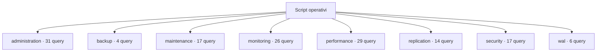

# Script operativi

[← Home](../README.md) · [Sicurezza e privilegi](../_support/docs/SAFETY.md)

**144 query** · client `psql` · diagnosi in transazione read-only.

Leggere header, versione e privilegi prima dell’esecuzione. I contatori di attività sono cumulativi: un valore isolato non giustifica un’azione correttiva.

[administration](administration/README.md) · [backup](backup/README.md) · [maintenance](maintenance/README.md) · [monitoring](monitoring/README.md) · [performance](performance/README.md) · [replication](replication/README.md) · [security](security/README.md) · [wal](wal/README.md)

## 🗂️ Mappa della libreria

```text
scripts/
|
+-- administration/                                  ← 31 script · Istanza, configurazione, connessioni e cataloghi
|   +-- configuration/                               ← 4 script · Parametri effettivi, capacità e impostazioni operative
|   |   +-- connection-capacity.sql                  ← Connection capacity
|   |   +-- non-default-settings.sql                 ← Non-default settings
|   |   +-- vacuum-settings.sql                      ← Vacuum and autovacuum settings
|   |   +-- wal-settings.sql                         ← WAL and checkpoint settings
|   +-- connections/                                 ← 6 script · Sessioni, transazioni e occupazione connessioni
|   |   +-- active.sql                               ← Active sessions
|   |   +-- backend-detail.sql                       ← Backend session detail
|   |   +-- by-state.sql                             ← Connections by state
|   |   +-- idle-in-transaction.sql                  ← Idle transactions
|   |   +-- oldest-backend-transactions.sql          ← Oldest active backend transactions
|   |   +-- xid-holding-backends.sql                 ← Sessions holding old transaction horizons
|   +-- inventory/                                   ← 21 script · Oggetti, vincoli, tipi, partizioni e dipendenze
|       +-- collation-versions.sql                   ← Collation provider and recorded versions
|       +-- columns.sql                              ← Column definitions inventory
|       +-- constraints.sql                          ← Constraint inventory
|       +-- databases.sql                            ← Database inventory
|       +-- extensions-dependencies.sql              ← Extension-owned object dependencies
|       +-- extensions.sql                           ← Installed extensions
|       +-- fdw-metadata.sql                         ← Foreign data wrapper metadata
|       +-- largest-relations.sql                    ← Largest relations
|       +-- materialized-views.sql                   ← Materialized view inventory
|       +-- object-dependencies.sql                  ← Direct object dependencies
|       +-- ownership.sql                            ← Application object ownership
|       +-- partition-tree.sql                       ← Partition hierarchy
|       +-- relations-detailed.sql                   ← Relation inventory with storage and state
|       +-- routines.sql                             ← Routine inventory
|       +-- schemas.sql                              ← Schema inventory
|       +-- sequences.sql                            ← Sequence inventory
|       +-- server-info.sql                          ← Server identity
|       +-- triggers.sql                             ← Trigger inventory
|       +-- types-enums-domains.sql                  ← Enum and domain type inventory
|       +-- unvalidated-constraints.sql              ← Unvalidated constraints
|       +-- views-and-definitions.sql                ← View inventory with options
+-- backup/                                          ← 4 script · Diagnosi backup fisico e stato recovery
|   +-- inspection/                                  ← 4 script · Identità cluster, recovery e attività di base backup
|       +-- active-backup-senders.sql                ← Active backup senders
|       +-- backup-api-activity.sql                  ← Backup API activity
|       +-- basebackup-progress.sql                  ← Base backup progress
|       +-- recovery-state.sql                       ← Recovery state
+-- maintenance/                                     ← 17 script · Vacuum, freeze, spazio e avanzamento operazioni
|   +-- bloat/                                       ← 2 script · Dimensioni heap, indici e TOAST; indicatori da verificare
|   |   +-- relation-size-breakdown.sql              ← Relation size breakdown
|   |   +-- toast-breakdown.sql                      ← TOAST storage breakdown
|   +-- progress/                                    ← 6 script · Progresso VACUUM, ANALYZE, COPY, CLUSTER e indici
|   |   +-- analyze.sql                              ← Analyze progress
|   |   +-- cluster-rewrite.sql                      ← CLUSTER and rewrite progress
|   |   +-- copy.sql                                 ← COPY progress
|   |   +-- create-index.sql                         ← Index build progress
|   |   +-- index-build.sql                          ← Index build progress detail
|   |   +-- vacuum.sql                               ← Vacuum progress
|   +-- vacuum/                                      ← 9 script · Tuple morte, transazioni lunghe, XID e autovacuum
|       +-- dead-tuples.sql                          ← Dead tuple estimates
|       +-- hot-update-ratio.sql                     ← HOT update ratio
|       +-- oldest-transactions.sql                  ← Old transactions
|       +-- per-table-autovacuum-overrides.sql       ← Per-table autovacuum overrides
|       +-- table-freeze-age.sql                     ← Table freeze age
|       +-- table-multixact-age.sql                  ← Table multixact age
|       +-- toast-storage-share.sql                  ← TOAST storage candidates
|       +-- vacuum-history.sql                       ← Per-table vacuum history
|       +-- wraparound-risk.sql                      ← Transaction and multixact age
+-- monitoring/                                      ← 26 script · Controlli quotidiani, attività e trend operativi
|   +-- activity/                                    ← 8 script · Attese, blocchi, transazioni e connessioni SSL
|   |   +-- advisory-locks.sql                       ← Advisory lock summary
|   |   +-- blocking-impact.sql                      ← Blocking impact by backend
|   |   +-- blocking-sessions.sql                    ← Blocking sessions
|   |   +-- long-running.sql                         ← Long-running queries
|   |   +-- prepared-transactions.sql                ← Prepared transactions
|   |   +-- ssl-connections.sql                      ← SSL connection summary
|   |   +-- wait-summary.sql                         ← Wait event summary
|   |   +-- waiting-locks-by-relation.sql            ← Waiting locks by relation
|   +-- capacity/                                    ← 2 script · Dimensioni, crescita e spazio allocato
|   |   +-- database-sizes.sql                       ← Database sizes
|   |   +-- tablespace-inventory.sql                 ← Tablespace inventory
|   +-- statistics/                                  ← 16 script · Contatori database, cache, SLRU e checkpoint
|       +-- checkpointer-activity.sql                ← Checkpointer activity counters
|       +-- checkpointer.sql                         ← Checkpointer counters
|       +-- database-age.sql                         ← Database transaction ID age
|       +-- database-cache-hit.sql                   ← Database shared-buffer hit ratio
|       +-- database-counters.sql                    ← Database counters
|       +-- database-transaction-ratio.sql           ← Database commit and rollback ratio
|       +-- database-work-counters.sql               ← Database workload counters
|       +-- deadlocks-and-conflicts.sql              ← Deadlocks and standby conflicts
|       +-- io-by-backend.sql                        ← I/O statistics by backend
|       +-- relation-block-io.sql                    ← Relation block I/O counters
|       +-- reset-times.sql                          ← Statistics reset times
|       +-- slru-counters.sql                        ← SLRU activity counters
|       +-- table-activity.sql                       ← Table activity
|       +-- table-hot-updates.sql                    ← Table HOT update ratios
|       +-- table-statistics-coverage.sql            ← Table statistics coverage
|       +-- temporary-files.sql                      ← Temporary file counters by database
+-- performance/                                     ← 29 script · Query, indici, statistiche del planner e I/O
|   +-- indexes/                                     ← 12 script · Indici, vincoli, FK, utilizzo e candidati da analizzare
|   |   +-- access-methods.sql                       ← Index access methods
|   |   +-- constraint-index-signatures.sql          ← Constraint index signatures
|   |   +-- definitions.sql                          ← Index definitions
|   |   +-- duplicate-candidates.sql                 ← Duplicate index candidates
|   |   +-- foreign-keys-without-index.sql           ← Foreign keys without leading index
|   |   +-- index-usage-context.sql                  ← Index usage counter context
|   |   +-- index-validity-state.sql                 ← Index validity state
|   |   +-- invalid-indexes.sql                      ← Invalid indexes
|   |   +-- key-included-columns.sql                 ← Index keys and included columns
|   |   +-- unused-candidates.sql                    ← Unused index candidates
|   |   +-- usage-by-table.sql                       ← Index usage by table
|   |   +-- write-pressure.sql                       ← Index write pressure context
|   +-- io/                                          ← 6 script · Letture, scritture, timing e buffer cache
|   |   +-- buffercache-summary.sql                  ← Buffer cache summary
|   |   +-- checkpoint-settings-context.sql          ← Checkpoint setting context
|   |   +-- database-io-timing.sql                   ← Database I/O timing
|   |   +-- database-temp-files.sql                  ← Database temporary file counters
|   |   +-- io-wait-snapshot.sql                     ← Current I/O wait snapshot
|   |   +-- pg-stat-io.sql                           ← I/O by backend and context
|   +-- queries/                                     ← 3 script · Top SQL, tempi e file temporanei
|   |   +-- top-mean-time.sql                        ← Statements by mean time
|   |   +-- top-temp-blocks.sql                      ← Statements by temporary blocks
|   |   +-- top-total-time.sql                       ← Statements by total time
|   +-- statistics/                                  ← 8 script · Distribuzione dati, partizioni, HOT e sequenze
|       +-- analyze-freshness.sql                    ← Analyze freshness
|       +-- column-skew-metadata.sql                 ← Column skew metadata
|       +-- null-fractions.sql                       ← Column null fraction metadata
|       +-- partition-hierarchy.sql                  ← Partition hierarchy
|       +-- partition-index-attachments.sql          ← Partition index attachments
|       +-- physical-correlation.sql                 ← Column physical correlation
|       +-- sequence-context.sql                     ← Sequence inventory context
|       +-- sequence-headroom.sql                    ← Sequence exhaustion headroom
+-- replication/                                     ← 14 script · Replica fisica/logica, consumer e retention
|   +-- logical/                                     ← 5 script · Publication, subscription e sincronizzazione tabelle
|   |   +-- publication-tables.sql                   ← Logical publication table mapping
|   |   +-- publications.sql                         ← Logical publication configuration
|   |   +-- subscriptions.sql                        ← Logical subscriptions
|   |   +-- table-sync-state.sql                     ← Logical table synchronization state
|   |   +-- workers.sql                              ← Logical replication workers
|   +-- physical/                                    ← 5 script · Sender, receiver, replay e conflitti dello standby
|   |   +-- primary-senders.sql                      ← Physical replication senders
|   |   +-- standby-conflicts.sql                    ← Standby recovery conflicts
|   |   +-- standby-receiver-health.sql              ← Standby receiver health
|   |   +-- standby-receiver.sql                     ← Standby WAL receiver
|   |   +-- standby-replay.sql                       ← Standby replay status
|   +-- slots/                                       ← 4 script · Slot, xmin, WAL trattenuti e margine di retention
|       +-- logical-stats.sql                        ← Logical slot counters
|       +-- retention.sql                            ← Replication slot retention
|       +-- wal-limit-headroom.sql                   ← Replication slot WAL limit headroom
|       +-- xmin-horizons.sql                        ← Replication slot xmin horizons
+-- security/                                        ← 17 script · Ruoli, accessi, ACL e row-level security
|   +-- privileges/                                  ← 11 script · Grant, privilegi effettivi, RLS e regole di accesso
|   |   +-- database-acl.sql                         ← Database ACL
|   |   +-- effective-database-privileges.sql        ← Effective database privileges for roles
|   |   +-- hba-rule-health.sql                      ← HBA rule health
|   |   +-- public-schema-grants.sql                 ← PUBLIC schema and relation grants
|   |   +-- relation-acl.sql                         ← Relation ACL
|   |   +-- rls-enabled-without-policy.sql           ← RLS-enabled relations without visible policies
|   |   +-- rls-policies.sql                         ← Row-level security policy inventory
|   |   +-- routine-execute-grants.sql               ← Routine EXECUTE grants
|   |   +-- routine-security-definer.sql             ← SECURITY DEFINER routine inventory
|   |   +-- schema-acl.sql                           ← Schema ACL
|   |   +-- schema-effective-privileges.sql          ← Effective schema privileges
|   +-- roles/                                       ← 6 script · Membership, ereditarietà e attributi dei ruoli
|       +-- default-acl.sql                          ← Default privileges inventory
|       +-- expiring-logins.sql                      ← Expiring login roles
|       +-- membership.sql                           ← Role memberships
|       +-- role-attributes.sql                      ← Role security attributes
|       +-- role-inventory.sql                       ← Role inventory
|       +-- role-membership-edges.sql                ← Role membership edges with portable attributes
+-- wal/                                             ← 6 script · Generazione WAL, archiviazione e checkpoint
    +-- archive/                                     ← 2 script · Archiver, fallimenti e marker pronti da archiviare
    |   +-- archive-status.sql                       ← Archive status
    |   +-- ready-files.sql                          ← Ready WAL archive files
    +-- retention/                                   ← 4 script · Contatori, segmenti e cause della crescita WAL
        +-- checkpoint-counters-common.sql           ← Checkpoint counters
        +-- retention-context.sql                    ← WAL retention context
        +-- wal-counters.sql                         ← WAL counters
        +-- wal-directory-dimensions.sql             ← WAL directory dimensions
```



```console
psql -X -v ON_ERROR_STOP=1 -f scripts/administration/configuration/connection-capacity.sql
```

Comando da eseguire dalla radice del checkout.

| Script | Scopo | PostgreSQL | Privilegi | Procedura |
| :-- | :-- | :-- | :-- | :-- |
| [connection-capacity.sql](administration/configuration/connection-capacity.sql) | Compare configured connection limit with visible client backends; poolers and reserved slots affect capacity. | 14–18 (verificato) | pg_read_all_stats for full count | [Apri](../procedures/monitoring.md) |
| [non-default-settings.sql](administration/configuration/non-default-settings.sql) | Show only allowlisted diagnostic settings; connection strings, commands, paths and secrets are excluded. | 14–18 (verificato) | pg_read_all_settings for full view | [Apri](../procedures/monitoring.md) |
| [vacuum-settings.sql](administration/configuration/vacuum-settings.sql) | Show allowlisted vacuum-related settings; command strings, paths and secrets are excluded. | 14–18 (verificato) | pg_read_all_settings for full values | [Apri](../procedures/vacuum-bloat.md) |
| [wal-settings.sql](administration/configuration/wal-settings.sql) | Inspect safe WAL retention and archiving settings; command strings, paths and secrets are excluded. | 14–18 (verificato) | pg_read_all_settings for full view | [Apri](../procedures/wal-growth.md) |
| [active.sql](administration/connections/active.sql) | Show active sessions, age, waits and bounded query prefix; query text may contain sensitive values. | 14–18 (verificato) | pg_read_all_stats; otherwise own sessions | [Apri](../procedures/triage.md) |
| [backend-detail.sql](administration/connections/backend-detail.sql) | Summarize visible backends by database, user, application, client and state. | 14–18 (verificato) | pg_read_all_stats for complete session metadata visibility | [Apri](../procedures/triage.md) |
| [by-state.sql](administration/connections/by-state.sql) | Summarize visible sessions by database, role, state and wait class. | 14–18 (verificato) | pg_read_all_stats for complete details | [Apri](../procedures/triage.md) |
| [idle-in-transaction.sql](administration/connections/idle-in-transaction.sql) | Find idle-in-transaction sessions and transaction age. | 14–18 (verificato) | pg_read_all_stats; otherwise own sessions | [Apri](../procedures/locks.md) |
| [oldest-backend-transactions.sql](administration/connections/oldest-backend-transactions.sql) | Rank visible sessions by transaction age and identify idle-in-transaction blockers. | 14–18 (verificato) | pg_read_all_stats for complete session visibility | [Apri](../procedures/locks.md) |
| [xid-holding-backends.sql](administration/connections/xid-holding-backends.sql) | Rank sessions by backend xmin, the reported visibility horizon relevant to vacuum cleanup. | 14–18 (verificato) | pg_read_all_stats for complete session visibility | [Apri](../procedures/vacuum-bloat.md) |
| [collation-versions.sql](administration/inventory/collation-versions.sql) | Compare recorded and currently available collation versions to identify refresh review candidates. | 14–18 (verificato) | database CONNECT; visible collation metadata | [Apri](../procedures/triage.md) |
| [columns.sql](administration/inventory/columns.sql) | List visible user relation columns, types, nullability, defaults and identity/generated markers. | 14–18 (verificato) | database CONNECT; metadata visibility follows object visibility | [Apri](../procedures/triage.md) |
| [constraints.sql](administration/inventory/constraints.sql) | Show constraint type, validation/deferral state and definition for application relations. | 14–18 (verificato) | database CONNECT; metadata visibility follows object visibility | [Apri](../procedures/triage.md) |
| [databases.sql](administration/inventory/databases.sql) | List non-template databases, owners, connection limits and allocated size. | 14–18 (verificato) | database CONNECT | [Apri](../procedures/monitoring.md) |
| [extensions-dependencies.sql](administration/inventory/extensions-dependencies.sql) | Show objects that PostgreSQL marks as extension members and their owning extension. | 14–18 (verificato) | database CONNECT; visible object metadata | [Apri](../procedures/triage.md) |
| [extensions.sql](administration/inventory/extensions.sql) | Show extensions installed in this database; no installation or update is performed. | 14–18 (verificato) | database CONNECT | [Apri](../procedures/monitoring.md) |
| [fdw-metadata.sql](administration/inventory/fdw-metadata.sql) | Inventory FDWs, servers, foreign tables and mapping identities without exposing option values. | 14–18 (verificato) | database CONNECT; metadata visibility follows object visibility | [Apri](../procedures/triage.md) |
| [largest-relations.sql](administration/inventory/largest-relations.sql) | Rank user tables by total allocated bytes including indexes and TOAST. | 14–18 (verificato) | database CONNECT | [Apri](../procedures/monitoring.md) |
| [materialized-views.sql](administration/inventory/materialized-views.sql) | List materialized view ownership, tablespace and population state without exposing view definitions. | 14–18 (verificato) | database CONNECT | [Apri](../procedures/monitoring.md) |
| [object-dependencies.sql](administration/inventory/object-dependencies.sql) | Show direct catalog dependency links among user relations, views, routines and types. | 14–18 (verificato) | database CONNECT; visible object metadata | [Apri](../procedures/triage.md) |
| [ownership.sql](administration/inventory/ownership.sql) | Inventory relation owners to find objects owned by unexpected or retired roles. | 14–18 (verificato) | database CONNECT; metadata visibility follows object visibility | [Apri](../procedures/security.md) |
| [partition-tree.sql](administration/inventory/partition-tree.sql) | List partition parents and children using catalog inheritance links, without scanning table data. | 14–18 (verificato) | CONNECT | [Apri](../procedures/triage.md) |
| [relations-detailed.sql](administration/inventory/relations-detailed.sql) | Catalog inventory of user relations, kinds, persistence, size and maintenance flags. | 14–18 (verificato) | database CONNECT; pg_read_all_stats for complete statistics visibility | [Apri](../procedures/triage.md) |
| [routines.sql](administration/inventory/routines.sql) | List function and procedure metadata without exposing routine source text or bodies. | 14–18 (verificato) | database CONNECT; routine metadata visibility depends on privileges | [Apri](../procedures/monitoring.md) |
| [schemas.sql](administration/inventory/schemas.sql) | List non-system schemas and owners. | 14–18 (verificato) | database CONNECT | [Apri](../procedures/monitoring.md) |
| [sequences.sql](administration/inventory/sequences.sql) | List sequence ownership and bounds without exposing current sequence values. | 14–18 (verificato) | database CONNECT; sequence metadata visibility depends on privileges | [Apri](../procedures/monitoring.md) |
| [server-info.sql](administration/inventory/server-info.sql) | Identify database, role, server version, startup and primary or standby state before diagnosis. | 14–18 (verificato) | CONNECT | [Apri](../procedures/triage.md) |
| [triggers.sql](administration/inventory/triggers.sql) | List enabled state, firing events and target routine for user-table triggers. | 14–18 (verificato) | database CONNECT; metadata visibility follows object visibility | [Apri](../procedures/triage.md) |
| [types-enums-domains.sql](administration/inventory/types-enums-domains.sql) | Inspect enum labels and domain base type, nullability and check constraints. | 14–18 (verificato) | database CONNECT; visible type metadata | [Apri](../procedures/triage.md) |
| [unvalidated-constraints.sql](administration/inventory/unvalidated-constraints.sql) | Focus on constraints whose existing rows have not been fully checked by PostgreSQL. | 14–18 (verificato) | database CONNECT; metadata visibility follows object visibility | [Apri](../procedures/triage.md) |
| [views-and-definitions.sql](administration/inventory/views-and-definitions.sql) | List user views, security-barrier/check options, owner and normalized SQL definition. | 14–18 (verificato) | database CONNECT; metadata visibility follows object visibility | [Apri](../procedures/triage.md) |
| [active-backup-senders.sql](backup/inspection/active-backup-senders.sql) | Show current walsender activity as clues for a physical backup; validate against backup tooling. | 14–18 (verificato) | pg_read_all_stats | [Apri](../procedures/backup-restore.md) |
| [backup-api-activity.sql](backup/inspection/backup-api-activity.sql) | List active legacy and current backup API calls as supporting evidence. | 14–18 (verificato) | pg_read_all_stats | [Apri](../procedures/backup-restore.md) |
| [basebackup-progress.sql](backup/inspection/basebackup-progress.sql) | Show base backup phase, streamed bytes and tablespace counters. | 14–18 (verificato) | pg_read_all_stats | [Apri](../procedures/backup-restore.md) |
| [recovery-state.sql](backup/inspection/recovery-state.sql) | Report recovery state and system identifier/timeline; control data access may require elevated privileges. | 14–18 (verificato) | pg_monitor; control functions may need elevated rights | [Apri](../procedures/backup-restore.md) |
| [relation-size-breakdown.sql](maintenance/bloat/relation-size-breakdown.sql) | Compare heap, indexes and total allocated size; these are not direct bloat estimates. | 14–18 (verificato) | database CONNECT | [Apri](../procedures/vacuum-bloat.md) |
| [toast-breakdown.sql](maintenance/bloat/toast-breakdown.sql) | Show heap, index and TOAST allocation for larger user tables. | 14–18 (verificato) | database CONNECT | [Apri](../procedures/vacuum-bloat.md) |
| [analyze.sql](maintenance/progress/analyze.sql) | Show active ANALYZE progress counters. | 14–18 (verificato) | pg_read_all_stats for full visibility | [Apri](../procedures/vacuum-bloat.md) |
| [cluster-rewrite.sql](maintenance/progress/cluster-rewrite.sql) | Show progress for CLUSTER and VACUUM FULL rewrites. | 14–18 (verificato) | pg_read_all_stats | [Apri](../procedures/triage.md) |
| [copy.sql](maintenance/progress/copy.sql) | Show COPY phase counters and completion estimate when total bytes are known. | 14–18 (verificato) | pg_read_all_stats | [Apri](../procedures/triage.md) |
| [create-index.sql](maintenance/progress/create-index.sql) | Show active index build progress; no cancellation or mutation is performed. | 14–18 (verificato) | pg_read_all_stats for full visibility | [Apri](../procedures/slow-queries.md) |
| [index-build.sql](maintenance/progress/index-build.sql) | Show phase, locker, block and tuple counters for index builds. | 14–18 (verificato) | pg_read_all_stats | [Apri](../procedures/triage.md) |
| [vacuum.sql](maintenance/progress/vacuum.sql) | Show active vacuum phase and block counters common to PostgreSQL 14-18. | 14–18 (verificato) | pg_read_all_stats for full visibility | [Apri](../procedures/vacuum-bloat.md) |
| [dead-tuples.sql](maintenance/vacuum/dead-tuples.sql) | Rank user tables by estimated dead tuples and show last maintenance times. | 14–18 (verificato) | database CONNECT; statistics may be stale | [Apri](../procedures/vacuum-bloat.md) |
| [hot-update-ratio.sql](maintenance/vacuum/hot-update-ratio.sql) | Report HOT updates against total updates with table size context. | 14–18 (verificato) | pg_monitor for complete statistics visibility | [Apri](../procedures/vacuum-bloat.md) |
| [oldest-transactions.sql](maintenance/vacuum/oldest-transactions.sql) | Inspect backends with open transactions; long transactions can delay cleanup. | 14–18 (verificato) | pg_read_all_stats for complete details | [Apri](../procedures/vacuum-bloat.md) |
| [per-table-autovacuum-overrides.sql](maintenance/vacuum/per-table-autovacuum-overrides.sql) | List relation-level storage options that override global maintenance settings. | 14–18 (verificato) | CONNECT | [Apri](../procedures/vacuum-bloat.md) |
| [table-freeze-age.sql](maintenance/vacuum/table-freeze-age.sql) | Rank relations by frozen XID age and configured autovacuum horizon. | 14–18 (verificato) | pg_monitor for complete relation visibility | [Apri](../procedures/vacuum-bloat.md) |
| [table-multixact-age.sql](maintenance/vacuum/table-multixact-age.sql) | Rank relations by multixact horizon age with configured limit context. | 14–18 (verificato) | pg_monitor for complete relation visibility | [Apri](../procedures/vacuum-bloat.md) |
| [toast-storage-share.sql](maintenance/vacuum/toast-storage-share.sql) | Rank tables by TOAST relation storage and display update estimates. | 14–18 (verificato) | pg_monitor for complete relation visibility | [Apri](../procedures/vacuum-bloat.md) |
| [vacuum-history.sql](maintenance/vacuum/vacuum-history.sql) | Compare vacuum counts, latest timestamps and dead tuple estimates by table. | 14–18 (verificato) | pg_monitor for complete statistics visibility | [Apri](../procedures/vacuum-bloat.md) |
| [wraparound-risk.sql](maintenance/vacuum/wraparound-risk.sql) | Compare database XID and multixact ages with configured autovacuum thresholds; investigate trends before acting. | 14–18 (verificato) | CONNECT | [Apri](../procedures/vacuum-bloat.md) |
| [advisory-locks.sql](monitoring/activity/advisory-locks.sql) | List advisory lock ownership and wait state without exposing session query text. | 14–18 (verificato) | pg_read_all_stats for complete session details | [Apri](../procedures/locks.md) |
| [blocking-impact.sql](monitoring/activity/blocking-impact.sql) | Rank immediate blockers by number of waiting sessions in the current database. | 14–18 (verificato) | pg_read_all_stats for complete session metadata | [Apri](../procedures/locks.md) |
| [blocking-sessions.sql](monitoring/activity/blocking-sessions.sql) | Show one row per blocked session and blocking PID; a zero PID denotes a prepared transaction. | 14–18 (verificato) | pg_read_all_stats for complete activity | [Apri](../procedures/locks.md) |
| [long-running.sql](monitoring/activity/long-running.sql) | Find active queries older than one minute; query text may contain sensitive literals. | 14–18 (verificato) | pg_read_all_stats for complete details | [Apri](../procedures/slow-queries.md) |
| [prepared-transactions.sql](monitoring/activity/prepared-transactions.sql) | List two-phase transactions; resolution belongs to the transaction coordinator. | 14–18 (verificato) | database CONNECT | [Apri](../procedures/locks.md) |
| [ssl-connections.sql](monitoring/activity/ssl-connections.sql) | Show TLS use and negotiated parameters without client or issuer distinguished names. | 14–18 (verificato) | pg_read_all_stats for complete visibility | [Apri](../procedures/security.md) |
| [wait-summary.sql](monitoring/activity/wait-summary.sql) | Summarize sessions by backend type, state and wait event. | 14–18 (verificato) | pg_read_all_stats for complete details | [Apri](../procedures/triage.md) |
| [waiting-locks-by-relation.sql](monitoring/activity/waiting-locks-by-relation.sql) | Count waiting sessions and lock requests per relation and lock type in the current database. | 14–18 (verificato) | pg_read_all_stats for complete session metadata | [Apri](../procedures/locks.md) |
| [database-sizes.sql](monitoring/capacity/database-sizes.sql) | Rank connectable databases by allocated size. | 14–18 (verificato) | database CONNECT | [Apri](../procedures/monitoring.md) |
| [tablespace-inventory.sql](monitoring/capacity/tablespace-inventory.sql) | List tablespace names and configured paths; filesystem free space is not included. | 14–18 (verificato) | database CONNECT | [Apri](../procedures/monitoring.md) |
| [checkpointer-activity.sql](monitoring/statistics/checkpointer-activity.sql) | Inspect PostgreSQL 17+ checkpointer counters including timed/requested checkpoints and write time. | 17–18 (verificato; pg_stat_checkpointer separata da pg_stat_bgwriter in PostgreSQL 17) | pg_monitor for complete cluster statistics visibility | [Apri](../procedures/monitoring.md) |
| [checkpointer.sql](monitoring/statistics/checkpointer.sql) | Show checkpoint and restartpoint counters on PostgreSQL 17+; cumulative counters need delta snapshots. | 17–18 (verificato) | pg_read_all_stats | [Apri](../procedures/monitoring.md) |
| [database-age.sql](monitoring/statistics/database-age.sql) | Rank databases by frozen transaction ID age and report the configured wraparound threshold. | 14–18 (verificato) | database CONNECT; pg_monitor recommended for cluster-wide statistics | [Apri](../procedures/vacuum-bloat.md) |
| [database-cache-hit.sql](monitoring/statistics/database-cache-hit.sql) | Calculate cumulative shared-buffer hit ratios by database since statistics reset. | 14–18 (verificato) | pg_monitor for all databases; otherwise visible statistics only | [Apri](../procedures/monitoring.md) |
| [database-counters.sql](monitoring/statistics/database-counters.sql) | Show cumulative transaction, deadlock, temp and block counters; use snapshot deltas for rates. | 14–18 (verificato) | pg_read_all_stats | [Apri](../procedures/monitoring.md) |
| [database-transaction-ratio.sql](monitoring/statistics/database-transaction-ratio.sql) | Calculate cumulative committed versus rolled-back transaction counts per database. | 14–18 (verificato) | pg_monitor for complete statistics visibility | [Apri](../procedures/monitoring.md) |
| [database-work-counters.sql](monitoring/statistics/database-work-counters.sql) | Compare transaction, tuple, temporary-file, conflict and deadlock counters by database. | 14–18 (verificato) | pg_monitor for complete visibility; otherwise visible databases only | [Apri](../procedures/monitoring.md) |
| [deadlocks-and-conflicts.sql](monitoring/statistics/deadlocks-and-conflicts.sql) | Review cumulative deadlock and recovery-conflict counters by database. | 14–18 (verificato) | pg_monitor for complete statistics visibility | [Apri](../procedures/locks.md) |
| [io-by-backend.sql](monitoring/statistics/io-by-backend.sql) | Summarize common PostgreSQL 16+ pg_stat_io counters by backend, object and I/O context. | 16–18 (verificato; pg_stat_io introdotta in PostgreSQL 16) | pg_monitor for complete cluster statistics visibility | [Apri](../procedures/monitoring.md) |
| [relation-block-io.sql](monitoring/statistics/relation-block-io.sql) | Compare cumulative heap, index and toast block read/hit counters for user tables. | 14–18 (verificato) | pg_monitor for complete statistics visibility; database CONNECT | [Apri](../procedures/monitoring.md) |
| [reset-times.sql](monitoring/statistics/reset-times.sql) | Show database statistics reset timestamps to interpret cumulative counters. | 14–18 (verificato) | database CONNECT | [Apri](../procedures/monitoring.md) |
| [slru-counters.sql](monitoring/statistics/slru-counters.sql) | Inspect SLRU hit, read, write and eviction counters with reset timestamp. | 14–18 (verificato) | pg_monitor for complete cluster statistics visibility | [Apri](../procedures/monitoring.md) |
| [table-activity.sql](monitoring/statistics/table-activity.sql) | Show scans, estimated tuples and last maintenance timestamps. | 14–18 (verificato) | database CONNECT; estimates and visibility vary | [Apri](../procedures/monitoring.md) |
| [table-hot-updates.sql](monitoring/statistics/table-hot-updates.sql) | Identify tables where updates often avoid creating new index entries through HOT updates. | 14–18 (verificato) | pg_monitor for complete statistics; database CONNECT | [Apri](../procedures/monitoring.md) |
| [table-statistics-coverage.sql](monitoring/statistics/table-statistics-coverage.sql) | Find user tables with no recorded analyze or vacuum and report dead/live estimates. | 14–18 (verificato) | pg_monitor for complete statistics visibility; database CONNECT | [Apri](../procedures/monitoring.md) |
| [temporary-files.sql](monitoring/statistics/temporary-files.sql) | Rank databases by cumulative temporary-file count and bytes written. | 14–18 (verificato) | pg_monitor for complete database statistics visibility | [Apri](../procedures/monitoring.md) |
| [access-methods.sql](performance/indexes/access-methods.sql) | Inventory index access methods, capabilities and validity state. | 14–18 (verificato) | pg_monitor for complete relation visibility | [Apri](../procedures/slow-queries.md) |
| [constraint-index-signatures.sql](performance/indexes/constraint-index-signatures.sql) | Map unique and primary-key constraints to their supporting index definitions and size. | 14–18 (verificato) | CONNECT | [Apri](../procedures/slow-queries.md) |
| [definitions.sql](performance/indexes/definitions.sql) | List index definitions for review. | 14–18 (verificato) | database CONNECT | [Apri](../procedures/slow-queries.md) |
| [duplicate-candidates.sql](performance/indexes/duplicate-candidates.sql) | Find exact-signature index pairs for manual review, comparing keys, expressions, predicates, opclasses, collations and storage options; no index is removed. | 14–18 (verificato) | database CONNECT | [Apri](../procedures/slow-queries.md) |
| [foreign-keys-without-index.sql](performance/indexes/foreign-keys-without-index.sql) | Find foreign-key columns not covered by a valid, non-partial index whose leading key set covers the FK columns. | 14–18 (verificato) | pg_monitor for complete relation visibility | [Apri](../procedures/slow-queries.md) |
| [index-usage-context.sql](performance/indexes/index-usage-context.sql) | Compare cumulative index usage counters, size and reset timestamp. | 14–18 (verificato) | pg_monitor for complete statistics visibility | [Apri](../procedures/slow-queries.md) |
| [index-validity-state.sql](performance/indexes/index-validity-state.sql) | List indexes that are invalid, not ready or not live for manual recovery review. | 14–18 (verificato) | pg_monitor for complete relation visibility | [Apri](../procedures/slow-queries.md) |
| [invalid-indexes.sql](performance/indexes/invalid-indexes.sql) | Identify indexes marked invalid or not ready for DBA investigation. | 14–18 (verificato) | database CONNECT | [Apri](../procedures/slow-queries.md) |
| [key-included-columns.sql](performance/indexes/key-included-columns.sql) | Distinguish index search keys from INCLUDE payload and report size. | 14–18 (verificato) | pg_monitor for complete relation visibility | [Apri](../procedures/slow-queries.md) |
| [unused-candidates.sql](performance/indexes/unused-candidates.sql) | Find valid large indexes with zero scans; review workload cycles before any decision and never auto-drop. | 14–18 (verificato) | database CONNECT | [Apri](../procedures/slow-queries.md) |
| [usage-by-table.sql](performance/indexes/usage-by-table.sql) | Compare sequential and index scans and tuple fetches; counters can reset. | 14–18 (verificato) | database CONNECT | [Apri](../procedures/slow-queries.md) |
| [write-pressure.sql](performance/indexes/write-pressure.sql) | Compare cumulative table writes, HOT updates, index count and index bytes. | 14–18 (verificato) | pg_monitor for complete statistics visibility | [Apri](../procedures/slow-queries.md) |
| [buffercache-summary.sql](performance/io/buffercache-summary.sql) | Summarize shared-buffer usage only when pg_buffercache is already installed; extension schema is discovered and quoted safely. | 16–18 (verificato) | pg_monitor; function EXECUTE may be granted separately | [Apri](../procedures/monitoring.md) |
| [checkpoint-settings-context.sql](performance/io/checkpoint-settings-context.sql) | Show checkpoint and background write settings relevant to observed counter trends. | 14–18 (verificato) | CONNECT | [Apri](../procedures/monitoring.md) |
| [database-io-timing.sql](performance/io/database-io-timing.sql) | Show cumulative block timings; zero can mean track_io_timing was disabled. | 14–18 (verificato) | pg_read_all_stats | [Apri](../procedures/monitoring.md) |
| [database-temp-files.sql](performance/io/database-temp-files.sql) | Rank databases by temporary file volume and count since reset. | 14–18 (verificato) | pg_monitor | [Apri](../procedures/monitoring.md) |
| [io-wait-snapshot.sql](performance/io/io-wait-snapshot.sql) | Summarize active sessions currently waiting on I/O by event and backend type. | 14–18 (verificato) | pg_read_all_stats | [Apri](../procedures/monitoring.md) |
| [pg-stat-io.sql](performance/io/pg-stat-io.sql) | Inspect cumulative I/O counters; correlate them with operating system metrics. | 16–18 (verificato) | pg_read_all_stats; PostgreSQL 16+ | [Apri](../procedures/monitoring.md) |
| [top-mean-time.sql](performance/queries/top-mean-time.sql) | Rank normalized statements by mean time; low call counts may skew results. | 14–18 (verificato) | pg_read_all_stats; extension already installed | [Apri](../procedures/slow-queries.md) |
| [top-temp-blocks.sql](performance/queries/top-temp-blocks.sql) | Find statements with cumulative temporary block writes; compare snapshots for rates. | 14–18 (verificato) | pg_read_all_stats; extension already installed | [Apri](../procedures/slow-queries.md) |
| [top-total-time.sql](performance/queries/top-total-time.sql) | Rank pg_stat_statements by cumulative execution time; extension must already be available. | 14–18 (verificato) | pg_read_all_stats; extension already installed | [Apri](../procedures/slow-queries.md) |
| [analyze-freshness.sql](performance/statistics/analyze-freshness.sql) | Compare estimated modified tuples to live rows and latest ANALYZE timestamps. | 14–18 (verificato) | pg_monitor for complete statistics visibility | [Apri](../procedures/slow-queries.md) |
| [column-skew-metadata.sql](performance/statistics/column-skew-metadata.sql) | Show estimated distinctness and MCV array size without returning sensitive MCV values. | 14–18 (verificato) | CONNECT and SELECT on analyzed columns | [Apri](../procedures/slow-queries.md) |
| [null-fractions.sql](performance/statistics/null-fractions.sql) | Rank analyzed columns by estimated null fraction and show analysis context. | 14–18 (verificato) | CONNECT and SELECT on analyzed columns; pg_monitor does not bypass pg_stats visibility | [Apri](../procedures/slow-queries.md) |
| [partition-hierarchy.sql](performance/statistics/partition-hierarchy.sql) | Show direct parent-child table edges and partition bounds. | 14–18 (verificato) | CONNECT | [Apri](../procedures/slow-queries.md) |
| [partition-index-attachments.sql](performance/statistics/partition-index-attachments.sql) | Find parent indexes and attached child indexes across partition hierarchy. | 14–18 (verificato) | pg_monitor for complete relation visibility | [Apri](../procedures/slow-queries.md) |
| [physical-correlation.sql](performance/statistics/physical-correlation.sql) | Review planner correlation estimates with analysis timestamps. | 14–18 (verificato) | CONNECT and SELECT on analyzed columns; pg_monitor does not bypass pg_stats visibility | [Apri](../procedures/slow-queries.md) |
| [sequence-context.sql](performance/statistics/sequence-context.sql) | Show sequence bounds, increments, cycle and cache settings separately from current headroom. | 14–18 (verificato) | CONNECT | [Apri](../procedures/triage.md) |
| [sequence-headroom.sql](performance/statistics/sequence-headroom.sql) | Estimate remaining sequence increments from current last value to the configured bound. | 14–18 (verificato) | CONNECT and USAGE or SELECT on each sequence | [Apri](../procedures/triage.md) |
| [publication-tables.sql](replication/logical/publication-tables.sql) | List tables included in each publication, including all-table membership. | 14–18 (verificato) | CONNECT | [Apri](../procedures/replication-lag.md) |
| [publications.sql](replication/logical/publications.sql) | Inventory publication operations and partition-root setting. | 14–18 (verificato) | CONNECT | [Apri](../procedures/replication-lag.md) |
| [subscriptions.sql](replication/logical/subscriptions.sql) | List subscriptions without connection strings or credentials. | 14–18 (verificato) | database owner or pg_read_all_stats | [Apri](../procedures/replication-lag.md) |
| [table-sync-state.sql](replication/logical/table-sync-state.sql) | Show per-table subscription initialization state and associated worker. | 14–18 (verificato) | pg_read_all_stats | [Apri](../procedures/replication-lag.md) |
| [workers.sql](replication/logical/workers.sql) | Show logical replication worker state and bounded query prefixes. | 14–18 (verificato) | pg_read_all_stats | [Apri](../procedures/replication-lag.md) |
| [primary-senders.sql](replication/physical/primary-senders.sql) | On primary show sender state and byte lag; time lag is approximate and may be NULL. | 14–18 (verificato) | pg_read_all_stats for full visibility | [Apri](../procedures/replication-lag.md) |
| [standby-conflicts.sql](replication/physical/standby-conflicts.sql) | Show cumulative standby conflict cancellations by conflict class and database. | 14–18 (verificato) | pg_monitor | [Apri](../procedures/replication-lag.md) |
| [standby-receiver-health.sql](replication/physical/standby-receiver-health.sql) | Show current receiver state, received LSNs and message recency on a standby. | 14–18 (verificato) | pg_monitor | [Apri](../procedures/replication-lag.md) |
| [standby-receiver.sql](replication/physical/standby-receiver.sql) | On standby inspect receiver state; connection string is omitted to avoid credentials. | 14–18 (verificato) | database CONNECT | [Apri](../procedures/replication-lag.md) |
| [standby-replay.sql](replication/physical/standby-replay.sql) | Estimate received-but-not-replayed bytes and time since last replay; time can mislead when idle. | 14–18 (verificato) | database CONNECT | [Apri](../procedures/replication-lag.md) |
| [logical-stats.sql](replication/slots/logical-stats.sql) | Inspect cumulative logical decoding slot statistics. | 14–18 (verificato) | database CONNECT | [Apri](../procedures/replication-lag.md) |
| [retention.sql](replication/slots/retention.sql) | Show WAL retained by slots; inactive slots may retain large volumes. | 14–18 (verificato) | database CONNECT | [Apri](../procedures/wal-growth.md) |
| [wal-limit-headroom.sql](replication/slots/wal-limit-headroom.sql) | Compare slot safe WAL headroom and retention status without imposing a fixed threshold. | 14–18 (verificato) | pg_monitor | [Apri](../procedures/wal-growth.md) |
| [xmin-horizons.sql](replication/slots/xmin-horizons.sql) | Identify replication slots retaining transaction or catalog horizons. | 14–18 (verificato) | pg_monitor | [Apri](../procedures/replication-lag.md) |
| [database-acl.sql](security/privileges/database-acl.sql) | Expand database ACL entries; null ACLs use built-in defaults. | 14–18 (verificato) | database CONNECT | [Apri](../procedures/security.md) |
| [effective-database-privileges.sql](security/privileges/effective-database-privileges.sql) | Evaluate CONNECT, CREATE and TEMPORARY rights for a bounded set of database roles. | 14–18 (verificato) | database CONNECT; visible database and role names | [Apri](../procedures/security.md) |
| [hba-rule-health.sql](security/privileges/hba-rule-health.sql) | Show parse health for pg_hba.conf rules without exposing databases, users, addresses or authentication options. | 14–18 (verificato) | superuser by default; an administrator can grant SELECT on the view | [Apri](../procedures/security.md) |
| [public-schema-grants.sql](security/privileges/public-schema-grants.sql) | Find explicit grants to PUBLIC on schemas and relations in the current database. | 14–18 (verificato) | database CONNECT; visible object metadata | [Apri](../procedures/security.md) |
| [relation-acl.sql](security/privileges/relation-acl.sql) | Inspect explicit ACL entries for user relations. | 14–18 (verificato) | database CONNECT | [Apri](../procedures/security.md) |
| [rls-enabled-without-policy.sql](security/privileges/rls-enabled-without-policy.sql) | Find application relations with row security enabled but no catalog-visible policy. | 14–18 (verificato) | database CONNECT; metadata visibility follows object visibility | [Apri](../procedures/security.md) |
| [rls-policies.sql](security/privileges/rls-policies.sql) | List user tables' RLS flags and policy names, modes, commands and roles; policy expressions are excluded. | 14–18 (verificato) | database CONNECT; metadata visibility depends on ownership/privileges | [Apri](../procedures/security.md) |
| [routine-execute-grants.sql](security/privileges/routine-execute-grants.sql) | List explicit EXECUTE ACL entries on visible application routines, including grantee and grant option. | 14–18 (verificato) | database CONNECT; visible routine metadata | [Apri](../procedures/security.md) |
| [routine-security-definer.sql](security/privileges/routine-security-definer.sql) | Locate routines running with owner privileges and expose their owner and configuration metadata. | 14–18 (verificato) | database CONNECT; visible routine metadata | [Apri](../procedures/security.md) |
| [schema-acl.sql](security/privileges/schema-acl.sql) | List schema ACLs; role membership and ownership affect effective privileges. | 14–18 (verificato) | database CONNECT | [Apri](../procedures/security.md) |
| [schema-effective-privileges.sql](security/privileges/schema-effective-privileges.sql) | Evaluate USAGE and CREATE privileges for visible application schemas and login roles. | 14–18 (verificato) | database CONNECT; metadata visibility follows object visibility | [Apri](../procedures/security.md) |
| [default-acl.sql](security/roles/default-acl.sql) | Show per-role and per-schema default ACL entries that affect future objects. | 14–18 (verificato) | database CONNECT; visible role and schema metadata | [Apri](../procedures/security.md) |
| [expiring-logins.sql](security/roles/expiring-logins.sql) | Identify login roles expired or expiring in 30 days. | 14–18 (verificato) | database CONNECT | [Apri](../procedures/security.md) |
| [membership.sql](security/roles/membership.sql) | Show granted membership and delegation options. | 16–18 (verificato) | database CONNECT | [Apri](../procedures/security.md) |
| [role-attributes.sql](security/roles/role-attributes.sql) | Review login, superuser, creation and bypass-RLS attributes for roles visible to the caller. | 14–18 (verificato) | database CONNECT; pg_read_all_settings for full visibility of protected role metadata | [Apri](../procedures/security.md) |
| [role-inventory.sql](security/roles/role-inventory.sql) | List role attributes and validity without password hashes. | 14–18 (verificato) | database CONNECT | [Apri](../procedures/security.md) |
| [role-membership-edges.sql](security/roles/role-membership-edges.sql) | Show granted role edges and legacy-compatible admin option without relying on PG16 fields. | 14–18 (verificato) | database CONNECT; membership metadata visibility follows role visibility | [Apri](../procedures/security.md) |
| [archive-status.sql](wal/archive/archive-status.sql) | Inspect cumulative archive success and failure counters; archive ordering can have exceptions. | 14–18 (verificato) | database CONNECT | [Apri](../procedures/wal-growth.md) |
| [ready-files.sql](wal/archive/ready-files.sql) | Count .ready/.done marker files in pg_wal/archive_status; marker sizes are not WAL sizes. | 14–18 (verificato) | pg_monitor or EXECUTE on pg_ls_archive_statusdir | [Apri](../procedures/wal-growth.md) |
| [checkpoint-counters-common.sql](wal/retention/checkpoint-counters-common.sql) | Show checkpoint and background writer counters common across PostgreSQL 14–18. | 14–18 (verificato) | pg_monitor | [Apri](../procedures/wal-growth.md) |
| [retention-context.sql](wal/retention/retention-context.sql) | Summarize slots, senders and retention settings that may influence pg_wal growth. | 14–18 (verificato) | database CONNECT; settings visibility may require pg_read_all_settings | [Apri](../procedures/wal-growth.md) |
| [wal-counters.sql](wal/retention/wal-counters.sql) | Show cumulative WAL byte and record counters; compare snapshots for rates. | 14–18 (verificato) | pg_read_all_stats | [Apri](../procedures/wal-growth.md) |
| [wal-directory-dimensions.sql](wal/retention/wal-directory-dimensions.sql) | Count WAL segment-shaped files and measure observed sizes and modification times. | 14–18 (verificato) | pg_monitor | [Apri](../procedures/wal-growth.md) |

> Indice generato da `python _support/tools/catalog.py`; modificare gli header SQL per aggiornare le descrizioni.
