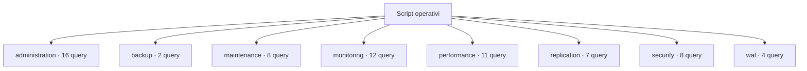

# Script operativi

[← Home](../README.md) · [Sicurezza e privilegi](../docs/SAFETY.md)

**68 query** · client `psql` · diagnosi in transazione read-only.

Leggere header, versione e privilegi prima dell’esecuzione. Le statistiche sono cumulative: un valore isolato non giustifica un’azione correttiva.

[administration](administration/README.md) · [backup](backup/README.md) · [maintenance](maintenance/README.md) · [monitoring](monitoring/README.md) · [performance](performance/README.md) · [replication](replication/README.md) · [security](security/README.md) · [wal](wal/README.md)



```console
python tools/pgdn.py run scripts/administration/configuration/connection-capacity.sql
```

Comando da eseguire dalla radice del checkout.

| Script | Scopo | PostgreSQL | Privilegi |
| :-- | :-- | :-- | :-- |
| [connection-capacity.sql](administration/configuration/connection-capacity.sql) | Compare configured connection limit with visible client backends; poolers and reserved slots affect capacity. | 14+ | pg_read_all_stats for full count |
| [non-default-settings.sql](administration/configuration/non-default-settings.sql) | Show only allowlisted diagnostic settings; connection strings, commands, paths and secrets are excluded. | 14+ | pg_read_all_settings for full view |
| [vacuum-settings.sql](administration/configuration/vacuum-settings.sql) | Show allowlisted vacuum-related settings; command strings, paths and secrets are excluded. | 14+ | pg_read_all_settings for full values |
| [wal-settings.sql](administration/configuration/wal-settings.sql) | Inspect safe WAL retention and archiving settings; command strings, paths and secrets are excluded. | 14+ | pg_read_all_settings for full view |
| [active.sql](administration/connections/active.sql) | Show active sessions, age, waits and bounded query prefix; query text may contain sensitive values. | 14+ | pg_read_all_stats; otherwise own sessions |
| [by-state.sql](administration/connections/by-state.sql) | Summarize visible sessions by database, role, state and wait class. | 14+ | pg_read_all_stats for complete details |
| [idle-in-transaction.sql](administration/connections/idle-in-transaction.sql) | Find idle-in-transaction sessions and transaction age. | 14+ | pg_read_all_stats; otherwise own sessions |
| [databases.sql](administration/inventory/databases.sql) | List non-template databases, owners, connection limits and allocated size. | 14+ | database CONNECT |
| [extensions.sql](administration/inventory/extensions.sql) | Show extensions installed in this database; no installation or update is performed. | 14+ | database CONNECT |
| [largest-relations.sql](administration/inventory/largest-relations.sql) | Rank user tables by total allocated bytes including indexes and TOAST. | 14+ | database CONNECT |
| [materialized-views.sql](administration/inventory/materialized-views.sql) | List materialized view ownership, tablespace and population state without exposing view definitions. | 14+ | database CONNECT |
| [partition-tree.sql](administration/inventory/partition-tree.sql) | List partition parents and children using catalog inheritance links, without scanning table data. | 14+ | CONNECT |
| [routines.sql](administration/inventory/routines.sql) | List function and procedure metadata without exposing routine source text or bodies. | 14+ | database CONNECT; routine metadata visibility depends on privileges |
| [schemas.sql](administration/inventory/schemas.sql) | List non-system schemas and owners. | 14+ | database CONNECT |
| [sequences.sql](administration/inventory/sequences.sql) | List sequence ownership and bounds without exposing current sequence values. | 14+ | database CONNECT; sequence metadata visibility depends on privileges |
| [server-info.sql](administration/inventory/server-info.sql) | Identify database, role, server version, startup and primary or standby state before diagnosis. | 14+ | CONNECT |
| [active-backup-senders.sql](backup/inspection/active-backup-senders.sql) | Show current walsender activity as clues for a physical backup; validate against backup tooling. | 14+ | pg_read_all_stats |
| [recovery-state.sql](backup/inspection/recovery-state.sql) | Report recovery state and system identifier/timeline; control data access may require elevated privileges. | 14+ | pg_monitor; control functions may need elevated rights |
| [relation-size-breakdown.sql](maintenance/bloat/relation-size-breakdown.sql) | Compare heap, indexes and total allocated size; these are not direct bloat estimates. | 14+ | database CONNECT |
| [toast-breakdown.sql](maintenance/bloat/toast-breakdown.sql) | Show heap, index and TOAST allocation for larger user tables. | 14+ | database CONNECT |
| [analyze.sql](maintenance/progress/analyze.sql) | Show active ANALYZE progress counters. | 14+ | pg_read_all_stats for full visibility |
| [create-index.sql](maintenance/progress/create-index.sql) | Show active index build progress; no cancellation or mutation is performed. | 14+ | pg_read_all_stats for full visibility |
| [vacuum.sql](maintenance/progress/vacuum.sql) | Show active vacuum phase and block counters common to PostgreSQL 14-18. | 14+ | pg_read_all_stats for full visibility |
| [dead-tuples.sql](maintenance/vacuum/dead-tuples.sql) | Rank user tables by estimated dead tuples and show last maintenance times. | 14+ | database CONNECT; statistics may be stale |
| [oldest-transactions.sql](maintenance/vacuum/oldest-transactions.sql) | Inspect backends with open transactions; long transactions can delay cleanup. | 14+ | pg_read_all_stats for complete details |
| [wraparound-risk.sql](maintenance/vacuum/wraparound-risk.sql) | Compare database XID and multixact ages with configured autovacuum thresholds; investigate trends before acting. | 14+ | CONNECT |
| [advisory-locks.sql](monitoring/activity/advisory-locks.sql) | List advisory lock ownership and wait state without exposing session query text. | 14+ | pg_read_all_stats for complete session details |
| [blocking-sessions.sql](monitoring/activity/blocking-sessions.sql) | Show one row per blocked session and blocking PID; a zero PID denotes a prepared transaction. | 14+ | pg_read_all_stats for complete activity |
| [long-running.sql](monitoring/activity/long-running.sql) | Find active queries older than one minute; query text may contain sensitive literals. | 14+ | pg_read_all_stats for complete details |
| [prepared-transactions.sql](monitoring/activity/prepared-transactions.sql) | List two-phase transactions; resolution belongs to the transaction coordinator. | 14+ | database CONNECT |
| [ssl-connections.sql](monitoring/activity/ssl-connections.sql) | Show TLS use and negotiated parameters without client or issuer distinguished names. | 14+ | pg_read_all_stats for complete visibility |
| [wait-summary.sql](monitoring/activity/wait-summary.sql) | Summarize sessions by backend type, state and wait event. | 14+ | pg_read_all_stats for complete details |
| [database-sizes.sql](monitoring/capacity/database-sizes.sql) | Rank connectable databases by allocated size. | 14+ | database CONNECT |
| [tablespace-inventory.sql](monitoring/capacity/tablespace-inventory.sql) | List tablespace names and configured paths; filesystem free space is not included. | 14+ | database CONNECT |
| [checkpointer.sql](monitoring/statistics/checkpointer.sql) | Show checkpoint and restartpoint counters on PostgreSQL 17+; cumulative counters need delta snapshots. | 17+ | pg_read_all_stats |
| [database-counters.sql](monitoring/statistics/database-counters.sql) | Show cumulative transaction, deadlock, temp and block counters; use snapshot deltas for rates. | 14+ | pg_read_all_stats |
| [reset-times.sql](monitoring/statistics/reset-times.sql) | Show database statistics reset timestamps to interpret cumulative counters. | 14+ | database CONNECT |
| [table-activity.sql](monitoring/statistics/table-activity.sql) | Show scans, estimated tuples and last maintenance timestamps. | 14+ | database CONNECT; estimates and visibility vary |
| [definitions.sql](performance/indexes/definitions.sql) | List index definitions for review. | 14+ | database CONNECT |
| [duplicate-candidates.sql](performance/indexes/duplicate-candidates.sql) | Find exact-signature index pairs for manual review, comparing keys, expressions, predicates, opclasses, collations and storage options; no index is removed. | 14+ | database CONNECT |
| [invalid-indexes.sql](performance/indexes/invalid-indexes.sql) | Identify indexes marked invalid or not ready for DBA investigation. | 14+ | database CONNECT |
| [unused-candidates.sql](performance/indexes/unused-candidates.sql) | Find valid large indexes with zero scans; review workload cycles before any decision and never auto-drop. | 14+ | database CONNECT |
| [usage-by-table.sql](performance/indexes/usage-by-table.sql) | Compare sequential and index scans and tuple fetches; counters can reset. | 14+ | database CONNECT |
| [buffercache-summary.sql](performance/io/buffercache-summary.sql) | Summarize shared-buffer usage only when pg_buffercache is already installed; extension schema is discovered and quoted safely. | 16+ | pg_monitor; function EXECUTE may be granted separately |
| [database-io-timing.sql](performance/io/database-io-timing.sql) | Show cumulative block timings; zero can mean track_io_timing was disabled. | 14+ | pg_read_all_stats |
| [pg-stat-io.sql](performance/io/pg-stat-io.sql) | Inspect cumulative I/O counters; correlate them with operating system metrics. | 16+ | pg_read_all_stats; PostgreSQL 16+ |
| [top-mean-time.sql](performance/queries/top-mean-time.sql) | Rank normalized statements by mean time; low call counts may skew results. | 14+ | pg_read_all_stats; extension already installed |
| [top-temp-blocks.sql](performance/queries/top-temp-blocks.sql) | Find statements with cumulative temporary block writes; compare snapshots for rates. | 14+ | pg_read_all_stats; extension already installed |
| [top-total-time.sql](performance/queries/top-total-time.sql) | Rank pg_stat_statements by cumulative execution time; extension must already be available. | 14+ | pg_read_all_stats; extension already installed |
| [subscriptions.sql](replication/logical/subscriptions.sql) | List subscriptions without connection strings or credentials. | 14+ | database owner or pg_read_all_stats |
| [workers.sql](replication/logical/workers.sql) | Show logical replication worker state and bounded query prefixes. | 14+ | pg_read_all_stats |
| [primary-senders.sql](replication/physical/primary-senders.sql) | On primary show sender state and byte lag; time lag is approximate and may be NULL. | 14+ | pg_read_all_stats for full visibility |
| [standby-receiver.sql](replication/physical/standby-receiver.sql) | On standby inspect receiver state; connection string is omitted to avoid credentials. | 14+ | database CONNECT |
| [standby-replay.sql](replication/physical/standby-replay.sql) | Estimate received-but-not-replayed bytes and time since last replay; time can mislead when idle. | 14+ | database CONNECT |
| [logical-stats.sql](replication/slots/logical-stats.sql) | Inspect cumulative logical decoding slot statistics. | 14+ | database CONNECT |
| [retention.sql](replication/slots/retention.sql) | Show WAL retained by slots; inactive slots may retain large volumes. | 14+ | database CONNECT |
| [database-acl.sql](security/privileges/database-acl.sql) | Expand database ACL entries; null ACLs use built-in defaults. | 14+ | database CONNECT |
| [hba-rule-health.sql](security/privileges/hba-rule-health.sql) | Show parse health for pg_hba.conf rules without exposing databases, users, addresses or authentication options. | 14+ | superuser by default; an administrator can grant SELECT on the view |
| [relation-acl.sql](security/privileges/relation-acl.sql) | Inspect explicit ACL entries for user relations. | 14+ | database CONNECT |
| [rls-policies.sql](security/privileges/rls-policies.sql) | List user tables' RLS flags and policy names, modes, commands and roles; policy expressions are excluded. | 14+ | database CONNECT; metadata visibility depends on ownership/privileges |
| [schema-acl.sql](security/privileges/schema-acl.sql) | List schema ACLs; role membership and ownership affect effective privileges. | 14+ | database CONNECT |
| [expiring-logins.sql](security/roles/expiring-logins.sql) | Identify login roles expired or expiring in 30 days. | 14+ | database CONNECT |
| [membership.sql](security/roles/membership.sql) | Show granted membership and delegation options. | 16+ | database CONNECT |
| [role-inventory.sql](security/roles/role-inventory.sql) | List role attributes and validity without password hashes. | 14+ | database CONNECT |
| [archive-status.sql](wal/archive/archive-status.sql) | Inspect cumulative archive success and failure counters; archive ordering can have exceptions. | 14+ | database CONNECT |
| [ready-files.sql](wal/archive/ready-files.sql) | Count .ready/.done marker files in pg_wal/archive_status; marker sizes are not WAL sizes. | 14+ | pg_monitor or EXECUTE on pg_ls_archive_statusdir |
| [retention-context.sql](wal/retention/retention-context.sql) | Summarize slots, senders and retention settings that may influence pg_wal growth. | 14+ | database CONNECT; settings visibility may require pg_read_all_settings |
| [wal-counters.sql](wal/retention/wal-counters.sql) | Show cumulative WAL byte and record counters; compare snapshots for rates. | 14+ | pg_read_all_stats |

> Indice generato da `python tools/catalog.py`; modificare gli header SQL per aggiornare le descrizioni.
