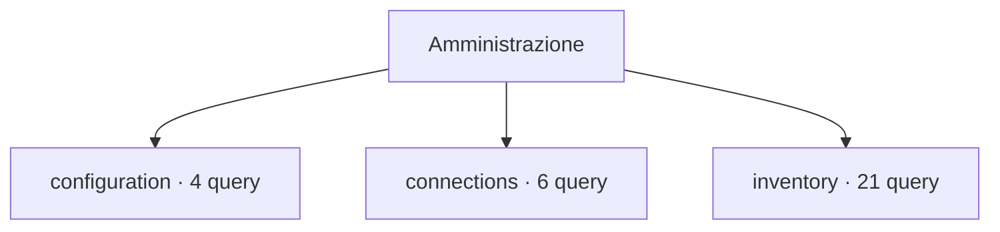

# Amministrazione

[← Home](../../README.md) · [Sicurezza e privilegi](../../_support/docs/SAFETY.md)

**31 query** · client `psql` · diagnosi in transazione read-only.

Leggere header, versione e privilegi prima dell’esecuzione. I contatori di attività sono cumulativi: un valore isolato non giustifica un’azione correttiva.

[configuration](configuration/README.md) · [connections](connections/README.md) · [inventory](inventory/README.md)

## 🗂️ Mappa della libreria

```text
administration/
|
+-- configuration/                                   ← 4 script · Parametri effettivi, capacità e impostazioni operative
|   +-- connection-capacity.sql                      ← Connection capacity
|   +-- non-default-settings.sql                     ← Non-default settings
|   +-- vacuum-settings.sql                          ← Vacuum and autovacuum settings
|   +-- wal-settings.sql                             ← WAL and checkpoint settings
+-- connections/                                     ← 6 script · Sessioni, transazioni e occupazione connessioni
|   +-- active.sql                                   ← Active sessions
|   +-- backend-detail.sql                           ← Backend session detail
|   +-- by-state.sql                                 ← Connections by state
|   +-- idle-in-transaction.sql                      ← Idle transactions
|   +-- oldest-backend-transactions.sql              ← Oldest active backend transactions
|   +-- xid-holding-backends.sql                     ← Sessions holding old transaction horizons
+-- inventory/                                       ← 21 script · Oggetti, vincoli, tipi, partizioni e dipendenze
    +-- collation-versions.sql                       ← Collation provider and recorded versions
    +-- columns.sql                                  ← Column definitions inventory
    +-- constraints.sql                              ← Constraint inventory
    +-- databases.sql                                ← Database inventory
    +-- extensions-dependencies.sql                  ← Extension-owned object dependencies
    +-- extensions.sql                               ← Installed extensions
    +-- fdw-metadata.sql                             ← Foreign data wrapper metadata
    +-- largest-relations.sql                        ← Largest relations
    +-- materialized-views.sql                       ← Materialized view inventory
    +-- object-dependencies.sql                      ← Direct object dependencies
    +-- ownership.sql                                ← Application object ownership
    +-- partition-tree.sql                           ← Partition hierarchy
    +-- relations-detailed.sql                       ← Relation inventory with storage and state
    +-- routines.sql                                 ← Routine inventory
    +-- schemas.sql                                  ← Schema inventory
    +-- sequences.sql                                ← Sequence inventory
    +-- server-info.sql                              ← Server identity
    +-- triggers.sql                                 ← Trigger inventory
    +-- types-enums-domains.sql                      ← Enum and domain type inventory
    +-- unvalidated-constraints.sql                  ← Unvalidated constraints
    +-- views-and-definitions.sql                    ← View inventory with options
```



```console
psql -X -v ON_ERROR_STOP=1 -f scripts/administration/configuration/connection-capacity.sql
```

Comando da eseguire dalla radice del checkout.

| Script | Scopo | PostgreSQL | Privilegi | Procedura |
| :-- | :-- | :-- | :-- | :-- |
| [connection-capacity.sql](configuration/connection-capacity.sql) | Compare configured connection limit with visible client backends; poolers and reserved slots affect capacity. | 14–18 (verificato) | pg_read_all_stats for full count | [Apri](../../procedures/monitoring.md) |
| [non-default-settings.sql](configuration/non-default-settings.sql) | Show only allowlisted diagnostic settings; connection strings, commands, paths and secrets are excluded. | 14–18 (verificato) | pg_read_all_settings for full view | [Apri](../../procedures/monitoring.md) |
| [vacuum-settings.sql](configuration/vacuum-settings.sql) | Show allowlisted vacuum-related settings; command strings, paths and secrets are excluded. | 14–18 (verificato) | pg_read_all_settings for full values | [Apri](../../procedures/vacuum-bloat.md) |
| [wal-settings.sql](configuration/wal-settings.sql) | Inspect safe WAL retention and archiving settings; command strings, paths and secrets are excluded. | 14–18 (verificato) | pg_read_all_settings for full view | [Apri](../../procedures/wal-growth.md) |
| [active.sql](connections/active.sql) | Show active sessions, age, waits and bounded query prefix; query text may contain sensitive values. | 14–18 (verificato) | pg_read_all_stats; otherwise own sessions | [Apri](../../procedures/triage.md) |
| [backend-detail.sql](connections/backend-detail.sql) | Summarize visible backends by database, user, application, client and state. | 14–18 (verificato) | pg_read_all_stats for complete session metadata visibility | [Apri](../../procedures/triage.md) |
| [by-state.sql](connections/by-state.sql) | Summarize visible sessions by database, role, state and wait class. | 14–18 (verificato) | pg_read_all_stats for complete details | [Apri](../../procedures/triage.md) |
| [idle-in-transaction.sql](connections/idle-in-transaction.sql) | Find idle-in-transaction sessions and transaction age. | 14–18 (verificato) | pg_read_all_stats; otherwise own sessions | [Apri](../../procedures/locks.md) |
| [oldest-backend-transactions.sql](connections/oldest-backend-transactions.sql) | Rank visible sessions by transaction age and identify idle-in-transaction blockers. | 14–18 (verificato) | pg_read_all_stats for complete session visibility | [Apri](../../procedures/locks.md) |
| [xid-holding-backends.sql](connections/xid-holding-backends.sql) | Rank sessions by backend xmin, the reported visibility horizon relevant to vacuum cleanup. | 14–18 (verificato) | pg_read_all_stats for complete session visibility | [Apri](../../procedures/vacuum-bloat.md) |
| [collation-versions.sql](inventory/collation-versions.sql) | Compare recorded and currently available collation versions to identify refresh review candidates. | 14–18 (verificato) | database CONNECT; visible collation metadata | [Apri](../../procedures/triage.md) |
| [columns.sql](inventory/columns.sql) | List visible user relation columns, types, nullability, defaults and identity/generated markers. | 14–18 (verificato) | database CONNECT; metadata visibility follows object visibility | [Apri](../../procedures/triage.md) |
| [constraints.sql](inventory/constraints.sql) | Show constraint type, validation/deferral state and definition for application relations. | 14–18 (verificato) | database CONNECT; metadata visibility follows object visibility | [Apri](../../procedures/triage.md) |
| [databases.sql](inventory/databases.sql) | List non-template databases, owners, connection limits and allocated size. | 14–18 (verificato) | database CONNECT | [Apri](../../procedures/monitoring.md) |
| [extensions-dependencies.sql](inventory/extensions-dependencies.sql) | Show objects that PostgreSQL marks as extension members and their owning extension. | 14–18 (verificato) | database CONNECT; visible object metadata | [Apri](../../procedures/triage.md) |
| [extensions.sql](inventory/extensions.sql) | Show extensions installed in this database; no installation or update is performed. | 14–18 (verificato) | database CONNECT | [Apri](../../procedures/monitoring.md) |
| [fdw-metadata.sql](inventory/fdw-metadata.sql) | Inventory FDWs, servers, foreign tables and mapping identities without exposing option values. | 14–18 (verificato) | database CONNECT; metadata visibility follows object visibility | [Apri](../../procedures/triage.md) |
| [largest-relations.sql](inventory/largest-relations.sql) | Rank user tables by total allocated bytes including indexes and TOAST. | 14–18 (verificato) | database CONNECT | [Apri](../../procedures/monitoring.md) |
| [materialized-views.sql](inventory/materialized-views.sql) | List materialized view ownership, tablespace and population state without exposing view definitions. | 14–18 (verificato) | database CONNECT | [Apri](../../procedures/monitoring.md) |
| [object-dependencies.sql](inventory/object-dependencies.sql) | Show direct catalog dependency links among user relations, views, routines and types. | 14–18 (verificato) | database CONNECT; visible object metadata | [Apri](../../procedures/triage.md) |
| [ownership.sql](inventory/ownership.sql) | Inventory relation owners to find objects owned by unexpected or retired roles. | 14–18 (verificato) | database CONNECT; metadata visibility follows object visibility | [Apri](../../procedures/security.md) |
| [partition-tree.sql](inventory/partition-tree.sql) | List partition parents and children using catalog inheritance links, without scanning table data. | 14–18 (verificato) | CONNECT | [Apri](../../procedures/triage.md) |
| [relations-detailed.sql](inventory/relations-detailed.sql) | Catalog inventory of user relations, kinds, persistence, size and maintenance flags. | 14–18 (verificato) | database CONNECT; pg_read_all_stats for complete statistics visibility | [Apri](../../procedures/triage.md) |
| [routines.sql](inventory/routines.sql) | List function and procedure metadata without exposing routine source text or bodies. | 14–18 (verificato) | database CONNECT; routine metadata visibility depends on privileges | [Apri](../../procedures/monitoring.md) |
| [schemas.sql](inventory/schemas.sql) | List non-system schemas and owners. | 14–18 (verificato) | database CONNECT | [Apri](../../procedures/monitoring.md) |
| [sequences.sql](inventory/sequences.sql) | List sequence ownership and bounds without exposing current sequence values. | 14–18 (verificato) | database CONNECT; sequence metadata visibility depends on privileges | [Apri](../../procedures/monitoring.md) |
| [server-info.sql](inventory/server-info.sql) | Identify database, role, server version, startup and primary or standby state before diagnosis. | 14–18 (verificato) | CONNECT | [Apri](../../procedures/triage.md) |
| [triggers.sql](inventory/triggers.sql) | List enabled state, firing events and target routine for user-table triggers. | 14–18 (verificato) | database CONNECT; metadata visibility follows object visibility | [Apri](../../procedures/triage.md) |
| [types-enums-domains.sql](inventory/types-enums-domains.sql) | Inspect enum labels and domain base type, nullability and check constraints. | 14–18 (verificato) | database CONNECT; visible type metadata | [Apri](../../procedures/triage.md) |
| [unvalidated-constraints.sql](inventory/unvalidated-constraints.sql) | Focus on constraints whose existing rows have not been fully checked by PostgreSQL. | 14–18 (verificato) | database CONNECT; metadata visibility follows object visibility | [Apri](../../procedures/triage.md) |
| [views-and-definitions.sql](inventory/views-and-definitions.sql) | List user views, security-barrier/check options, owner and normalized SQL definition. | 14–18 (verificato) | database CONNECT; metadata visibility follows object visibility | [Apri](../../procedures/triage.md) |

> Indice generato da `python _support/tools/catalog.py`; modificare gli header SQL per aggiornare le descrizioni.
