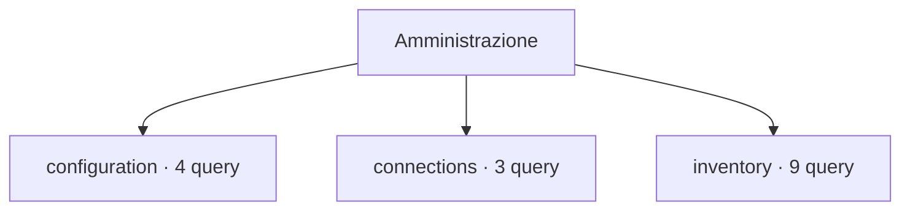

# Amministrazione

[← Home](../../README.md) · [Sicurezza e privilegi](../../docs/SAFETY.md)

**16 query** · client `psql` · diagnosi in transazione read-only.

Leggere header, versione e privilegi prima dell’esecuzione. Le statistiche sono cumulative: un valore isolato non giustifica un’azione correttiva.

[configuration](configuration/README.md) · [connections](connections/README.md) · [inventory](inventory/README.md)



```console
python tools/pgdn.py run scripts/administration/configuration/connection-capacity.sql
```

Comando da eseguire dalla radice del checkout.

| Script | Scopo | PostgreSQL | Privilegi |
| :-- | :-- | :-- | :-- |
| [connection-capacity.sql](configuration/connection-capacity.sql) | Compare configured connection limit with visible client backends; poolers and reserved slots affect capacity. | 14+ | pg_read_all_stats for full count |
| [non-default-settings.sql](configuration/non-default-settings.sql) | Show only allowlisted diagnostic settings; connection strings, commands, paths and secrets are excluded. | 14+ | pg_read_all_settings for full view |
| [vacuum-settings.sql](configuration/vacuum-settings.sql) | Show allowlisted vacuum-related settings; command strings, paths and secrets are excluded. | 14+ | pg_read_all_settings for full values |
| [wal-settings.sql](configuration/wal-settings.sql) | Inspect safe WAL retention and archiving settings; command strings, paths and secrets are excluded. | 14+ | pg_read_all_settings for full view |
| [active.sql](connections/active.sql) | Show active sessions, age, waits and bounded query prefix; query text may contain sensitive values. | 14+ | pg_read_all_stats; otherwise own sessions |
| [by-state.sql](connections/by-state.sql) | Summarize visible sessions by database, role, state and wait class. | 14+ | pg_read_all_stats for complete details |
| [idle-in-transaction.sql](connections/idle-in-transaction.sql) | Find idle-in-transaction sessions and transaction age. | 14+ | pg_read_all_stats; otherwise own sessions |
| [databases.sql](inventory/databases.sql) | List non-template databases, owners, connection limits and allocated size. | 14+ | database CONNECT |
| [extensions.sql](inventory/extensions.sql) | Show extensions installed in this database; no installation or update is performed. | 14+ | database CONNECT |
| [largest-relations.sql](inventory/largest-relations.sql) | Rank user tables by total allocated bytes including indexes and TOAST. | 14+ | database CONNECT |
| [materialized-views.sql](inventory/materialized-views.sql) | List materialized view ownership, tablespace and population state without exposing view definitions. | 14+ | database CONNECT |
| [partition-tree.sql](inventory/partition-tree.sql) | List partition parents and children using catalog inheritance links, without scanning table data. | 14+ | CONNECT |
| [routines.sql](inventory/routines.sql) | List function and procedure metadata without exposing routine source text or bodies. | 14+ | database CONNECT; routine metadata visibility depends on privileges |
| [schemas.sql](inventory/schemas.sql) | List non-system schemas and owners. | 14+ | database CONNECT |
| [sequences.sql](inventory/sequences.sql) | List sequence ownership and bounds without exposing current sequence values. | 14+ | database CONNECT; sequence metadata visibility depends on privileges |
| [server-info.sql](inventory/server-info.sql) | Identify database, role, server version, startup and primary or standby state before diagnosis. | 14+ | CONNECT |

> Indice generato da `python tools/catalog.py`; modificare gli header SQL per aggiornare le descrizioni.
