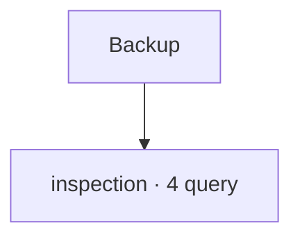

# Backup

[← Home](../../README.md) · [Sicurezza e privilegi](../../_support/docs/SAFETY.md)

**4 query** · client `psql` · diagnosi in transazione read-only.

Leggere header, versione e privilegi prima dell’esecuzione. I contatori di attività sono cumulativi: un valore isolato non giustifica un’azione correttiva.

[inspection](inspection/README.md)

## 🗂️ Mappa della libreria

```text
backup/
|
+-- inspection/                                      ← 4 script · Identità cluster, recovery e attività di base backup
    +-- active-backup-senders.sql                    ← Active backup senders
    +-- backup-api-activity.sql                      ← Backup API activity
    +-- basebackup-progress.sql                      ← Base backup progress
    +-- recovery-state.sql                           ← Recovery state
```



```console
psql -X -v ON_ERROR_STOP=1 -f scripts/backup/inspection/active-backup-senders.sql
```

Comando da eseguire dalla radice del checkout.

| Script | Scopo | PostgreSQL | Privilegi | Procedura |
| :-- | :-- | :-- | :-- | :-- |
| [active-backup-senders.sql](inspection/active-backup-senders.sql) | Show current walsender activity as clues for a physical backup; validate against backup tooling. | 14–18 (verificato) | pg_read_all_stats | [Apri](../../procedures/backup-restore.md) |
| [backup-api-activity.sql](inspection/backup-api-activity.sql) | List active legacy and current backup API calls as supporting evidence. | 14–18 (verificato) | pg_read_all_stats | [Apri](../../procedures/backup-restore.md) |
| [basebackup-progress.sql](inspection/basebackup-progress.sql) | Show base backup phase, streamed bytes and tablespace counters. | 14–18 (verificato) | pg_read_all_stats | [Apri](../../procedures/backup-restore.md) |
| [recovery-state.sql](inspection/recovery-state.sql) | Report recovery state and system identifier/timeline; control data access may require elevated privileges. | 14–18 (verificato) | pg_monitor; control functions may need elevated rights | [Apri](../../procedures/backup-restore.md) |

> Indice generato da `python _support/tools/catalog.py`; modificare gli header SQL per aggiornare le descrizioni.
