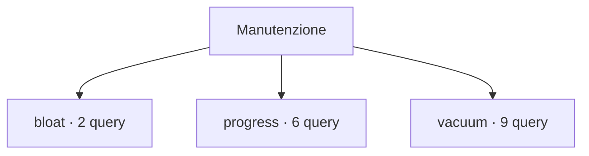

# Manutenzione

[← Home](../../README.md) · [Come eseguire gli script](../../_support/docs/QUICKSTART.md) · [Sicurezza e privilegi](../../_support/docs/SAFETY.md)

**17 query** · client `psql` · diagnosi in transazione read-only.

Leggere header, versione e privilegi prima dell’esecuzione. I contatori di attività sono cumulativi: un valore isolato non giustifica un’azione correttiva.

[bloat](bloat/README.md) · [progress](progress/README.md) · [vacuum](vacuum/README.md)

<details>
<summary>🗂️ Mappa della libreria · apri / chiudi</summary>

```text
maintenance/
|
+-- bloat/                                           ← 2 script · Dimensioni heap, indici e TOAST; indicatori da verificare
|   +-- relation-size-breakdown.sql                  ← Relation size breakdown
|   +-- toast-breakdown.sql                          ← TOAST storage breakdown
+-- progress/                                        ← 6 script · Progresso VACUUM, ANALYZE, COPY, CLUSTER e indici
|   +-- analyze.sql                                  ← Analyze progress
|   +-- cluster-rewrite.sql                          ← CLUSTER and rewrite progress
|   +-- copy.sql                                     ← COPY progress
|   +-- create-index.sql                             ← Index build progress
|   +-- index-build.sql                              ← Index build progress detail
|   +-- vacuum.sql                                   ← Vacuum progress
+-- vacuum/                                          ← 9 script · Tuple morte, transazioni lunghe, XID e autovacuum
    +-- dead-tuples.sql                              ← Dead tuple estimates
    +-- hot-update-ratio.sql                         ← HOT update ratio
    +-- oldest-transactions.sql                      ← Old transactions
    +-- per-table-autovacuum-overrides.sql           ← Per-table autovacuum overrides
    +-- table-freeze-age.sql                         ← Table freeze age
    +-- table-multixact-age.sql                      ← Table multixact age
    +-- toast-storage-share.sql                      ← TOAST storage candidates
    +-- vacuum-history.sql                           ← Per-table vacuum history
    +-- wraparound-risk.sql                          ← Transaction and multixact age
```



</details>

## Scegli uno script

Trova il controllo nella tabella, apri il file e leggi scopo, versione e privilegi. La colonna **Procedura** spiega come interpretare il risultato e scegliere il passo successivo.

| Script | Scopo | PostgreSQL | Privilegi | Procedura |
| :-- | :-- | :-- | :-- | :-- |
| [relation-size-breakdown.sql](bloat/relation-size-breakdown.sql) | Compare heap, indexes and total allocated size; these are not direct bloat estimates. | 14–18 (verificato) | database CONNECT | [Apri](../../procedures/vacuum-bloat.md) |
| [toast-breakdown.sql](bloat/toast-breakdown.sql) | Show heap, index and TOAST allocation for larger user tables. | 14–18 (verificato) | database CONNECT | [Apri](../../procedures/vacuum-bloat.md) |
| [analyze.sql](progress/analyze.sql) | Show active ANALYZE progress counters. | 14–18 (verificato) | pg_read_all_stats for full visibility | [Apri](../../procedures/vacuum-bloat.md) |
| [cluster-rewrite.sql](progress/cluster-rewrite.sql) | Show progress for CLUSTER and VACUUM FULL rewrites. | 14–18 (verificato) | pg_read_all_stats | [Apri](../../procedures/triage.md) |
| [copy.sql](progress/copy.sql) | Show COPY phase counters and completion estimate when total bytes are known. | 14–18 (verificato) | pg_read_all_stats | [Apri](../../procedures/triage.md) |
| [create-index.sql](progress/create-index.sql) | Show active index build progress; no cancellation or mutation is performed. | 14–18 (verificato) | pg_read_all_stats for full visibility | [Apri](../../procedures/slow-queries.md) |
| [index-build.sql](progress/index-build.sql) | Show phase, locker, block and tuple counters for index builds. | 14–18 (verificato) | pg_read_all_stats | [Apri](../../procedures/triage.md) |
| [vacuum.sql](progress/vacuum.sql) | Show active vacuum phase and block counters common to PostgreSQL 14-18. | 14–18 (verificato) | pg_read_all_stats for full visibility | [Apri](../../procedures/vacuum-bloat.md) |
| [dead-tuples.sql](vacuum/dead-tuples.sql) | Rank user tables by estimated dead tuples and show last maintenance times. | 14–18 (verificato) | database CONNECT; statistics may be stale | [Apri](../../procedures/vacuum-bloat.md) |
| [hot-update-ratio.sql](vacuum/hot-update-ratio.sql) | Report HOT updates against total updates with table size context. | 14–18 (verificato) | pg_monitor for complete statistics visibility | [Apri](../../procedures/vacuum-bloat.md) |
| [oldest-transactions.sql](vacuum/oldest-transactions.sql) | Inspect backends with open transactions; long transactions can delay cleanup. | 14–18 (verificato) | pg_read_all_stats for complete details | [Apri](../../procedures/vacuum-bloat.md) |
| [per-table-autovacuum-overrides.sql](vacuum/per-table-autovacuum-overrides.sql) | List relation-level storage options that override global maintenance settings. | 14–18 (verificato) | CONNECT | [Apri](../../procedures/vacuum-bloat.md) |
| [table-freeze-age.sql](vacuum/table-freeze-age.sql) | Rank relations by frozen XID age and configured autovacuum horizon. | 14–18 (verificato) | pg_monitor for complete relation visibility | [Apri](../../procedures/vacuum-bloat.md) |
| [table-multixact-age.sql](vacuum/table-multixact-age.sql) | Rank relations by multixact horizon age with configured limit context. | 14–18 (verificato) | pg_monitor for complete relation visibility | [Apri](../../procedures/vacuum-bloat.md) |
| [toast-storage-share.sql](vacuum/toast-storage-share.sql) | Rank tables by TOAST relation storage and display update estimates. | 14–18 (verificato) | pg_monitor for complete relation visibility | [Apri](../../procedures/vacuum-bloat.md) |
| [vacuum-history.sql](vacuum/vacuum-history.sql) | Compare vacuum counts, latest timestamps and dead tuple estimates by table. | 14–18 (verificato) | pg_monitor for complete statistics visibility | [Apri](../../procedures/vacuum-bloat.md) |
| [wraparound-risk.sql](vacuum/wraparound-risk.sql) | Compare database XID and multixact ages with configured autovacuum thresholds; investigate trends before acting. | 14–18 (verificato) | CONNECT | [Apri](../../procedures/vacuum-bloat.md) |

> Indice generato da `python _support/tools/catalog.py`; modificare gli header SQL per aggiornare le descrizioni.
