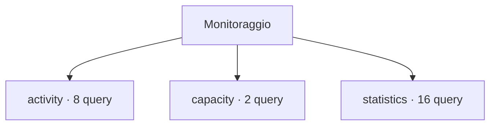

# Monitoraggio

[← Home](../../README.md) · [Come eseguire gli script](../../_support/docs/QUICKSTART.md) · [Sicurezza e privilegi](../../_support/docs/SAFETY.md)

**26 query** · client `psql` · diagnosi in transazione read-only.

Leggere header, versione e privilegi prima dell’esecuzione. I contatori di attività sono cumulativi: un valore isolato non giustifica un’azione correttiva.

[activity](activity/README.md) · [capacity](capacity/README.md) · [statistics](statistics/README.md)

<details>
<summary>🗂️ Mappa della libreria · apri / chiudi</summary>

```text
monitoring/
|
+-- activity/                                        ← 8 script · Attese, blocchi, transazioni e connessioni SSL
|   +-- advisory-locks.sql                           ← Advisory lock summary
|   +-- blocking-impact.sql                          ← Blocking impact by backend
|   +-- blocking-sessions.sql                        ← Blocking sessions
|   +-- long-running.sql                             ← Long-running queries
|   +-- prepared-transactions.sql                    ← Prepared transactions
|   +-- ssl-connections.sql                          ← SSL connection summary
|   +-- wait-summary.sql                             ← Wait event summary
|   +-- waiting-locks-by-relation.sql                ← Waiting locks by relation
+-- capacity/                                        ← 2 script · Dimensioni, crescita e spazio allocato
|   +-- database-sizes.sql                           ← Database sizes
|   +-- tablespace-inventory.sql                     ← Tablespace inventory
+-- statistics/                                      ← 16 script · Contatori database, cache, SLRU e checkpoint
    +-- checkpointer-activity.sql                    ← Checkpointer activity counters
    +-- checkpointer.sql                             ← Checkpointer counters
    +-- database-age.sql                             ← Database transaction ID age
    +-- database-cache-hit.sql                       ← Database shared-buffer hit ratio
    +-- database-counters.sql                        ← Database counters
    +-- database-transaction-ratio.sql               ← Database commit and rollback ratio
    +-- database-work-counters.sql                   ← Database workload counters
    +-- deadlocks-and-conflicts.sql                  ← Deadlocks and standby conflicts
    +-- io-by-backend.sql                            ← I/O statistics by backend
    +-- relation-block-io.sql                        ← Relation block I/O counters
    +-- reset-times.sql                              ← Statistics reset times
    +-- slru-counters.sql                            ← SLRU activity counters
    +-- table-activity.sql                           ← Table activity
    +-- table-hot-updates.sql                        ← Table HOT update ratios
    +-- table-statistics-coverage.sql                ← Table statistics coverage
    +-- temporary-files.sql                          ← Temporary file counters by database
```



</details>

## Scegli uno script

Trova il controllo nella tabella, apri il file e leggi scopo, versione e privilegi. La colonna **Procedura** spiega come interpretare il risultato e scegliere il passo successivo.

| Script | Scopo | PostgreSQL | Privilegi | Procedura |
| :-- | :-- | :-- | :-- | :-- |
| [advisory-locks.sql](activity/advisory-locks.sql) | List advisory lock ownership and wait state without exposing session query text. | 14–18 (verificato) | pg_read_all_stats for complete session details | [Apri](../../procedures/locks.md) |
| [blocking-impact.sql](activity/blocking-impact.sql) | Rank immediate blockers by number of waiting sessions in the current database. | 14–18 (verificato) | pg_read_all_stats for complete session metadata | [Apri](../../procedures/locks.md) |
| [blocking-sessions.sql](activity/blocking-sessions.sql) | Show one row per blocked session and blocking PID; a zero PID denotes a prepared transaction. | 14–18 (verificato) | pg_read_all_stats for complete activity | [Apri](../../procedures/locks.md) |
| [long-running.sql](activity/long-running.sql) | Find active queries older than one minute; query text may contain sensitive literals. | 14–18 (verificato) | pg_read_all_stats for complete details | [Apri](../../procedures/slow-queries.md) |
| [prepared-transactions.sql](activity/prepared-transactions.sql) | List two-phase transactions; resolution belongs to the transaction coordinator. | 14–18 (verificato) | database CONNECT | [Apri](../../procedures/locks.md) |
| [ssl-connections.sql](activity/ssl-connections.sql) | Show TLS use and negotiated parameters without client or issuer distinguished names. | 14–18 (verificato) | pg_read_all_stats for complete visibility | [Apri](../../procedures/security.md) |
| [wait-summary.sql](activity/wait-summary.sql) | Summarize sessions by backend type, state and wait event. | 14–18 (verificato) | pg_read_all_stats for complete details | [Apri](../../procedures/triage.md) |
| [waiting-locks-by-relation.sql](activity/waiting-locks-by-relation.sql) | Count waiting sessions and lock requests per relation and lock type in the current database. | 14–18 (verificato) | pg_read_all_stats for complete session metadata | [Apri](../../procedures/locks.md) |
| [database-sizes.sql](capacity/database-sizes.sql) | Rank connectable databases by allocated size. | 14–18 (verificato) | database CONNECT | [Apri](../../procedures/monitoring.md) |
| [tablespace-inventory.sql](capacity/tablespace-inventory.sql) | List tablespace names and configured paths; filesystem free space is not included. | 14–18 (verificato) | database CONNECT | [Apri](../../procedures/monitoring.md) |
| [checkpointer-activity.sql](statistics/checkpointer-activity.sql) | Inspect PostgreSQL 17+ checkpointer counters including timed/requested checkpoints and write time. | 17–18 (verificato; pg_stat_checkpointer separata da pg_stat_bgwriter in PostgreSQL 17) | pg_monitor for complete cluster statistics visibility | [Apri](../../procedures/monitoring.md) |
| [checkpointer.sql](statistics/checkpointer.sql) | Show checkpoint and restartpoint counters on PostgreSQL 17+; cumulative counters need delta snapshots. | 17–18 (verificato) | pg_read_all_stats | [Apri](../../procedures/monitoring.md) |
| [database-age.sql](statistics/database-age.sql) | Rank databases by frozen transaction ID age and report the configured wraparound threshold. | 14–18 (verificato) | database CONNECT; pg_monitor recommended for cluster-wide statistics | [Apri](../../procedures/vacuum-bloat.md) |
| [database-cache-hit.sql](statistics/database-cache-hit.sql) | Calculate cumulative shared-buffer hit ratios by database since statistics reset. | 14–18 (verificato) | pg_monitor for all databases; otherwise visible statistics only | [Apri](../../procedures/monitoring.md) |
| [database-counters.sql](statistics/database-counters.sql) | Show cumulative transaction, deadlock, temp and block counters; use snapshot deltas for rates. | 14–18 (verificato) | pg_read_all_stats | [Apri](../../procedures/monitoring.md) |
| [database-transaction-ratio.sql](statistics/database-transaction-ratio.sql) | Calculate cumulative committed versus rolled-back transaction counts per database. | 14–18 (verificato) | pg_monitor for complete statistics visibility | [Apri](../../procedures/monitoring.md) |
| [database-work-counters.sql](statistics/database-work-counters.sql) | Compare transaction, tuple, temporary-file, conflict and deadlock counters by database. | 14–18 (verificato) | pg_monitor for complete visibility; otherwise visible databases only | [Apri](../../procedures/monitoring.md) |
| [deadlocks-and-conflicts.sql](statistics/deadlocks-and-conflicts.sql) | Review cumulative deadlock and recovery-conflict counters by database. | 14–18 (verificato) | pg_monitor for complete statistics visibility | [Apri](../../procedures/locks.md) |
| [io-by-backend.sql](statistics/io-by-backend.sql) | Summarize common PostgreSQL 16+ pg_stat_io counters by backend, object and I/O context. | 16–18 (verificato; pg_stat_io introdotta in PostgreSQL 16) | pg_monitor for complete cluster statistics visibility | [Apri](../../procedures/monitoring.md) |
| [relation-block-io.sql](statistics/relation-block-io.sql) | Compare cumulative heap, index and toast block read/hit counters for user tables. | 14–18 (verificato) | pg_monitor for complete statistics visibility; database CONNECT | [Apri](../../procedures/monitoring.md) |
| [reset-times.sql](statistics/reset-times.sql) | Show database statistics reset timestamps to interpret cumulative counters. | 14–18 (verificato) | database CONNECT | [Apri](../../procedures/monitoring.md) |
| [slru-counters.sql](statistics/slru-counters.sql) | Inspect SLRU hit, read, write and eviction counters with reset timestamp. | 14–18 (verificato) | pg_monitor for complete cluster statistics visibility | [Apri](../../procedures/monitoring.md) |
| [table-activity.sql](statistics/table-activity.sql) | Show scans, estimated tuples and last maintenance timestamps. | 14–18 (verificato) | database CONNECT; estimates and visibility vary | [Apri](../../procedures/monitoring.md) |
| [table-hot-updates.sql](statistics/table-hot-updates.sql) | Identify tables where updates often avoid creating new index entries through HOT updates. | 14–18 (verificato) | pg_monitor for complete statistics; database CONNECT | [Apri](../../procedures/monitoring.md) |
| [table-statistics-coverage.sql](statistics/table-statistics-coverage.sql) | Find user tables with no recorded analyze or vacuum and report dead/live estimates. | 14–18 (verificato) | pg_monitor for complete statistics visibility; database CONNECT | [Apri](../../procedures/monitoring.md) |
| [temporary-files.sql](statistics/temporary-files.sql) | Rank databases by cumulative temporary-file count and bytes written. | 14–18 (verificato) | pg_monitor for complete database statistics visibility | [Apri](../../procedures/monitoring.md) |

> Indice generato da `python _support/tools/catalog.py`; modificare gli header SQL per aggiornare le descrizioni.
