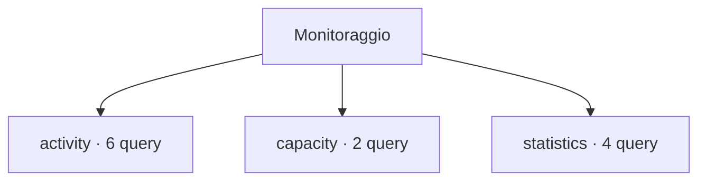

# Monitoraggio

[← Home](../../README.md) · [Sicurezza e privilegi](../../docs/SAFETY.md)

**12 query** · client `psql` · diagnosi in transazione read-only.

Leggere header, versione e privilegi prima dell’esecuzione. Le statistiche sono cumulative: un valore isolato non giustifica un’azione correttiva.

[activity](activity/README.md) · [capacity](capacity/README.md) · [statistics](statistics/README.md)



```console
python tools/pgdn.py run scripts/monitoring/activity/advisory-locks.sql
```

Comando da eseguire dalla radice del checkout.

| Script | Scopo | PostgreSQL | Privilegi |
| :-- | :-- | :-- | :-- |
| [advisory-locks.sql](activity/advisory-locks.sql) | List advisory lock ownership and wait state without exposing session query text. | 14+ | pg_read_all_stats for complete session details |
| [blocking-sessions.sql](activity/blocking-sessions.sql) | Show one row per blocked session and blocking PID; a zero PID denotes a prepared transaction. | 14+ | pg_read_all_stats for complete activity |
| [long-running.sql](activity/long-running.sql) | Find active queries older than one minute; query text may contain sensitive literals. | 14+ | pg_read_all_stats for complete details |
| [prepared-transactions.sql](activity/prepared-transactions.sql) | List two-phase transactions; resolution belongs to the transaction coordinator. | 14+ | database CONNECT |
| [ssl-connections.sql](activity/ssl-connections.sql) | Show TLS use and negotiated parameters without client or issuer distinguished names. | 14+ | pg_read_all_stats for complete visibility |
| [wait-summary.sql](activity/wait-summary.sql) | Summarize sessions by backend type, state and wait event. | 14+ | pg_read_all_stats for complete details |
| [database-sizes.sql](capacity/database-sizes.sql) | Rank connectable databases by allocated size. | 14+ | database CONNECT |
| [tablespace-inventory.sql](capacity/tablespace-inventory.sql) | List tablespace names and configured paths; filesystem free space is not included. | 14+ | database CONNECT |
| [checkpointer.sql](statistics/checkpointer.sql) | Show checkpoint and restartpoint counters on PostgreSQL 17+; cumulative counters need delta snapshots. | 17+ | pg_read_all_stats |
| [database-counters.sql](statistics/database-counters.sql) | Show cumulative transaction, deadlock, temp and block counters; use snapshot deltas for rates. | 14+ | pg_read_all_stats |
| [reset-times.sql](statistics/reset-times.sql) | Show database statistics reset timestamps to interpret cumulative counters. | 14+ | database CONNECT |
| [table-activity.sql](statistics/table-activity.sql) | Show scans, estimated tuples and last maintenance timestamps. | 14+ | database CONNECT; estimates and visibility vary |

> Indice generato da `python tools/catalog.py`; modificare gli header SQL per aggiornare le descrizioni.
