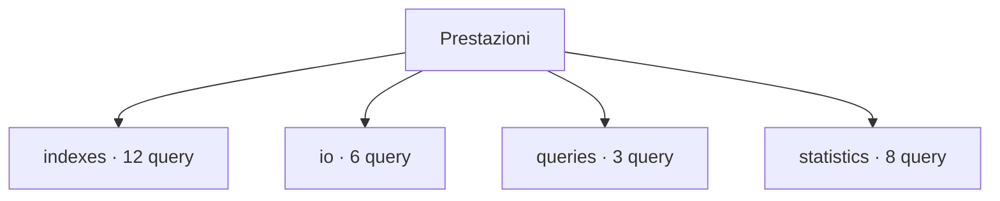

# Prestazioni

[← Home](../../README.md) · [Sicurezza e privilegi](../../_support/docs/SAFETY.md)

**29 query** · client `psql` · diagnosi in transazione read-only.

Leggere header, versione e privilegi prima dell’esecuzione. I contatori di attività sono cumulativi: un valore isolato non giustifica un’azione correttiva.

[indexes](indexes/README.md) · [io](io/README.md) · [queries](queries/README.md) · [statistics](statistics/README.md)

## 🗂️ Mappa della libreria

```text
performance/
|
+-- indexes/                                         ← 12 script · Indici, vincoli, FK, utilizzo e candidati da analizzare
|   +-- access-methods.sql                           ← Index access methods
|   +-- constraint-index-signatures.sql              ← Constraint index signatures
|   +-- definitions.sql                              ← Index definitions
|   +-- duplicate-candidates.sql                     ← Duplicate index candidates
|   +-- foreign-keys-without-index.sql               ← Foreign keys without leading index
|   +-- index-usage-context.sql                      ← Index usage counter context
|   +-- index-validity-state.sql                     ← Index validity state
|   +-- invalid-indexes.sql                          ← Invalid indexes
|   +-- key-included-columns.sql                     ← Index keys and included columns
|   +-- unused-candidates.sql                        ← Unused index candidates
|   +-- usage-by-table.sql                           ← Index usage by table
|   +-- write-pressure.sql                           ← Index write pressure context
+-- io/                                              ← 6 script · Letture, scritture, timing e buffer cache
|   +-- buffercache-summary.sql                      ← Buffer cache summary
|   +-- checkpoint-settings-context.sql              ← Checkpoint setting context
|   +-- database-io-timing.sql                       ← Database I/O timing
|   +-- database-temp-files.sql                      ← Database temporary file counters
|   +-- io-wait-snapshot.sql                         ← Current I/O wait snapshot
|   +-- pg-stat-io.sql                               ← I/O by backend and context
+-- queries/                                         ← 3 script · Top SQL, tempi e file temporanei
|   +-- top-mean-time.sql                            ← Statements by mean time
|   +-- top-temp-blocks.sql                          ← Statements by temporary blocks
|   +-- top-total-time.sql                           ← Statements by total time
+-- statistics/                                      ← 8 script · Distribuzione dati, partizioni, HOT e sequenze
    +-- analyze-freshness.sql                        ← Analyze freshness
    +-- column-skew-metadata.sql                     ← Column skew metadata
    +-- null-fractions.sql                           ← Column null fraction metadata
    +-- partition-hierarchy.sql                      ← Partition hierarchy
    +-- partition-index-attachments.sql              ← Partition index attachments
    +-- physical-correlation.sql                     ← Column physical correlation
    +-- sequence-context.sql                         ← Sequence inventory context
    +-- sequence-headroom.sql                        ← Sequence exhaustion headroom
```



```console
psql -X -v ON_ERROR_STOP=1 -f scripts/performance/indexes/access-methods.sql
```

Comando da eseguire dalla radice del checkout.

| Script | Scopo | PostgreSQL | Privilegi | Procedura |
| :-- | :-- | :-- | :-- | :-- |
| [access-methods.sql](indexes/access-methods.sql) | Inventory index access methods, capabilities and validity state. | 14–18 (verificato) | pg_monitor for complete relation visibility | [Apri](../../procedures/slow-queries.md) |
| [constraint-index-signatures.sql](indexes/constraint-index-signatures.sql) | Map unique and primary-key constraints to their supporting index definitions and size. | 14–18 (verificato) | CONNECT | [Apri](../../procedures/slow-queries.md) |
| [definitions.sql](indexes/definitions.sql) | List index definitions for review. | 14–18 (verificato) | database CONNECT | [Apri](../../procedures/slow-queries.md) |
| [duplicate-candidates.sql](indexes/duplicate-candidates.sql) | Find exact-signature index pairs for manual review, comparing keys, expressions, predicates, opclasses, collations and storage options; no index is removed. | 14–18 (verificato) | database CONNECT | [Apri](../../procedures/slow-queries.md) |
| [foreign-keys-without-index.sql](indexes/foreign-keys-without-index.sql) | Find foreign-key columns not covered by a valid, non-partial index whose leading key set covers the FK columns. | 14–18 (verificato) | pg_monitor for complete relation visibility | [Apri](../../procedures/slow-queries.md) |
| [index-usage-context.sql](indexes/index-usage-context.sql) | Compare cumulative index usage counters, size and reset timestamp. | 14–18 (verificato) | pg_monitor for complete statistics visibility | [Apri](../../procedures/slow-queries.md) |
| [index-validity-state.sql](indexes/index-validity-state.sql) | List indexes that are invalid, not ready or not live for manual recovery review. | 14–18 (verificato) | pg_monitor for complete relation visibility | [Apri](../../procedures/slow-queries.md) |
| [invalid-indexes.sql](indexes/invalid-indexes.sql) | Identify indexes marked invalid or not ready for DBA investigation. | 14–18 (verificato) | database CONNECT | [Apri](../../procedures/slow-queries.md) |
| [key-included-columns.sql](indexes/key-included-columns.sql) | Distinguish index search keys from INCLUDE payload and report size. | 14–18 (verificato) | pg_monitor for complete relation visibility | [Apri](../../procedures/slow-queries.md) |
| [unused-candidates.sql](indexes/unused-candidates.sql) | Find valid large indexes with zero scans; review workload cycles before any decision and never auto-drop. | 14–18 (verificato) | database CONNECT | [Apri](../../procedures/slow-queries.md) |
| [usage-by-table.sql](indexes/usage-by-table.sql) | Compare sequential and index scans and tuple fetches; counters can reset. | 14–18 (verificato) | database CONNECT | [Apri](../../procedures/slow-queries.md) |
| [write-pressure.sql](indexes/write-pressure.sql) | Compare cumulative table writes, HOT updates, index count and index bytes. | 14–18 (verificato) | pg_monitor for complete statistics visibility | [Apri](../../procedures/slow-queries.md) |
| [buffercache-summary.sql](io/buffercache-summary.sql) | Summarize shared-buffer usage only when pg_buffercache is already installed; extension schema is discovered and quoted safely. | 16–18 (verificato) | pg_monitor; function EXECUTE may be granted separately | [Apri](../../procedures/monitoring.md) |
| [checkpoint-settings-context.sql](io/checkpoint-settings-context.sql) | Show checkpoint and background write settings relevant to observed counter trends. | 14–18 (verificato) | CONNECT | [Apri](../../procedures/monitoring.md) |
| [database-io-timing.sql](io/database-io-timing.sql) | Show cumulative block timings; zero can mean track_io_timing was disabled. | 14–18 (verificato) | pg_read_all_stats | [Apri](../../procedures/monitoring.md) |
| [database-temp-files.sql](io/database-temp-files.sql) | Rank databases by temporary file volume and count since reset. | 14–18 (verificato) | pg_monitor | [Apri](../../procedures/monitoring.md) |
| [io-wait-snapshot.sql](io/io-wait-snapshot.sql) | Summarize active sessions currently waiting on I/O by event and backend type. | 14–18 (verificato) | pg_read_all_stats | [Apri](../../procedures/monitoring.md) |
| [pg-stat-io.sql](io/pg-stat-io.sql) | Inspect cumulative I/O counters; correlate them with operating system metrics. | 16–18 (verificato) | pg_read_all_stats; PostgreSQL 16+ | [Apri](../../procedures/monitoring.md) |
| [top-mean-time.sql](queries/top-mean-time.sql) | Rank normalized statements by mean time; low call counts may skew results. | 14–18 (verificato) | pg_read_all_stats; extension already installed | [Apri](../../procedures/slow-queries.md) |
| [top-temp-blocks.sql](queries/top-temp-blocks.sql) | Find statements with cumulative temporary block writes; compare snapshots for rates. | 14–18 (verificato) | pg_read_all_stats; extension already installed | [Apri](../../procedures/slow-queries.md) |
| [top-total-time.sql](queries/top-total-time.sql) | Rank pg_stat_statements by cumulative execution time; extension must already be available. | 14–18 (verificato) | pg_read_all_stats; extension already installed | [Apri](../../procedures/slow-queries.md) |
| [analyze-freshness.sql](statistics/analyze-freshness.sql) | Compare estimated modified tuples to live rows and latest ANALYZE timestamps. | 14–18 (verificato) | pg_monitor for complete statistics visibility | [Apri](../../procedures/slow-queries.md) |
| [column-skew-metadata.sql](statistics/column-skew-metadata.sql) | Show estimated distinctness and MCV array size without returning sensitive MCV values. | 14–18 (verificato) | CONNECT and SELECT on analyzed columns | [Apri](../../procedures/slow-queries.md) |
| [null-fractions.sql](statistics/null-fractions.sql) | Rank analyzed columns by estimated null fraction and show analysis context. | 14–18 (verificato) | CONNECT and SELECT on analyzed columns; pg_monitor does not bypass pg_stats visibility | [Apri](../../procedures/slow-queries.md) |
| [partition-hierarchy.sql](statistics/partition-hierarchy.sql) | Show direct parent-child table edges and partition bounds. | 14–18 (verificato) | CONNECT | [Apri](../../procedures/slow-queries.md) |
| [partition-index-attachments.sql](statistics/partition-index-attachments.sql) | Find parent indexes and attached child indexes across partition hierarchy. | 14–18 (verificato) | pg_monitor for complete relation visibility | [Apri](../../procedures/slow-queries.md) |
| [physical-correlation.sql](statistics/physical-correlation.sql) | Review planner correlation estimates with analysis timestamps. | 14–18 (verificato) | CONNECT and SELECT on analyzed columns; pg_monitor does not bypass pg_stats visibility | [Apri](../../procedures/slow-queries.md) |
| [sequence-context.sql](statistics/sequence-context.sql) | Show sequence bounds, increments, cycle and cache settings separately from current headroom. | 14–18 (verificato) | CONNECT | [Apri](../../procedures/triage.md) |
| [sequence-headroom.sql](statistics/sequence-headroom.sql) | Estimate remaining sequence increments from current last value to the configured bound. | 14–18 (verificato) | CONNECT and USAGE or SELECT on each sequence | [Apri](../../procedures/triage.md) |

> Indice generato da `python _support/tools/catalog.py`; modificare gli header SQL per aggiornare le descrizioni.
