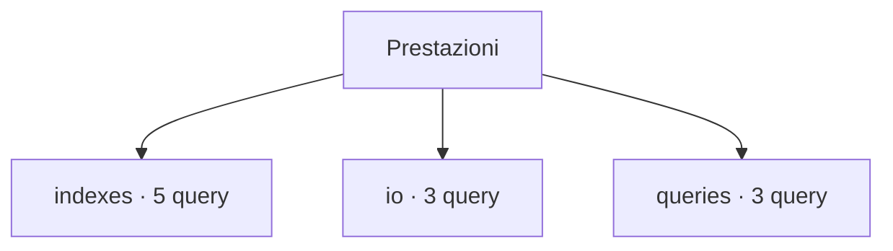

# Prestazioni

[← Home](../../README.md) · [Sicurezza e privilegi](../../docs/SAFETY.md)

**11 query** · client `psql` · diagnosi in transazione read-only.

Leggere header, versione e privilegi prima dell’esecuzione. Le statistiche sono cumulative: un valore isolato non giustifica un’azione correttiva.

[indexes](indexes/README.md) · [io](io/README.md) · [queries](queries/README.md)



```console
python tools/pgdn.py run scripts/performance/indexes/definitions.sql
```

Comando da eseguire dalla radice del checkout.

| Script | Scopo | PostgreSQL | Privilegi |
| :-- | :-- | :-- | :-- |
| [definitions.sql](indexes/definitions.sql) | List index definitions for review. | 14+ | database CONNECT |
| [duplicate-candidates.sql](indexes/duplicate-candidates.sql) | Find exact-signature index pairs for manual review, comparing keys, expressions, predicates, opclasses, collations and storage options; no index is removed. | 14+ | database CONNECT |
| [invalid-indexes.sql](indexes/invalid-indexes.sql) | Identify indexes marked invalid or not ready for DBA investigation. | 14+ | database CONNECT |
| [unused-candidates.sql](indexes/unused-candidates.sql) | Find valid large indexes with zero scans; review workload cycles before any decision and never auto-drop. | 14+ | database CONNECT |
| [usage-by-table.sql](indexes/usage-by-table.sql) | Compare sequential and index scans and tuple fetches; counters can reset. | 14+ | database CONNECT |
| [buffercache-summary.sql](io/buffercache-summary.sql) | Summarize shared-buffer usage only when pg_buffercache is already installed; extension schema is discovered and quoted safely. | 16+ | pg_monitor; function EXECUTE may be granted separately |
| [database-io-timing.sql](io/database-io-timing.sql) | Show cumulative block timings; zero can mean track_io_timing was disabled. | 14+ | pg_read_all_stats |
| [pg-stat-io.sql](io/pg-stat-io.sql) | Inspect cumulative I/O counters; correlate them with operating system metrics. | 16+ | pg_read_all_stats; PostgreSQL 16+ |
| [top-mean-time.sql](queries/top-mean-time.sql) | Rank normalized statements by mean time; low call counts may skew results. | 14+ | pg_read_all_stats; extension already installed |
| [top-temp-blocks.sql](queries/top-temp-blocks.sql) | Find statements with cumulative temporary block writes; compare snapshots for rates. | 14+ | pg_read_all_stats; extension already installed |
| [top-total-time.sql](queries/top-total-time.sql) | Rank pg_stat_statements by cumulative execution time; extension must already be available. | 14+ | pg_read_all_stats; extension already installed |

> Indice generato da `python tools/catalog.py`; modificare gli header SQL per aggiornare le descrizioni.
