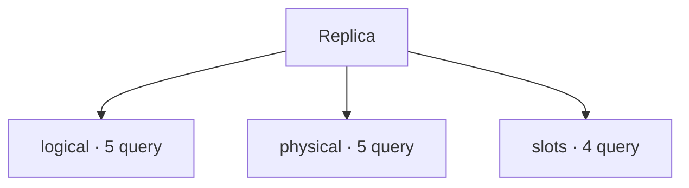

# Replica

[← Home](../../README.md) · [Sicurezza e privilegi](../../_support/docs/SAFETY.md)

**14 query** · client `psql` · diagnosi in transazione read-only.

Leggere header, versione e privilegi prima dell’esecuzione. I contatori di attività sono cumulativi: un valore isolato non giustifica un’azione correttiva.

[logical](logical/README.md) · [physical](physical/README.md) · [slots](slots/README.md)

## 🗂️ Mappa della libreria

```text
replication/
|
+-- logical/                                         ← 5 script · Publication, subscription e sincronizzazione tabelle
|   +-- publication-tables.sql                       ← Logical publication table mapping
|   +-- publications.sql                             ← Logical publication configuration
|   +-- subscriptions.sql                            ← Logical subscriptions
|   +-- table-sync-state.sql                         ← Logical table synchronization state
|   +-- workers.sql                                  ← Logical replication workers
+-- physical/                                        ← 5 script · Sender, receiver, replay e conflitti dello standby
|   +-- primary-senders.sql                          ← Physical replication senders
|   +-- standby-conflicts.sql                        ← Standby recovery conflicts
|   +-- standby-receiver-health.sql                  ← Standby receiver health
|   +-- standby-receiver.sql                         ← Standby WAL receiver
|   +-- standby-replay.sql                           ← Standby replay status
+-- slots/                                           ← 4 script · Slot, xmin, WAL trattenuti e margine di retention
    +-- logical-stats.sql                            ← Logical slot counters
    +-- retention.sql                                ← Replication slot retention
    +-- wal-limit-headroom.sql                       ← Replication slot WAL limit headroom
    +-- xmin-horizons.sql                            ← Replication slot xmin horizons
```



```console
psql -X -v ON_ERROR_STOP=1 -f scripts/replication/logical/publication-tables.sql
```

Comando da eseguire dalla radice del checkout.

| Script | Scopo | PostgreSQL | Privilegi | Procedura |
| :-- | :-- | :-- | :-- | :-- |
| [publication-tables.sql](logical/publication-tables.sql) | List tables included in each publication, including all-table membership. | 14–18 (verificato) | CONNECT | [Apri](../../procedures/replication-lag.md) |
| [publications.sql](logical/publications.sql) | Inventory publication operations and partition-root setting. | 14–18 (verificato) | CONNECT | [Apri](../../procedures/replication-lag.md) |
| [subscriptions.sql](logical/subscriptions.sql) | List subscriptions without connection strings or credentials. | 14–18 (verificato) | database owner or pg_read_all_stats | [Apri](../../procedures/replication-lag.md) |
| [table-sync-state.sql](logical/table-sync-state.sql) | Show per-table subscription initialization state and associated worker. | 14–18 (verificato) | pg_read_all_stats | [Apri](../../procedures/replication-lag.md) |
| [workers.sql](logical/workers.sql) | Show logical replication worker state and bounded query prefixes. | 14–18 (verificato) | pg_read_all_stats | [Apri](../../procedures/replication-lag.md) |
| [primary-senders.sql](physical/primary-senders.sql) | On primary show sender state and byte lag; time lag is approximate and may be NULL. | 14–18 (verificato) | pg_read_all_stats for full visibility | [Apri](../../procedures/replication-lag.md) |
| [standby-conflicts.sql](physical/standby-conflicts.sql) | Show cumulative standby conflict cancellations by conflict class and database. | 14–18 (verificato) | pg_monitor | [Apri](../../procedures/replication-lag.md) |
| [standby-receiver-health.sql](physical/standby-receiver-health.sql) | Show current receiver state, received LSNs and message recency on a standby. | 14–18 (verificato) | pg_monitor | [Apri](../../procedures/replication-lag.md) |
| [standby-receiver.sql](physical/standby-receiver.sql) | On standby inspect receiver state; connection string is omitted to avoid credentials. | 14–18 (verificato) | database CONNECT | [Apri](../../procedures/replication-lag.md) |
| [standby-replay.sql](physical/standby-replay.sql) | Estimate received-but-not-replayed bytes and time since last replay; time can mislead when idle. | 14–18 (verificato) | database CONNECT | [Apri](../../procedures/replication-lag.md) |
| [logical-stats.sql](slots/logical-stats.sql) | Inspect cumulative logical decoding slot statistics. | 14–18 (verificato) | database CONNECT | [Apri](../../procedures/replication-lag.md) |
| [retention.sql](slots/retention.sql) | Show WAL retained by slots; inactive slots may retain large volumes. | 14–18 (verificato) | database CONNECT | [Apri](../../procedures/wal-growth.md) |
| [wal-limit-headroom.sql](slots/wal-limit-headroom.sql) | Compare slot safe WAL headroom and retention status without imposing a fixed threshold. | 14–18 (verificato) | pg_monitor | [Apri](../../procedures/wal-growth.md) |
| [xmin-horizons.sql](slots/xmin-horizons.sql) | Identify replication slots retaining transaction or catalog horizons. | 14–18 (verificato) | pg_monitor | [Apri](../../procedures/replication-lag.md) |

> Indice generato da `python _support/tools/catalog.py`; modificare gli header SQL per aggiornare le descrizioni.
