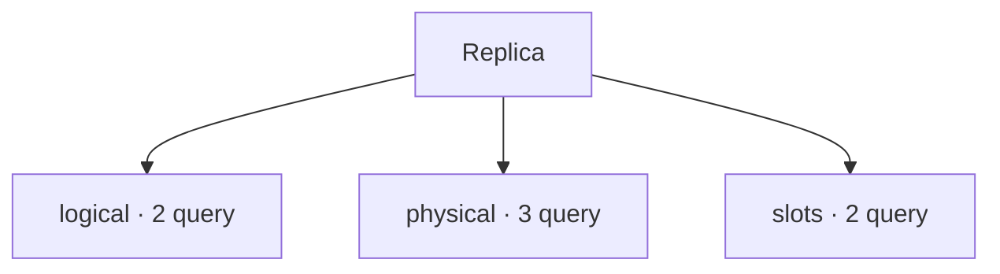

# Replica

[← Home](../../README.md) · [Sicurezza e privilegi](../../docs/SAFETY.md)

**7 query** · client `psql` · diagnosi in transazione read-only.

Leggere header, versione e privilegi prima dell’esecuzione. Le statistiche sono cumulative: un valore isolato non giustifica un’azione correttiva.

[logical](logical/README.md) · [physical](physical/README.md) · [slots](slots/README.md)



```console
python tools/pgdn.py run scripts/replication/logical/subscriptions.sql
```

Comando da eseguire dalla radice del checkout.

| Script | Scopo | PostgreSQL | Privilegi |
| :-- | :-- | :-- | :-- |
| [subscriptions.sql](logical/subscriptions.sql) | List subscriptions without connection strings or credentials. | 14+ | database owner or pg_read_all_stats |
| [workers.sql](logical/workers.sql) | Show logical replication worker state and bounded query prefixes. | 14+ | pg_read_all_stats |
| [primary-senders.sql](physical/primary-senders.sql) | On primary show sender state and byte lag; time lag is approximate and may be NULL. | 14+ | pg_read_all_stats for full visibility |
| [standby-receiver.sql](physical/standby-receiver.sql) | On standby inspect receiver state; connection string is omitted to avoid credentials. | 14+ | database CONNECT |
| [standby-replay.sql](physical/standby-replay.sql) | Estimate received-but-not-replayed bytes and time since last replay; time can mislead when idle. | 14+ | database CONNECT |
| [logical-stats.sql](slots/logical-stats.sql) | Inspect cumulative logical decoding slot statistics. | 14+ | database CONNECT |
| [retention.sql](slots/retention.sql) | Show WAL retained by slots; inactive slots may retain large volumes. | 14+ | database CONNECT |

> Indice generato da `python tools/catalog.py`; modificare gli header SQL per aggiornare le descrizioni.
