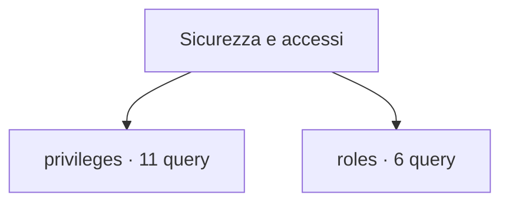

# Sicurezza e accessi

[← Home](../../README.md) · [Sicurezza e privilegi](../../_support/docs/SAFETY.md)

**17 query** · client `psql` · diagnosi in transazione read-only.

Leggere header, versione e privilegi prima dell’esecuzione. I contatori di attività sono cumulativi: un valore isolato non giustifica un’azione correttiva.

[privileges](privileges/README.md) · [roles](roles/README.md)

## 🗂️ Mappa della libreria

```text
security/
|
+-- privileges/                                      ← 11 script · Grant, privilegi effettivi, RLS e regole di accesso
|   +-- database-acl.sql                             ← Database ACL
|   +-- effective-database-privileges.sql            ← Effective database privileges for roles
|   +-- hba-rule-health.sql                          ← HBA rule health
|   +-- public-schema-grants.sql                     ← PUBLIC schema and relation grants
|   +-- relation-acl.sql                             ← Relation ACL
|   +-- rls-enabled-without-policy.sql               ← RLS-enabled relations without visible policies
|   +-- rls-policies.sql                             ← Row-level security policy inventory
|   +-- routine-execute-grants.sql                   ← Routine EXECUTE grants
|   +-- routine-security-definer.sql                 ← SECURITY DEFINER routine inventory
|   +-- schema-acl.sql                               ← Schema ACL
|   +-- schema-effective-privileges.sql              ← Effective schema privileges
+-- roles/                                           ← 6 script · Membership, ereditarietà e attributi dei ruoli
    +-- default-acl.sql                              ← Default privileges inventory
    +-- expiring-logins.sql                          ← Expiring login roles
    +-- membership.sql                               ← Role memberships
    +-- role-attributes.sql                          ← Role security attributes
    +-- role-inventory.sql                           ← Role inventory
    +-- role-membership-edges.sql                    ← Role membership edges with portable attributes
```



```console
psql -X -v ON_ERROR_STOP=1 -f scripts/security/privileges/database-acl.sql
```

Comando da eseguire dalla radice del checkout.

| Script | Scopo | PostgreSQL | Privilegi | Procedura |
| :-- | :-- | :-- | :-- | :-- |
| [database-acl.sql](privileges/database-acl.sql) | Expand database ACL entries; null ACLs use built-in defaults. | 14–18 (verificato) | database CONNECT | [Apri](../../procedures/security.md) |
| [effective-database-privileges.sql](privileges/effective-database-privileges.sql) | Evaluate CONNECT, CREATE and TEMPORARY rights for a bounded set of database roles. | 14–18 (verificato) | database CONNECT; visible database and role names | [Apri](../../procedures/security.md) |
| [hba-rule-health.sql](privileges/hba-rule-health.sql) | Show parse health for pg_hba.conf rules without exposing databases, users, addresses or authentication options. | 14–18 (verificato) | superuser by default; an administrator can grant SELECT on the view | [Apri](../../procedures/security.md) |
| [public-schema-grants.sql](privileges/public-schema-grants.sql) | Find explicit grants to PUBLIC on schemas and relations in the current database. | 14–18 (verificato) | database CONNECT; visible object metadata | [Apri](../../procedures/security.md) |
| [relation-acl.sql](privileges/relation-acl.sql) | Inspect explicit ACL entries for user relations. | 14–18 (verificato) | database CONNECT | [Apri](../../procedures/security.md) |
| [rls-enabled-without-policy.sql](privileges/rls-enabled-without-policy.sql) | Find application relations with row security enabled but no catalog-visible policy. | 14–18 (verificato) | database CONNECT; metadata visibility follows object visibility | [Apri](../../procedures/security.md) |
| [rls-policies.sql](privileges/rls-policies.sql) | List user tables' RLS flags and policy names, modes, commands and roles; policy expressions are excluded. | 14–18 (verificato) | database CONNECT; metadata visibility depends on ownership/privileges | [Apri](../../procedures/security.md) |
| [routine-execute-grants.sql](privileges/routine-execute-grants.sql) | List explicit EXECUTE ACL entries on visible application routines, including grantee and grant option. | 14–18 (verificato) | database CONNECT; visible routine metadata | [Apri](../../procedures/security.md) |
| [routine-security-definer.sql](privileges/routine-security-definer.sql) | Locate routines running with owner privileges and expose their owner and configuration metadata. | 14–18 (verificato) | database CONNECT; visible routine metadata | [Apri](../../procedures/security.md) |
| [schema-acl.sql](privileges/schema-acl.sql) | List schema ACLs; role membership and ownership affect effective privileges. | 14–18 (verificato) | database CONNECT | [Apri](../../procedures/security.md) |
| [schema-effective-privileges.sql](privileges/schema-effective-privileges.sql) | Evaluate USAGE and CREATE privileges for visible application schemas and login roles. | 14–18 (verificato) | database CONNECT; metadata visibility follows object visibility | [Apri](../../procedures/security.md) |
| [default-acl.sql](roles/default-acl.sql) | Show per-role and per-schema default ACL entries that affect future objects. | 14–18 (verificato) | database CONNECT; visible role and schema metadata | [Apri](../../procedures/security.md) |
| [expiring-logins.sql](roles/expiring-logins.sql) | Identify login roles expired or expiring in 30 days. | 14–18 (verificato) | database CONNECT | [Apri](../../procedures/security.md) |
| [membership.sql](roles/membership.sql) | Show granted membership and delegation options. | 16–18 (verificato) | database CONNECT | [Apri](../../procedures/security.md) |
| [role-attributes.sql](roles/role-attributes.sql) | Review login, superuser, creation and bypass-RLS attributes for roles visible to the caller. | 14–18 (verificato) | database CONNECT; pg_read_all_settings for full visibility of protected role metadata | [Apri](../../procedures/security.md) |
| [role-inventory.sql](roles/role-inventory.sql) | List role attributes and validity without password hashes. | 14–18 (verificato) | database CONNECT | [Apri](../../procedures/security.md) |
| [role-membership-edges.sql](roles/role-membership-edges.sql) | Show granted role edges and legacy-compatible admin option without relying on PG16 fields. | 14–18 (verificato) | database CONNECT; membership metadata visibility follows role visibility | [Apri](../../procedures/security.md) |

> Indice generato da `python _support/tools/catalog.py`; modificare gli header SQL per aggiornare le descrizioni.
