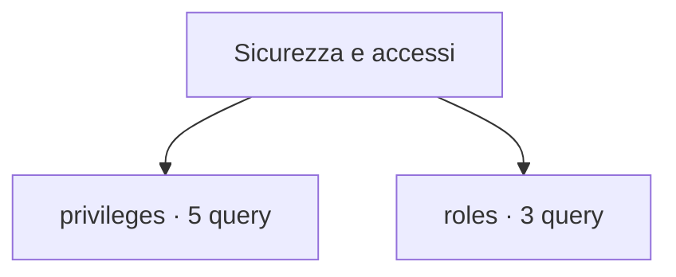

# Sicurezza e accessi

[← Home](../../README.md) · [Sicurezza e privilegi](../../docs/SAFETY.md)

**8 query** · client `psql` · diagnosi in transazione read-only.

Leggere header, versione e privilegi prima dell’esecuzione. Le statistiche sono cumulative: un valore isolato non giustifica un’azione correttiva.

[privileges](privileges/README.md) · [roles](roles/README.md)



```console
python tools/pgdn.py run scripts/security/privileges/database-acl.sql
```

Comando da eseguire dalla radice del checkout.

| Script | Scopo | PostgreSQL | Privilegi |
| :-- | :-- | :-- | :-- |
| [database-acl.sql](privileges/database-acl.sql) | Expand database ACL entries; null ACLs use built-in defaults. | 14+ | database CONNECT |
| [hba-rule-health.sql](privileges/hba-rule-health.sql) | Show parse health for pg_hba.conf rules without exposing databases, users, addresses or authentication options. | 14+ | superuser by default; an administrator can grant SELECT on the view |
| [relation-acl.sql](privileges/relation-acl.sql) | Inspect explicit ACL entries for user relations. | 14+ | database CONNECT |
| [rls-policies.sql](privileges/rls-policies.sql) | List user tables' RLS flags and policy names, modes, commands and roles; policy expressions are excluded. | 14+ | database CONNECT; metadata visibility depends on ownership/privileges |
| [schema-acl.sql](privileges/schema-acl.sql) | List schema ACLs; role membership and ownership affect effective privileges. | 14+ | database CONNECT |
| [expiring-logins.sql](roles/expiring-logins.sql) | Identify login roles expired or expiring in 30 days. | 14+ | database CONNECT |
| [membership.sql](roles/membership.sql) | Show granted membership and delegation options. | 16+ | database CONNECT |
| [role-inventory.sql](roles/role-inventory.sql) | List role attributes and validity without password hashes. | 14+ | database CONNECT |

> Indice generato da `python tools/catalog.py`; modificare gli header SQL per aggiornare le descrizioni.
