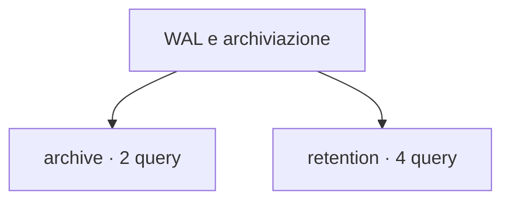

# WAL e archiviazione

[← Home](../../README.md) · [Sicurezza e privilegi](../../_support/docs/SAFETY.md)

**6 query** · client `psql` · diagnosi in transazione read-only.

Leggere header, versione e privilegi prima dell’esecuzione. I contatori di attività sono cumulativi: un valore isolato non giustifica un’azione correttiva.

[archive](archive/README.md) · [retention](retention/README.md)

## 🗂️ Mappa della libreria

```text
wal/
|
+-- archive/                                         ← 2 script · Archiver, fallimenti e marker pronti da archiviare
|   +-- archive-status.sql                           ← Archive status
|   +-- ready-files.sql                              ← Ready WAL archive files
+-- retention/                                       ← 4 script · Contatori, segmenti e cause della crescita WAL
    +-- checkpoint-counters-common.sql               ← Checkpoint counters
    +-- retention-context.sql                        ← WAL retention context
    +-- wal-counters.sql                             ← WAL counters
    +-- wal-directory-dimensions.sql                 ← WAL directory dimensions
```



```console
psql -X -v ON_ERROR_STOP=1 -f scripts/wal/archive/archive-status.sql
```

Comando da eseguire dalla radice del checkout.

| Script | Scopo | PostgreSQL | Privilegi | Procedura |
| :-- | :-- | :-- | :-- | :-- |
| [archive-status.sql](archive/archive-status.sql) | Inspect cumulative archive success and failure counters; archive ordering can have exceptions. | 14–18 (verificato) | database CONNECT | [Apri](../../procedures/wal-growth.md) |
| [ready-files.sql](archive/ready-files.sql) | Count .ready/.done marker files in pg_wal/archive_status; marker sizes are not WAL sizes. | 14–18 (verificato) | pg_monitor or EXECUTE on pg_ls_archive_statusdir | [Apri](../../procedures/wal-growth.md) |
| [checkpoint-counters-common.sql](retention/checkpoint-counters-common.sql) | Show checkpoint and background writer counters common across PostgreSQL 14–18. | 14–18 (verificato) | pg_monitor | [Apri](../../procedures/wal-growth.md) |
| [retention-context.sql](retention/retention-context.sql) | Summarize slots, senders and retention settings that may influence pg_wal growth. | 14–18 (verificato) | database CONNECT; settings visibility may require pg_read_all_settings | [Apri](../../procedures/wal-growth.md) |
| [wal-counters.sql](retention/wal-counters.sql) | Show cumulative WAL byte and record counters; compare snapshots for rates. | 14–18 (verificato) | pg_read_all_stats | [Apri](../../procedures/wal-growth.md) |
| [wal-directory-dimensions.sql](retention/wal-directory-dimensions.sql) | Count WAL segment-shaped files and measure observed sizes and modification times. | 14–18 (verificato) | pg_monitor | [Apri](../../procedures/wal-growth.md) |

> Indice generato da `python _support/tools/catalog.py`; modificare gli header SQL per aggiornare le descrizioni.
